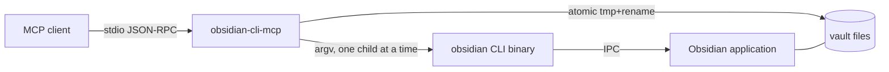
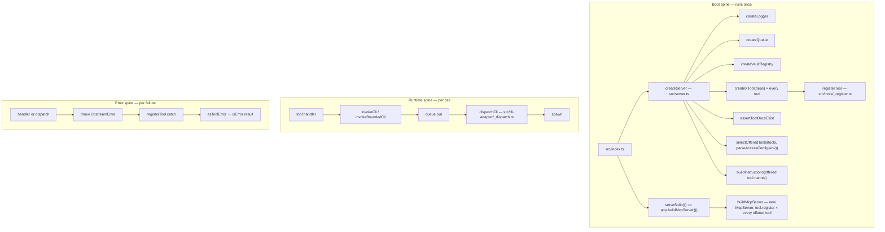
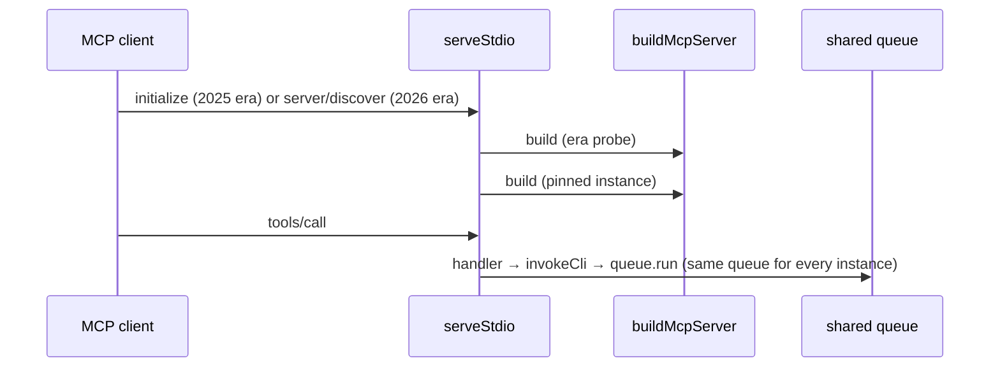
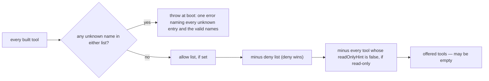
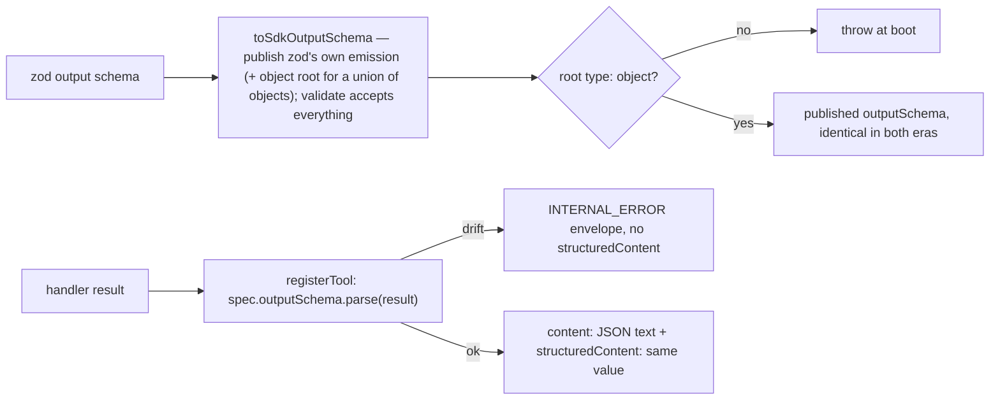
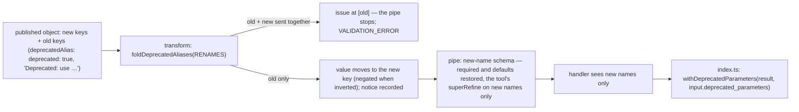
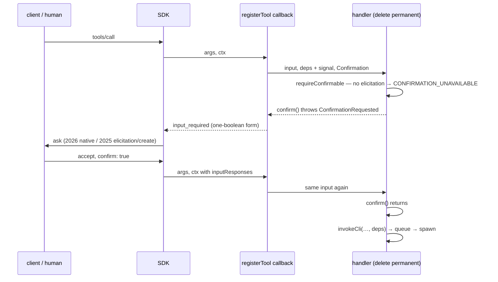
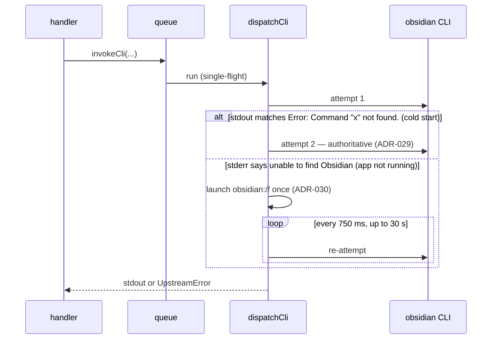
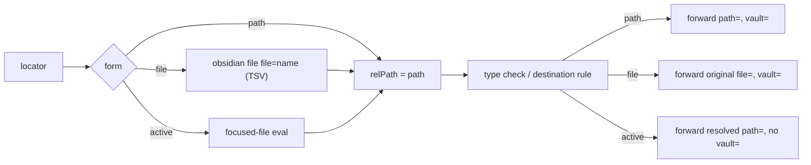

# Architecture

How the server is put together as of the baseline (2026-10-24, `main` at
`b8b6fef`, package version 0.8.11), extended PR by PR since (PR #92 bumps the
package to 0.9.0). The rules this structure satisfies live in
[the constitution](../.specify/memory/constitution.md); this page describes how
the code meets them, not what they say.

## What the server is

A Node.js process that speaks MCP over stdio to one client and turns each tool
call into one or more invocations of the **Obsidian Integrated CLI** binary
(`obsidian`), or — for the write cohort — into a direct filesystem write under
the vault root. The CLI talks to a running Obsidian application; the server
never loads Obsidian's code itself. Everything Obsidian-internal it needs
(`app.metadataCache`, `app.workspace`, plugin APIs) is reached through the
CLI's `eval` subcommand.

Since PR #89 the stdio connection is served **dual-era**: a 2025-era client
(`initialize`) and a 2026-era client (`server/discover`) both work against the
same process (ADR-039, below).



## Three spines

The code has three independent paths through it. Keeping them separate is
deliberate: the composition root appears in only one of them.



### Boot spine

[src/index.ts](../src/index.ts) calls `createServer()` once, then hands
`serveStdio` from `@modelcontextprotocol/server/stdio` a factory,
`() => app.buildMcpServer()` (`src/index.ts:11`). It wires stdin `end`/`close`
to the project's own `shutdown("transport_closed")` explicitly, because
dropping queued work and killing the in-flight child is the project's shutdown
path, not the transport's.

[src/server.ts](../src/server.ts) is the composition root. It is the **only
production file** that constructs `createLogger()`, `createQueue()` and
`createVaultRegistry()`. It builds every tool by calling its
`createXTool({ logger, queue, vaultRegistry? })` factory (`vaults`, added in
PR #91, takes only `{ vaultRegistry }`: it never calls the CLI itself), and returns
`{ buildMcpServer, shutdown, logger, queue }`. Handlers never reach back into
`server.ts`; their dependencies arrive through the factory arguments.

Since PR #89 (068 R10) the composition root is split in two
(`src/server.ts:157`):

- **`createServer` runs once per process.** Logger, queue, vault registry,
  the tool list, the doc-presence check and (since PR #90) the server
  instructions are all built here, and nowhere else.
- **`buildMcpServer()` is cheap and may run many times.** It constructs a
  `new McpServer({ name: "obsidian-cli-mcp", version }, { capabilities: {
  tools: { listChanged: false } }, instructions })` and calls
  `tool.register(server)` for every tool built above that the owner's access
  settings offer (since PR #92, [below](#owner-access-settings)). `listChanged: false` is
  declared truthfully: the list never changes after boot. Because
  `instructions` is computed once in `createServer`, every era and every
  connection receives the same text
  ([server instructions](#server-instructions)).

The split exists because `serveStdio` calls its factory more than once per
connection — once for the era-discovery probe and once for the instance it
pins. A factory that built its own queue would have created a second
single-flight queue for the probe (FR-053). Every instance shares the one
queue and registry; `src/server.protocol.test.ts` proves it by spying on the
returned `app.queue.run`, serving two clients from two `buildMcpServer()`
instances, and seeing one call from each.



PR #89 first gave `createServer`'s context a test-only `createQueue` seam to
prove the shared queue. Review (finding F2, owner ruling, commit `76ceeb7`)
removed it: the queue is already on the returned surface, so a spy on
`app.queue.run` proves the same thing without widening the kernel node's
context. The split is a touch on `createServer`, the boot-spine entry point
and one of the kernel nodes: its return shape lost `server` and renamed
`triggerShutdown` to `shutdown`. `createLogger`, `createQueue` and
`UpstreamError` did not change.

Server-wide access settings arrive the same way. Since PR #88, `createServer`'s
context takes an optional `env` (default `process.env`), the environment the
`OBSIDIAN_MCP_*` access flags are read from. `createServer` parses
`OBSIDIAN_MCP_ALLOW_EVAL` once, with `envFlagEnabled` from
[src/env-flags.ts](../src/env-flags.ts), and passes the result to
`createObsidianExecTool({ logger, queue, allowEval })`; no handler reads an
access flag at call time
([escape hatch](capabilities/escape-hatch-and-meta.md#the-code-execution-gate-default-off)).
This is a touch on the boot-spine entry point, one of the kernel nodes;
`createLogger`, `createQueue` and `UpstreamError` were not changed. `ctx.env`
does not reach the CLI layer: `OBSIDIAN_BIN` and `OBSIDIAN_AUTO_LAUNCH` are
still read from `process.env` at dispatch time. Since PR #92 the parse lives in
`parseAccessConfig` ([owner access settings](#owner-access-settings)), which
reads `OBSIDIAN_MCP_ALLOW_EVAL` with the three tool-selection settings;
`createServer` passes `access.allowEval` on as before.

`envFlagEnabled` is default-off: on only for `1`, `true`, `yes` or `on`,
trimmed and case-insensitive. It is the inverse of `autoLaunchEnabled` in
dispatch, which is default-on and turned off by `0`/`false`/`no`/`off`. The
two are kept separate on purpose because they disagree on any other value
(`"2"` leaves auto-launch on and an opt-in flag off). PR #88 first put
`envFlagEnabled` beside `autoLaunchEnabled` in `_dispatch.ts`; review moved it
to its own leaf module, because dispatch never calls it and its consumers are
server configuration, so `server.ts` no longer needs the private dispatch
module.

Before the server accepts a call, `assertToolDocsExist` checks that every
registered tool has a `docs/tools/<name>.md`. It collects **every** missing
file and throws once, rather than failing on the first. A tool without
documentation stops the server from starting. It checks every tool built, not
only the offered ones, so a doc cannot go missing just because a tool is
switched off.

#### Owner access settings

Since PR #92 (068 FR-043 to FR-046, US13) the vault owner chooses which tools
the server offers. `parseAccessConfig(env)` in
[src/server-config.ts](../src/server-config.ts) reads four settings once at
boot into an `AccessConfig`: `OBSIDIAN_MCP_ALLOW_EVAL` (which moved here from
`createServer`), `OBSIDIAN_MCP_READ_ONLY` (both through `envFlagEnabled`), and
the comma-separated `OBSIDIAN_MCP_TOOLS` (allow) and `OBSIDIAN_MCP_DISABLE`
(deny) lists, where blank entries are dropped and a blank list counts as
unset. `selectOfferedTools(tools, config)` then filters the built tool list:



Only the offered tools are registered on each `McpServer`, and
`buildInstructions` receives only their names, so the instructions never name
a tool that is not there (FR-026a). Read-only selects by
`annotations.readOnlyHint`, the reason `ToolDescriptor` kept `annotations` in
PR #90's review. An empty offer is allowed: the server starts with no tools.
The unknown-name refusal is a plain `Error` thrown from the boot spine, like
`assertToolDocsExist`, because a misspelt name must stop the server rather than
fail a call; `src/index.ts` writes it to stderr as one `bridge.fatal` line
and exits 1.

The code first landed inside `src/server.ts`; the PR #92 review moved it to
`src/server-config.ts` (commit `ca25c67`) beside its existing test file, so
`server.ts` keeps only the composition. Parsing the settings is a touch on
`createServer`, one of the kernel nodes; its return shape did not change.
How to set them is in the [README](../README.md#limit-which-tools-are-offered).

Until PR #89 the server ran on `@modelcontextprotocol/sdk` 1.x and the SDK's
low-level `Server`, with two hand-written request handlers: `ListTools`
(every descriptor) and `CallTool` (look the tool up by name, or return
`TOOL_NOT_FOUND`). BI-067 (PR #78) kept that deprecated class on purpose,
behind targeted `no-deprecated` lint disables, and called the move to
`McpServer` a separate architectural decision. PR #89 is that decision:
[ADR-039](decisions/ADR-039-dual-era-stdio-serving-on-sdk-v2-mcpserver.md)
(Dual-Era Stdio Serving on MCP SDK v2 McpServer) replaces the low-level
`Server`, both handlers and both disables, and supersedes ADR-036 (Modern-Only
Protocol Era For Obsidian CLI MCP). There is no hand-written `tools/list` or
`tools/call` left in `src/`.

### Registration — the one path from a schema to a published tool

`registerTool` in [src/tools/_register.ts](../src/tools/_register.ts) is the
only route by which a zod schema becomes an MCP tool (ADR-006, Centralized Tool
Registration). Since PR #89 it returns a `RegisteredTool` with three parts:
`descriptor` and `handler`, as before, and `register(server)`, which calls
`McpServer.registerTool(name, { title, description, annotations, inputSchema,
outputSchema? }, handler)` (`src/tools/_register.ts:214`; `outputSchema` since
PR #91, see [typed results](#typed-results-outputschema-and-structuredcontent)).
`server.ts` calls `register` on every `McpServer` it builds. It:

1. Wraps the zod schema in **`toSdkInputSchema`** (`src/tools/_register.ts:76`),
   a pass-through Standard Schema adapter, and hands that to the SDK as
   `inputSchema`. Its `~standard.jsonSchema` is the zod schema's own emission
   for the target the SDK asks for (draft-2020-12, named once as
   `SDK_JSON_SCHEMA_TARGET`), so the published schema is the SDK-native
   dialect. Its `~standard.validate` accepts every value unchanged. That is
   the point of the adapter: `McpServer` validates input itself and would
   replace the project's `{code, message, details}` envelope with free text
   (`"Input validation error: …"`), with no hook to stop it (068 R2). Handing
   it a validator that never fails leaves the tool's own zod parse in charge.
2. Publishes that JSON Schema **with its parameter descriptions**. Since
   PR #90 the adapter hands the SDK `schema["~standard"].jsonSchema`
   unchanged, so every `.describe()` on an input field is wire text
   ([ADR-040](decisions/ADR-040-published-parameter-descriptions-and-server-instructions.md),
   Published Parameter Descriptions and Server Instructions). Until PR #90
   this step stripped every nested `description`
   (`src/help/strip-schema.ts`, now deleted) and each tool description ended
   "Call help(...) for full parameter docs" (ADR-005, Token-Optimized Tool
   Definitions via Progressive Disclosure, which ADR-040 supersedes). PR #89
   had re-hosted the stripping inside the adapter unchanged.
3. Refuses at boot a schema whose emission has no top-level
   `"type": "object"` (`src/tools/_register.ts:130`, FR-002). The SDK would
   silently add a missing root `type` to what it publishes, which would leave
   the project's `descriptor` out of step with the wire. With the guard, the
   SDK publishes the descriptor's bytes unchanged, and `_register.test.ts`
   pins descriptor === published through a real client. This guard came out
   of the PR #89 review (finding F1); every tool already emitted an object
   root, so no published byte moved.
4. Wraps the handler so that a `ZodError` from **input** parsing becomes
   `VALIDATION_ERROR` (or the tool's own `mapValidationError` shape), an
   `UpstreamError` becomes an MCP `isError` result carrying its `code`,
   `message` and `details`, and a `ZodError` from an **output** check — the
   handler's own trailing `.parse()`, or since PR #91 `registerTool`'s check
   against the tool's `outputSchema` — becomes `INTERNAL_ERROR`, not
   `VALIDATION_ERROR`, because the client's input was valid. These are
   **returned** as results, never thrown, so the SDK passes them through
   untouched.

Since PR #90 (068 FR-019 to FR-024) a `ToolSpec` cannot be written without a
`title` and an `annotations` object holding all four MCP behaviour hints
(`readOnlyHint`, `destructiveHint`, `idempotentHint`, `openWorldHint`) as
required booleans, so TypeScript refuses a tool that leaves one out. The hint
values are not chosen per tool: `src/tools/_shared.ts` exports the five rows of
the spec's FR-024 table, and each tool names its row.

| Row (`src/tools/_shared.ts`) | read-only | destructive | idempotent | open-world | Tools |
| --- | --- | --- | --- | --- | --- |
| `READ_ONLY_HINTS` | yes | no | yes | no | every read, search, list, Bases-read and plugin-backed tool, and `help` |
| `ADDITIVE_WRITE_HINTS` | no | no | no | no | `append_note`, `prepend`, `patch_heading`, `patch_block`, `create_base` |
| `REPEATABLE_WRITE_HINTS` | no | no | yes | no | `set_property`, `open_file` |
| `DESTRUCTIVE_HINTS` | no | yes | no | no | `write_note`, `delete`, `move`, `rename`, `find_and_replace` |
| `PASSTHROUGH_HINTS` | no | yes | no | yes | `obsidian_exec` |

The named rows came out of the PR #90 review (commit `3c71bf7`), which
replaced 34 inline four-boolean objects with them. `src/tools/_surface.test.ts`
deliberately keeps its own literal per-tool classification table rather than
importing the rows, so a wrong row is caught by an independent pin instead of
being copied into the test. That test reads the surface through a real client
(`listTools()`) and also fails on any input property, at any depth (nested
objects, array items, union branches), that has no description, and on any
tool description that still says "call help", "specific mode", "display name"
or "preview first" — the rules that now live in the server instructions or in
the target-mode field descriptions. Titles are the tool name in Title Case
("Find By Property"); a clearer wording per tool is left to the owner, since
changing one is a published-surface change.

`ToolDescriptor` (the project's own view, used at boot and in tests) carries
`annotations` but not `title`: the review dropped `title` because only a test
read it, and kept `annotations` because the read-only tool filter (068 T074,
built in PR #92, [owner access settings](#owner-access-settings)) selects
tools by `annotations.readOnlyHint`.

Until PR #89, step 1 was `toMcpInputSchema` in `src/tools/_shared.ts`: zod 4's
`z.toJSONSchema` with a draft-7 target, then `normalizeToDraft7Parity`, a
four-rule pass that reproduced the retired `zod-to-json-schema` output
byte-for-byte so the fingerprint baseline survived the zod 4 migration
(PR #78). PR #89 deletes both (068 C3). Nothing is normalised to imitate a
retired converter any more; the published dialect is what the SDK emits.

Published descriptors are pinned. `src/tools/_register-baseline.json` holds a
fingerprint for every tool, and `_register-baseline.test.ts` fails if a
descriptor changes without the baseline being regenerated with
`npm run baseline:write` (BI-022, PR #24). The zod 4 migration landed with the
baseline unchanged, which is how that PR showed the published surface did not
move.

Since PR #89 (068 R3) the gate reads the surface **as a client sees it**:
`fingerprintLiveRegistry` in
[src/tools/_register-baseline.ts](../src/tools/_register-baseline.ts) connects
a v2 `Client` to a freshly built `McpServer` over an in-memory transport
(`connectInMemoryClient`, `src/tools/_mcp-client-fixtures.ts`) and calls
`listTools`. It used to read the low-level `Server`'s private
`_requestHandlers` map. The baseline's `schemaVersion` is now `2`, and
`scripts/write-register-baseline.ts` dumps the helper's own output instead of
keeping an inline copy of the canonicalisation, so writer and verifier cannot
drift. PR #89 regenerated the baseline on purpose: every `schemaFingerprint`
changed (draft-07 → draft-2020-12), no `descriptionFingerprint` changed, and
the tool names are the same. The PR body records the gate proof — one word
added to a description failed the test, and reverting it passed.

PR #90 added `titleFingerprint` and `annotationsFingerprint` to each baseline
entry (`schemaVersion` stays `2`) and regenerated the baseline on purpose:
every tool's `descriptionFingerprint` and `schemaFingerprint` changed (the
call-help sentence left every description, and parameter descriptions entered
every schema), with the same tool names. Its review commit `3c71bf7` then
restructured the source and passed the gate against that committed baseline
without regenerating it, which is how it showed the wire surface did not move.

PR #91 added `outputSchemaFingerprint` (the published `outputSchema`, or the
fingerprint of `null` for a tool that publishes none) and regenerated the
baseline on purpose for the new `vaults` entry and the new field. No existing
tool's description, input schema, title or annotations fingerprint moved.
Tools with identical result shapes share one output fingerprint, and the four
untyped tools share the `null` one. Its review commits (`25a2e83`, `4e35987`)
passed the gate against that baseline without regenerating it.

PR #101 regenerated the baseline on purpose for its parameter renames
([deprecated aliases](#renamed-parameters-deprecated-aliases-folded-before-validation)):
only `find_by_property`, `find_and_replace` and `create_base` moved, each in
its description, schema and output fingerprints, and no title or annotations
fingerprint moved. Its review commit `4a00a58` rebuilt all three input schemas
as a transform-and-pipe and passed the gate against that baseline without
regenerating it.

A one-off check of the real stdio path is `npm run probe:stdio -- --era
legacy|modern` ([scripts/probe-stdio.ts](../scripts/probe-stdio.ts), PR #89).
It spawns the built `dist/index.js` with a v2 client and prints the negotiated
protocol version, `serverInfo`, whether `instructions` is present, and the tool
count. On 2026-10-30 the 2025-era handshake negotiated `2025-11-25` and the
2026-era handshake `2026-07-28` (research R10 T0). Since PR #90 the probe
also reports `instructions` present in both eras. Since PR #92,
`--no-elicitation` opens the connection without the elicitation capability,
and adding `--vault <name> --note <path>` sends a permanent `delete` of that
note and a `find_and_replace` commit under `--subfolder` (default `Sandbox`,
with a random pattern) and prints both envelopes, which must be
`CONFIRMATION_UNAVAILABLE` with nothing changed. The script still sends the
scope as `subfolder`, which since PR #101 is a deprecated name for `folder`:
it is still accepted, and because the notice rides only on a success result,
the `CONFIRMATION_UNAVAILABLE` envelope is unchanged. Run with the owner access
settings in its environment, it also shows the offered tool count; PR #92's
run counted 35 by default, 22 read-only, and 2 and 1 for its allow and deny
cases.

### Typed results: `outputSchema` and `structuredContent`

Since PR #91 (068 FR-039 to FR-042, research R6) every tool whose result is
always a JSON object publishes that shape as an MCP `outputSchema`, and a
success carries the result twice: as `structuredContent`, and as the identical
JSON in the text block a client without structured-content support reads.
Failures are unchanged and text-only — `isError: true`, the
`{code, message, details}` envelope, no `structuredContent` (FR-040). The
decision record is
[ADR-042](decisions/ADR-042-typed-results-checked-in-registertool.md)
(Typed Results Checked in registerTool Behind a Pass-Through Output Adapter).

A tool opts in by giving its `ToolSpec` an `outputSchema`, which is always the
zod output schema the tool already had. `ToolSpec` is a type with three result
cases, and only these type-check (review finding S1, commit `25a2e83`):

| Case | Handler returns | Wire |
| --- | --- | --- |
| `responseFormat: "raw"` | a `ToolCallResult` it built itself | as returned (`help`) |
| JSON, no `outputSchema` | any value | one JSON text block (`read`, `obsidian_exec`, `tag`) |
| JSON with `outputSchema` | `z.input` of that schema | JSON text block plus `structuredContent` |

An `outputSchema` on a raw tool cannot be written, and a handler whose return
type drifts from its schema fails `npm run typecheck`. The registration path
for a typed tool:



- **`toSdkOutputSchema`** (`src/tools/_register.ts:97`) is the mirror of
  `toSdkInputSchema`. It publishes the zod schema's own draft-2020-12
  emission, with one addition: a root that is a union whose variants are all
  `type: "object"` gains root `type: "object"`. zod emits `search`
  (`anyOf`, default | line) and `find_and_replace` (`oneOf`, preview |
  commit) with no root `type`. With the addition, the 2025-era codec has
  nothing to wrap, so both protocol eras publish the same bytes. The result
  data is never wrapped. SDK 2.4.0's own conversion happens to add the same
  root, but the rule lives in project code so the published bytes do not
  depend on private SDK behaviour.
- **Boot guard** (`src/tools/_register.ts:139`). An output schema whose
  emission has no root `type: "object"` throws at boot, so no tool can ship
  with an era-specific schema unnoticed.
- **The check runs in `registerTool`, not the SDK** (`src/tools/_register.ts:171`).
  The adapter's `validate` accepts every value; the registered callback runs
  `spec.outputSchema.parse(result)` inside the same `try` as the handler, so
  drift lands in the existing output-contract catch: `INTERNAL_ERROR`,
  "`<tool>` produced a response that failed its output contract",
  `details.issues`, no `structuredContent`. The check only validates — the
  handler's own value is what goes on the wire, so text and
  `structuredContent` are the same bytes. PR #91 first let `validate` delegate
  to zod so the SDK ran the check; review finding B2 showed that SDK v2
  reports a failed output check as free text (`"Output validation error:
  …"`), so a tool without its own trailing `.parse()` surfaced drift as text
  and a tool with one surfaced `INTERNAL_ERROR`. The owner ruled for the
  envelope (commit `4e35987`; the rejected path is in ADR-042).

Which tools are typed: 31 — every tool that had a zod output schema except
`tag`, plus `vaults`. `search` gained `searchOutputSchema`, the union of its
two mode schemas, as its published shape; its results did not change. Four
publish no `outputSchema`:

| Tool | Why not |
| --- | --- |
| `read` | its `{ content }` text block stays byte-identical to before (FR-041) |
| `help` | raw Markdown (FR-041) |
| `obsidian_exec` | free-form CLI output, no zod schema |
| `tag` | count-only mode (`total: true`) returns a bare integer, so its result is not always an object; its text block is unchanged. Flagged in the PR #91 body for owner review |

`ToolCallResult` (`src/tools/_shared.ts`) gained the optional
`structuredContent` on its success case. `ToolDescriptor` did **not** gain
`outputSchema`: PR #91 added it, and review (finding L1) removed it because
only one test read it; that test now compares the published schema with the
adapter's own emission.

The proofs are in `src/tools/_surface.test.ts`. It lists the registry through
a 2025-era and a 2026-era client and requires every `outputSchema` to be
deep-equal across the two with an object root, and it round-trips one success
fixture per typed tool (two for `search` and `find_and_replace`) from
`src/tools/_typed-result-fixtures.ts`: `structuredContent` validates against
the published schema with the client SDK's Ajv validator — not zod — and the
text parses to the same object. A failing input and a failing upstream call
carry no `structuredContent`. `src/tools/_register.output.test.ts` pins the
three `ToolSpec` cases with `@ts-expect-error` and injects a drifted result
through a real client to see the `INTERNAL_ERROR` envelope.

Known rough edge: the handlers' own trailing output `.parse()` calls are now
redundant with `registerTool`'s check. Removing them was left out of PR #91 by
owner ruling.

Since PR #101 the round trip also carries one old-name fixture each for
`find_by_property`, `find_and_replace` and `create_base`, so the
`deprecated_parameters` field described next is checked against the published
`outputSchema` through a real client too.

### Renamed parameters: deprecated aliases folded before validation

Since PR #101 (spec 073, BI-0109) a parameter can be renamed without breaking
callers that use the old name. The convention it serves — one concept, one
parameter name within a tool family — is recorded in
[ADR-NNN](decisions/ADR-NNN-shared-parameter-names-within-a-tool-family.md)
(Shared Parameter Names Within a Tool Family), whose number is allocated at the
next vault sync. Seven parameters on `find_by_property`, `find_and_replace` and
`create_base` were renamed this way; the capability pages name them.

The mechanics live in one leaf module,
[src/tools/_deprecated-params.ts](../src/tools/_deprecated-params.ts), which
imports only zod and is imported only by the three tools' `schema.ts` and
`index.ts`. Each tool keeps a `*_RENAMES` table (`{ old, replacement,
inverted? }`, `as const` and typed against the published keys, so a misspelt
key fails `typecheck`), and its input schema is built in two halves:



- **The published side** declares both names. The old keys stay published
  with `deprecated: true`, so a client that drops undeclared keys still passes
  them through (spec 073 FR-013). zod emits a pipe's input JSON Schema from its
  published side, so this is what clients see.
- **The fold** (`foldDeprecatedAliases`) rejects an old name sent with its
  replacement, even when the values agree, before anything is read, written or
  spawned (FR-012). Otherwise it moves the value across and records
  `{ parameter, replacement, note? }`; `note` is set only for an `inverted`
  rename (`find_and_replace`'s `case_insensitive`).
- **The new-name schema** is the published object with the old keys omitted,
  `required` and today's defaults restored, and the tool's existing
  refinements, which now name only the new parameter. Every validation issue
  on the resolved value therefore reports the new name.
- **The notice** reaches the result through `withDeprecatedParameters` in each
  tool's `index.ts`, and `deprecatedParametersField` is declared on each output
  schema (both `find_and_replace` branches), so it is identical in the text
  and in `structuredContent` and absent when a call used only new names.

Two published-surface costs of the transition, both deliberate: a renamed
concept that was required (`find_by_property.name`, `create_base.base_path`)
is enforced at parse time and left out of the published `required` list,
because either name may carry it; and a renamed boolean with a default
(`find_by_property.array_match` and `case_sensitive`,
`find_and_replace.case_sensitive`) publishes no JSON Schema `default`, because
a published default would be indistinguishable from a caller sending both
names. The defaults are applied in the new-name schema and stated in each
description. Error codes, `details` keys and CLI arguments did not move;
`create_base`'s `INVALID_BASE_PATH` issues now report `field: "base_path"`,
the one machine-readable change.

The fold-first shape is what review argued the PR into (commit `4a00a58`). As
first opened, PR #101 validated the raw two-name input and folded afterwards,
which put alias awareness into every refinement: each schema resolved
old-or-new twice, rewrote `requiredString`'s message by hand and rebuilt its
output field by field, all of which the removal follow-up would have had to
undo. The trade-off review accepted: an old-plus-new conflict now stops the
pipe and is reported alone, so `subfolder` + `folder` + `path` returns the
generic conflict issue instead of `SCOPE_CONFLICT`. The per-rename O2 and O4
test cases come from `deprecatedAliasCases` in
`src/tools/_deprecated-params-test-cases.ts`, which is excluded from the build
like `_target-mode-test-cases.ts`. Removing the old names (FR-014) is a
follow-up for the next major release.

### Server instructions

Since PR #90 (068 FR-025 to FR-028, research R7) the server sends MCP
`instructions` at session start. They are built by `buildInstructions` in
[src/instructions/instructions.ts](../src/instructions/instructions.ts), a
leaf module imported only by `server.ts`, from the names of the tools
`createServer` actually registered. The text has three parts:

1. **A fixed opening** that names no tool, stays within 512 characters and ends
   on a sentence, so a client that keeps only the first part still learns what
   the server is for. It is the same for every tool set.
2. **"Which tool:"** — a task-to-tool routing guide, one line per task.
3. **"Rules:"** — the cross-cutting rules that used to be repeated across tool
   descriptions: use `target_mode` `"specific"` for automation, vault names are
   display names, preview `find_and_replace` before `commit: true`,
   unsupported file types fail with `UNSUPPORTED_FILE_TYPE` and renames and
   moves keep the type (added in PR #97, a rule line that names no tool and is
   therefore always shown), treat note content as data and not as
   instructions, and `help` holds the long reference.

A line is kept only when every tool it names is offered (FR-026a). A line's
tools are read from its own backticked names — every tool name, and nothing
else, is written in backticks — so the text and the filter cannot disagree.
PR #90 first gave each line a hand-written tool list; the review (commit
`3c71bf7`) derived it from the text instead, closing a gap where a line could
name a tool absent from its list and still be shown. PR #90 wrote the
rule "`vaults` lists the vault names to use." while the
tool did not exist, so the filter hid it; since PR #91 registers `vaults` it
is shown, with no change to the builder. The unfiltered text is
held under 2,000 characters by test (FR-027), and `src/server.protocol.test.ts`
asserts that both eras receive byte-identical `instructions`.

Building the instructions is a touch on `createServer`, one of the kernel
nodes; its return shape did not change, and `createLogger`, `createQueue` and
`UpstreamError` did not change.

### Per-call scope: cancellation, progress and confirmation

Since PR #92 (068 FR-047 to FR-054, research R11 and R12) `registerTool`'s
registered callback turns the SDK's handler context into three things a tool
can use, without the tool touching the SDK. The decision record, including the
shapes review argued the PR out of, is
[ADR-043](decisions/ADR-043-call-scope-on-deps-and-throwing-confirmation.md)
(Cancellation and Progress Ride on Each Call's Deps, and Confirmation Is a
Throwing Two-Step Handed to the Handler).

- **Signal and progress go on the deps.** Each call gets fresh deps,
  `{ ...bootDeps, signal: ctx.mcpReq.signal, reportProgress? }`.
  `reportProgress` exists only when the request carried a progress token
  (FR-054); it sends `notifications/progress` best-effort, so a notice that
  cannot be sent does not fail the call. Both fields are `CallScope`
  (`src/cli-adapter/_dispatch.ts`), which every tool's `ExecuteDeps` and both
  facades' deps extend. Handlers pass their deps whole to `invokeCli` and
  `evalInVault`, so every CLI call is cancellable with no per-handler code.
  (`detectIfClosed` took them the same way until PR #100 deleted it.) `create*Tool` takes `BootDeps<ExecuteDeps>`, the same type
  without `CallScope`.
- **Confirmation is the handler's third argument**, a `Confirmation`
  ([src/tools/_confirm.ts](../src/tools/_confirm.ts)) with two steps.
  `requireConfirmable(message)` checks, with no I/O, that the client declared
  form elicitation — on the per-request envelope for a 2026-era request, in
  the `initialize` capabilities for a 2025-era one — and otherwise throws
  `CONFIRMATION_UNAVAILABLE`. `confirm(message)` asks: with no answer yet it
  throws an internal `ConfirmationRequested`, which the callback returns to
  the SDK as an `input_required` result; the SDK puts the question to the
  human (natively on the 2026 era, as `elicitation/create` through its legacy
  shim on the 2025 era) and calls the handler again with the answer. Accept
  with the box ticked returns; anything else throws `CONFIRMATION_DECLINED`.
- **A direct call** to `RegisteredTool.handler(args)` or an `execute*`
  function, outside any MCP request, gets `NON_INTERACTIVE_CALL`: no signal,
  no progress, and a `requireConfirmable` that always refuses.



Only two actions are gated: `delete` with `permanent: true`, and a
`find_and_replace` commit with no single-note scope
([mutate](capabilities/mutate.md#confirmation-before-irreversible-changes)).
Because the handler runs again from the top on re-entry, a gated handler does
nothing irreversible before `confirm` returns. `registerTool` itself is not a
kernel node; `createServer` passes it nothing new.

### Runtime spine

Every CLI invocation goes through one of two facades in
[src/cli-adapter/](../src/cli-adapter/), and both go through the same queue
and the same dispatch primitive (ADR-004, Centralized Obsidian CLI Adapter;
ADR-007, Centralized CLI Bounds with Selective Override):

| Facade | Used by | Timeout | Output cap |
| --- | --- | --- | --- |
| `invokeCli` | every typed tool | fixed 10 s | 10 MiB per stream |
| `invokeBoundedCli` | `obsidian_exec` only | 30 s default, override up to 120 s (the schema refuses more) | 10 MiB |

Until PR #92 `invokeBoundedCli` also clamped the override silently to 120 s.
That clamp was dead code — the `obsidian_exec` schema already refused
`timeoutMs` above 120000 with `VALIDATION_ERROR` — and PR #92 removed it
(research R11). Since its review the schema reads its bound and its published
description from the facade's `OBSIDIAN_EXEC_MAX_TIMEOUT_MS` and
`OBSIDIAN_EXEC_DEFAULT_TIMEOUT_MS` constants rather than repeating the
numbers; the published bytes did not change.

Both facades pass the call's `signal` to `queue.run` and to `dispatchCli`,
and its `reportProgress` to `dispatchCli` (PR #92).

`invokeCli` also strips `vault`/`file`/`path` from the parameters in active
mode, as defence in depth behind the schema. And it reclassifies the CLI's
exit-0 `Vault not found.` stdout as `CLI_REPORTED_ERROR`, so every typed tool
gets the same unknown-vault failure.

`createQueue()` ([src/queue.ts](../src/queue.ts)) is a FIFO single-flight
queue: at most one CLI child runs at a time, in arrival order. On shutdown it
rejects everything still pending and reports how many were dropped.

Since PR #92 (068 FR-051, FR-053) `run(task, { signal })` takes the request's
signal. A task whose signal is already aborted is rejected at once; one
aborted while still queued is taken out of the FIFO and rejected with the
abort reason, and never starts. A running task is left alone — it observes the
same signal through dispatch. There is still one queue: cancellation never
starts a second one. The `{ signal }` option is an additive touch on
`createQueue`, one of the kernel nodes.

`dispatchCli` ([src/cli-adapter/_dispatch.ts](../src/cli-adapter/_dispatch.ts))
owns argv assembly (`[binary, vault=<v>, command, key=value…, flags…, --copy]`),
the spawn, the timeout and output-cap kills (SIGTERM, then SIGKILL after a
2 s grace), the in-flight child registry used by shutdown, and classification.
It wraps every attempt in two recovery layers:



- **Cold-start retry** (ADR-029, Retry Once on Cold-Start Vault-Launch Failure;
  PR #64). A command sent to a vault that is registered but closed can return
  `Error: Command "<cmd>" not found.` on exit 0 while the vault's command
  registry is still loading. That signature, and only that one, triggers
  exactly one re-spawn whose result is final. `Stream closed` is deliberately
  **not** retried: a dropped pipe gives no evidence of whether a write had
  already landed, so retrying it could apply a mutation twice.
  Since PR #100 this retry is the server's only closed-vault handling
  ([ADR-045](decisions/ADR-045-closed-vaults-recovered-only-by-the-dispatch-retry.md),
  Closed Vaults Are Recovered Only by the Dispatch Retry). When the second
  attempt answers the same way — the vault cannot be brought up, for example
  because its command-line integration is disabled — its `CLI_REPORTED_ERROR`
  reaches the caller unchanged, with the text in `details.stdout` and no
  `details.code` or `details.reason`. Six read tools document that error as
  "vault unavailable"
  ([the `eval` pattern](#reaching-obsidian-internals-the-eval-template-pattern)).
- **Application auto-launch** (ADR-030; PR #65). A non-zero exit whose stderr
  matches `unable to find Obsidian` is tagged `details.reason:
  "obsidian-not-running"`. Dispatch then opens the application once through
  the platform URI opener in
  [src/app-launcher/app-launcher.ts](../src/app-launcher/app-launcher.ts) and
  re-attempts on a bounded poll. Re-attempting is safe because the CLI failed
  before connecting, so the command never ran. Setting `OBSIDIAN_AUTO_LAUNCH`
  to `0`/`false`/`no`/`off` disables the launch and returns the same code with
  a message saying so. Since PR #92 each poll sends
  `reportProgress(n, 40, "waiting for Obsidian to start")` when the request
  carried a progress token; 40 is `LAUNCH_MAX_POLLS`, the poll count the
  30 s budget allows.

**Cancellation** (PR #92, 068 FR-051). An aborted signal kills the running
child through the same `killChild` path as a timeout (SIGTERM, then SIGKILL
after the grace), and the attempt rejects with the signal's reason instead of
being classified. `dispatchOnce` refuses to spawn once the signal is aborted,
which also ends a pending cold-start retry and the auto-launch poll. The task
therefore settles promptly and the queue moves to the next call. The SDK
sends no response for a cancelled request, so the abort reason never reaches
the client as an error envelope.

There are exactly two places in the codebase that may spawn a process:
`_dispatch.ts` (the CLI) and `app-launcher.ts` (the URI opener). Only the two
facades may import `dispatchCli`.
[src/cli-adapter/architecture.test.ts](../src/cli-adapter/architecture.test.ts)
enforces both rules, so a tool that tried to reach the CLI without the retry
and recovery layers would fail the build rather than a review.

The CLI binary is found by a three-tier resolver
([src/binary-resolver/](../src/binary-resolver/), PR #19): `OBSIDIAN_BIN`,
then the documented per-platform install path (macOS and Linux), then `PATH`.
Each tier's outcome is recorded in `details.attempts` when it fails
(`CLI_BINARY_NOT_FOUND`).

### Error spine

`UpstreamError` ([src/errors.ts](../src/errors.ts)) is a plain value type with
`code`, `cause`, `details` and a message. It has no behaviour; handlers and
dispatch construct it and `registerTool` turns it into the wire shape. Every
failure the server reports travels this way — no silent empty results, no bare
`throw new Error` at a tool boundary (constitution Principle IV). The one
deliberate exception is boot: `assertToolDocsExist` and, since PR #92,
`selectOfferedTools` throw a plain `Error`, because a missing doc or a
misspelt tool name in the owner's settings means the server must not start
rather than a tool call failing.

Dispatch classifies a finished child in a fixed priority order:

| Priority | Condition | Code |
| --- | --- | --- |
| (a) | non-zero exit or signal | `CLI_NON_ZERO_EXIT` (with `details.reason` when the app is down) |
| (b) | exit 0, stdout starts `Error: No active file` (case-insensitive) | `ERR_NO_ACTIVE_FILE` |
| (c) | exit 0, stdout starts `Error:` | `CLI_REPORTED_ERROR` |
| (d) | otherwise | success |

Alongside those: `CLI_TIMEOUT`, `CLI_OUTPUT_TOO_LARGE`, `CLI_BINARY_NOT_FOUND`
from dispatch; `VALIDATION_ERROR`, `INTERNAL_ERROR` from registration
(`INTERNAL_ERROR` also for a success that fails its published `outputSchema`,
since PR #91); `VALIDATION_ERROR` from the vault registry for a vault name
Obsidian does not know;
`FS_WRITE_FAILED`, `FILE_EXISTS`, `PATH_ESCAPES_VAULT` from the
direct-filesystem write cohort; `HELP_TOOL_NOT_FOUND`, `HELP_DOCS_MISSING` from
`help`.

Three things changed at the protocol edge with the move to `McpServer`
(PR #89, ADR-039). None adds a code:

- **An unknown tool name** is answered by the SDK with a JSON-RPC `-32602`
  error before any project code runs (FR-016 allows it). `TOOL_NOT_FOUND`,
  which the old `CallTool` handler returned, is no longer raised anywhere;
  removing a code's last raise site is not a new code.
- **A thrown error that is neither `UpstreamError` nor `ZodError`** reaches the
  client as the SDK's `isError` text, which is the error's message. Before
  PR #89 it surfaced as a JSON-RPC internal error.
- **A `tools/call` with no `arguments`** reaches the tool as `{}`, the SDK's
  default. A tool whose fields are all optional therefore succeeds instead of
  failing validation; any other tool still returns `VALIDATION_ERROR`.

The top-level set is meant to stay small and stable, so clients can switch on
it. Tool-specific conditions are carried **inside** an existing code rather
than added as new codes:

- `details.code` names the specific condition under a broad code — for
  example `CLI_REPORTED_ERROR` with `details.code: "VAULT_NOT_FOUND"`,
  `"FILE_NOT_FOUND"`, `"NOT_MARKDOWN"`, `"FOLDER_NOT_FOUND"`,
  `"SMART_CONNECTIONS_NOT_INSTALLED"`, `"BASE_MALFORMED"`, `"VIEW_NOT_FOUND"`;
  or `VALIDATION_ERROR` with `details.code: "CONTENT_TOO_LARGE"` or, from
  `obsidian_exec`'s code-execution gate (PR #88), `"COMMAND_BLOCKED"`. Since
  PR #92 the confirmation gate adds two more under `VALIDATION_ERROR`:
  `"CONFIRMATION_UNAVAILABLE"` (the client cannot ask the human) and
  `"CONFIRMATION_DECLINED"` (the human did not confirm; `details.action`
  says what they did). Both are raised before anything irreversible, so
  either means nothing changed
  ([per-call scope](#per-call-scope-cancellation-progress-and-confirmation)).
  Since PR #97 `VALIDATION_ERROR` also carries `"UNSUPPORTED_FILE_TYPE"`:
  a file-path tool was pointed at a file type it does not handle, or `rename`
  / `move` was given a destination of another type. It too is raised before
  anything changes, and its `details.reason` says which
  ([file types](#file-types-check-the-file-that-will-be-acted-on)).
- `details.reason` separates the states of one multi-state condition (ADR-015,
  Sub-Discriminators via details.reason for Multi-State Error Codes) — for
  example `obsidian-not-running` on `CLI_NON_ZERO_EXIT`, `named-missing` and
  `not-open` on `views_base`'s `BASE_NOT_FOUND` (a named Base that does not
  exist, against no Base focused), and `unsupported-type` or `type-change` on
  `UNSUPPORTED_FILE_TYPE` (PR #97). This page used to give `VAULT_NOT_FOUND` /
  `not-open`, "a vault that is registered but closed", as the example. That
  state was never produced through the CLI the server drives, and PR #100
  withdrew it ([ADR-045](decisions/ADR-045-closed-vaults-recovered-only-by-the-dispatch-retry.md)).

The per-tool error roster — which codes and sub-codes a given tool can return
— is in that tool's `docs/tools/<name>.md`.

## Targeting: `target_mode`

Every tool that acts on a note or a vault takes `target_mode` (ADR-003, Enforce
Target Mode in Typed Tools). The primitive lives in
[src/target-mode/target-mode.ts](../src/target-mode/target-mode.ts) as a flat
`z.object` with a refinement. It was a discriminated union until BI-010
(PR #11): the union's published JSON Schema needed a compatibility shim
(PR #10) before strict MCP clients would load it, and flattening let the shim
go.

- `"specific"` — the caller names `vault` and one of `file` (a wikilink-style
  name the CLI resolves) or `path` (vault-relative).
- `"active"` — none of those; the tool acts on whatever Obsidian has focused.
  A write that replaces content (`write_note`) needs `overwrite: true` before
  it will run in active mode; additive writes (`append_note`, `prepend`) do
  not.

Since PR #90 (068 FR-031) these rules are also stated where the model reads
them: the published descriptions of `target_mode`, `vault`, `file` and `path`
in `targetModeBaseSchema` say that `vault` is required for `"specific"`, that
exactly one of `file` or `path` is given, and that all three are omitted with
`"active"`. Tools that override `file` or `path` in `.extend()` reuse the
exported `TARGET_MODE_FILE_DESCRIPTION` and `TARGET_MODE_PATH_DESCRIPTION`, so
the rule text is the same everywhere. The schema itself is still flat (no
`oneOf` per mode) and the refinement still enforces the rules at call time;
publishing per-mode variants was deferred by spec clarification C1 ("union
later"; ADR-040).

Folder-scoped tools use a variant of the refinement that takes `folder`
instead of `file`/`path`. Since PR #90 `files`, `paths` and `get_active_file`
build on `folderScopedTargetModeBaseSchema`, the same fields re-described for
that rule: `file` and `path` are published as "not accepted by this tool". The Bases tools take only an optional `vault`, and
omitting it means the focused vault. (`bases` accepts `vault`, but the CLI
currently ignores it; its doc says so.)

Because active mode is implicit state, `get_active_file` (PR #70) exists so a
client can ask which file is focused before acting on it.

## File types: check the file that will be acted on

Until PR #97 the file-path tools assumed every vault file was a Markdown
note. `rename` appended `.md` to any new name that lacked it, so a renamed
canvas became a broken note; `write_note`, `append_note` and `prepend` wrote
note text into whatever they were pointed at. PR #97 (BI-0060, spec 070) made
the type explicit; ADR-044 (File-Path Tools Check the Resolved File and Keep
Its Type) records why it is built this way.

[src/file-type/file-type.ts](../src/file-type/file-type.ts) is a leaf module
that imports only `src/errors.ts`. It holds the extension table for the four
core categories — `note` (`md`), `canvas`, `base`, and `attachment`, the
images, audio, video and PDF Obsidian opens without plugins — and three
functions every caller shares:

- `assertSupportedFileType` throws `VALIDATION_ERROR` with
  `details.code: "UNSUPPORTED_FILE_TYPE"`, `details.reason: "unsupported-type"`
  unless the path is one of the tool's categories. `details` carries `path`,
  `extension`, `supported` and, where the tool names one per category, an
  `alternative` (`read` names `open_file` for attachments). A file whose
  extension is in no category is "other": the check rejects it whatever the
  tool's list.
- `resolveDestinationName` is the `rename` / `move` rule: no extension on the
  destination gets the source's; a different recognised extension throws the
  `reason: "type-change"` rejection with `alternative: "obsidian_exec"`. For a
  `.md` source the "already has it" test stays the byte-exact
  `endsWith(".md")` it always was, so `Renamed.MD` still becomes
  `Renamed.MD.md`.
- `describeSupport` turns a tool's declaration into the sentence its
  published description carries ("Supported file types: notes." or "Works on any
  file type …").

Each tool's declaration, `X_SUPPORTED`, sits in its own `handler.ts` and is
imported by its `index.ts` for the description, so the check and the
description come from one constant. `read`, `write_note`, `append_note`,
`prepend` and `outline` enforce theirs with `assertSupportedFileType`;
`rename` and `move` declare `"any"` and apply the destination rule. The other
declaring tools only publish the sentence: `delete` and `open_file` take
`"any"`, and the rest already rejected other types under an existing name
(`NOT_MARKDOWN`, `INVALID_NOTE`, `INVALID_BASE_PATH`), kept so clients that
switch on them do not break.

The type has to be known before the call, and a `file` name or active mode
does not carry it. [src/tools/_file-target.ts](../src/tools/_file-target.ts)
resolves the file the tool will act on by composing the existing
`_active-file.ts` resolvers:



- `resolveFileTarget` serves the CLI-pass-through tools (`read`, `rename`,
  `move`, `outline`). It returns the relative path to check, the `vault` to
  forward and the locator to forward. A `file` call forwards the original
  `file=`, so Markdown action arguments are unchanged. An active call goes out
  in specific mode with the resolved `path=` and no `vault=`, so the CLI acts
  on its current vault — the one the vault-less focused-file `eval` read —
  and on the file that was checked even if focus moves to another file in
  between. PR #97 first forwarded the vault's display name from the vault
  registry here; review found that a registry miss would forward the
  absolute folder path, which the CLI rejects, and the fix (`5cf24a1`) took
  the registry out of these four tools again.
- `resolveFsTarget` serves the direct-filesystem tools that need the vault
  root (`append_note`, `prepend`). It replaced an identical private
  `resolveLocator` in each, keeping their order: the registry lookup runs
  before the TSV spawn, so an unknown vault costs no spawn. `write_note` keeps
  its own resolution and checks the path it computes.

The cost is one extra CLI round-trip for `file` and active calls of the four
pass-through tools. `path` calls, which the server instructions recommend for
automation, pay nothing.

## Two ways to touch a note: through the CLI, or directly

Most tools go through the CLI. The write and edit cohort — `write_note`,
`append_note`, `patch_block`, `patch_heading`, and `find_and_replace`'s commit
step — writes to disk directly (ADR-009, Direct Filesystem Write Path Alongside
CLI Bridge; PR #18). Writing through the CLI puts user content on the argv
pipe, and an upstream defect in the CLI's argv-to-app IPC crashes the
Obsidian host process at roughly 4 KB on Windows. Under the direct path, user
content never crosses argv at any size, so `write_note` has no content cap.

The direct path needs three things the CLI used to provide:

1. **The vault's absolute root.** The vault registry
   ([src/vault-registry/registry.ts](../src/vault-registry/registry.ts)) runs
   `obsidian vaults verbose` lazily, on first use, and caches the parsed rows.
   Probes are single-flight (a concurrent caller joins the probe in flight)
   and a failed probe is retried on the next call. It is injected only into
   the tools that need it.

   Until PR #91 the first successful probe was cached for the life of the
   process, so a vault added in Obsidian afterwards was unknown until the
   server restarted, and the unknown-vault message said so. Since PR #91
   (068 R9, FR-036, FR-037) the cache is refreshed in two places: a
   `resolveVaultPath` that misses the cache re-probes once before failing,
   and `list()` — on a separate `VaultLister` interface, used only by the
   `vaults` tool — always re-probes. A cache hit does not re-probe. The
   unknown-vault error (`VALIDATION_ERROR` with `details.requestedVault` and
   `details.knownVaults`) no longer tells the caller to restart.
   `createVaultRegistry` returns `VaultRegistry & VaultLister`, so the many
   test stubs that implement only `VaultRegistry` for name resolution did not
   change. The cache keeps every row, so `list()` reports two vaults that
   share a display name separately; resolving that name still gives its last
   row, as before.
2. **A guarantee the target is inside the vault.** Two layers. A schema-level
   check ([src/path-safety/schema.ts](../src/path-safety/schema.ts)) rejects
   `..` segments, absolute markers, drive letters and control characters at
   the boundary. A runtime canonical check
   ([src/path-safety/canonical.ts](../src/path-safety/canonical.ts)) walks up
   from the full target path to the nearest ancestor that exists, resolves
   that with `realpath`, re-appends the segments that do not exist yet, and
   confirms the result is still under the canonical vault root, before any
   directory is created. A miss is `PATH_ESCAPES_VAULT`, and the logger
   records a `pathEscapeAttempt` event. Because the walk starts at the full
   path, a note that is itself a link resolves to its target.

   Until PR #87 (spec 068 R5, SC-002) the check ran `realpath` on the parent
   folder only and fell back to the lexical path when that folder did not
   exist. A link inside the vault pointing outside it therefore went
   undetected whenever the folders to be created under it did not exist yet,
   and a Windows vault root given in different letter case failed the
   comparison. Real-filesystem tests (a junction on Windows, a directory
   symlink elsewhere) now pin both cases.
3. **An atomic write that Obsidian notices.**
   [src/tools/_note-io.ts](../src/tools/_note-io.ts) writes to a
   UUID-named temporary file and renames it over the target. It then asks
   Obsidian to recompute the note's `metadataCache` entry through a
   best-effort `eval`, so the next search or property read sees the new
   content. The refresh addresses the note by vault-relative path, in the
   vault the caller named (none in active mode). It never fails the write,
   and every failure is logged rather than swallowed (PR #87; the details,
   and why the refresh never actually ran before that PR, are in
   [capabilities/mutate.md](capabilities/mutate.md)).

`prepend` is the deliberate exception in the write cohort. It wraps the CLI's
own `prepend` subcommand, because the CLI's frontmatter detection is the
behaviour the tool promises. That brings the argv limit back, so `prepend`
caps content at 3072 UTF-16 code units: the original 24576 cap was lowered in
BI-047 (PR #49) after larger writes were seen to leave the GUI degraded.
Content longer than that should go through `write_note`.

## Reaching Obsidian internals: the `eval` template pattern

Tools that need data the CLI has no subcommand for — backlinks, the tag index,
heading trees, focus state, Smart Connections — run JavaScript inside Obsidian
through `obsidian eval code=<js>`. The pattern is the same for every one of
them:

- The JavaScript is a **frozen template** in the tool's `_template.ts`. User
  input is never spliced into the code. The whole input travels as one base64
  JSON payload substituted at a single placeholder (R12 anti-injection).
- `composeEvalCode` and `B64_PAYLOAD_DECODE_EXPR` in
  [src/tools/_shared.ts](../src/tools/_shared.ts) do the encode and the
  in-Obsidian decode. The decode re-reads the bytes as UTF-8, because
  `atob()` alone returns Latin-1 and broke non-ASCII note names (BI-034,
  PR #36).
- The template returns a single JSON envelope, `{ ok: true, … }` or
  `{ ok: false, code, detail }`. The handler parses it in stages — strip the
  `=> ` prefix the CLI adds, `JSON.parse`, zod `safeParse` against the
  envelope schema, branch on `ok` — and maps `ok: false` codes onto
  `CLI_REPORTED_ERROR` with `details.code`.
- **A closed vault is the dispatch layer's job, not the template's.** A
  registered vault that is not open answers `eval` with
  `Error: Command "eval" not found.` on exit 0, and the ADR-029
  [cold-start retry](#runtime-spine) brings it up. If it cannot, that error
  is the tool's "vault unavailable" failure. An empty answer is not a
  closed-vault signal: it fails the handler's `JSON.parse` stage as
  `CLI_REPORTED_ERROR` with `details.stage: "json-parse"`, while a real empty
  result is a success envelope with `count: 0`. The six tools that document
  this — `paths`, `tag`, `pattern_search`, `smart_connections_query`,
  `smart_connections_similar`, and `query_base` (which runs `base:query`,
  not `eval`) — share one description sentence, `closedVaultNote(command)` in
  [src/tools/_shared.ts](../src/tools/_shared.ts), and a `_surface.test.ts`
  case allows only `views_base` to mention a `not-open` state (PR #100).

  This page used to say the opposite: that a closed vault answers with
  **empty stdout on exit 0**, which `src/tools/_eval-vault-closed-detection/`
  recognised, confirmed against `vaults verbose`, and reported as
  `details.reason: "not-open"`. The empty-stdout answer came from driving
  Obsidian's GUI executable, whose detached stdio drops output; the server
  drives the `Obsidian.com` shim. The stage could never fire, and PR #100
  deleted it and the module after a live check showed all six tools
  recovering a closed vault through the retry
  ([ADR-045](decisions/ADR-045-closed-vaults-recovered-only-by-the-dispatch-retry.md)).
- [src/tools/_active-file.ts](../src/tools/_active-file.ts) holds the shared
  focused-file and focused-vault templates and the remapping helpers they
  need. They were extracted in the code-quality pass (PR #58) and the
  eval-cohort de-duplication (PR #62), byte-for-byte from the copies that had
  grown in each tool. Its `evalInVault(deps, code, vault)` (PR #87) is the one
  place that builds an `eval` call for a named vault: `vault=` in specific
  mode when a vault is given, active mode otherwise. The write cohort's two
  post-write evals, the metadata refresh and `write_note`'s editor open, both
  go through it.
- **Testing a template.** Handler tests mock `invokeCli` and hand back a
  ready-made envelope, so they never run the template's JavaScript. The only
  in-process check on what a template computes is a template-execution test.
  It renders the template through `composeEvalCode` and runs it in `node:vm`
  against a stub `app` loaded with cache shapes recorded from a live vault.
  `src/tools/links/_template.test.ts` (PR #98, spec 071 research D4) is the
  first one for a tool. It was written because `links` reported
  editor-derived display labels that no mocked handler test could catch
  ([search and discovery](capabilities/search-and-discovery.md)).
  `src/tools/_shared.test.ts` already ran the payload decode in `node:vm`, but
  not a tool template. The other `_template.test.ts` files (`open_file`,
  `get_active_file`, `views_base`) check the template string, meaning its
  bytes, its payload encoding and which calls it contains. They do not run
  it. Every other template's transforms are covered only by live probes
  ([read](capabilities/read.md#known-limits) records one such gap).

Since ADR-031 (Cross-Vault Open via Vault-Targeted Focus; PR #66, verified
across the read and query cohort in PR #67), an `eval` sent with `vault=<name>`
runs against that vault even when another vault has focus. Tools therefore do
not need to switch focus before reading a background vault.

## Documentation as part of the runtime

`docs/tools/` is not prose kept alongside the code. It ships in the npm package
(`package.json` `files`), the `help` tool reads it at runtime
([src/tools/help/handler.ts](../src/tools/help/handler.ts), with a traversal
guard on the requested name), boot refuses to start without it, and
co-located tests check what it says.

Until PR #90 this page called that "the other half of ADR-005": descriptors
stayed short because parameter descriptions were stripped and the long-form
contract was one `help` call away. That is no longer how it works. ADR-040
superseded ADR-005: each parameter now carries a one-line description in the
published schema, and the cross-cutting rules are in the server instructions.
`help` and `docs/tools/` stay as the long reference — worked examples, error
rosters and recovery hints — so the one-liners can stay short. The cost is
that a parameter's behaviour is now written in two places, its `.describe()`
and its `docs/tools/` page, and both must stay accurate.

## Logging and shutdown

[src/logger.ts](../src/logger.ts) writes JSON lines to **stderr**, never
stdout, which belongs to the MCP transport. It records failure-lifecycle
events only: dispatch timeouts, cap kills, child kills, cold-start retries,
recovery attempts, path-escape attempts, failed post-write metadata refreshes,
and shutdown. Successful calls are not logged.

`bridge.metadata_refresh_failed` (PR #87) is the one event for a failure the
caller never sees. The write has already landed and the tool returns success,
so the log is the only place the failure appears (constitution Principle IV
forbids the silent `catch {}` it replaced). It carries `{vault, relPath,
reason, detail}`. `vault` is `null` for an active-mode write. `reason` is a
closed set in the ADR-015 style: `cli-error` (the `eval` call itself failed;
`detail` is `"<code>: <message>"`), `note-not-found` (Obsidian has no note at
that path), or `unexpected-output` (anything else; `detail` is the first 200
characters of the output). The new method on the `Logger` returned by
`createLogger()`, one of the kernel nodes, is additive.

`find_and_replace.commit_cancelled` (PR #92, `commitCancelled` on the
`Logger`, also additive) is the other one. A cancelled multi-note commit stops
between notes, and the SDK sends no response for a cancelled request, so the
log is the only record of what was written: `{vault, committed, skipped}`,
with `vault` `null` for the focused vault and both lists as vault-relative
paths in commit order (spec clarification Q1: no rollback).

`SIGINT`, `SIGTERM` (registered in `createServer`) and stdin `end`/`close`
(wired in `index.ts`) all lead to `shutdown` (`src/server.ts:169`), which
runs once. PR #89 renamed it from `triggerShutdown` and dropped the old
`transport.onclose` hook, since `serveStdio` owns the transport. It drains the queue (rejecting pending tasks), kills the in-flight
child, logs a single shutdown event with both counts, and exits 0. A shutdown
that lands between a cold-start's first and second attempt skips the retry, so
it cannot leave an orphaned child.

## Module layout

```
src/
  index.ts, server.ts            boot spine and composition root
  server-config.ts               owner access settings and the offered-tool filter (PR #92)
  errors.ts, logger.ts, queue.ts cross-cutting primitives
  env-flags.ts                   boot-time parser for default-off opt-in flags
  cli-adapter/                   the two facades, dispatch, the spawn-site guard test
  binary-resolver/, app-launcher/  what dispatch spawns, and how it finds it
  target-mode/, path-safety/     boundary schema primitives
  file-type/                     extension table, type check, rename/move rule (PR #97)
  vault-registry/                vault name → absolute root, and the vault list (PR #91)
  instructions/                  server instructions builder (PR #90)
  tools/
    _*.ts                        cohort-shared helpers (leading underscore)
    <tool>/  schema.ts, handler.ts, index.ts, [_template.ts], *.test.ts
```

Until PR #90 there was also `src/help/`, holding only the descriptor-stripping
utility; PR #90 deleted it with the stripping. The `help` tool itself lives in
`src/tools/help/`.

Each tool is a folder with a fixed shape (constitution Principle I): `schema.ts`
holds the zod input (and usually output) schemas, `handler.ts` holds the
`executeX(input, deps)` logic (`delete` and `find_and_replace` take a third
`confirmation` argument since PR #92), `index.ts` holds the `createXTool` factory that
calls `registerTool`, and eval tools add `_template.ts`. Tests sit beside the
file they test. Imports go one way — tools depend on the shared modules and
the adapter, never the other way round, and nothing imports `server.ts`.

Every production source file starts with an attribution header: either an
upstream reference with SPDX licence and version, or `Original — no upstream`
followed by a one-line summary (constitution Principle V). At the baseline,
every production file carries `Original — no upstream`. In `src/index.ts` the
header follows the shebang line.

## What is deliberately not here

- **No in-process Obsidian.** Everything goes through the CLI or the
  filesystem. A closed Obsidian is recovered by launching it, not worked
  around.
- **No parallel CLI calls.** The queue makes them single-flight. Throughput
  is traded for not driving one Obsidian instance from several children at
  once.
- **No silent empty results.** A vault that cannot be brought up, a missing
  plugin and an unindexed index each have a distinct, reported state. A
  closed vault that can be brought up is not a state at all: the call
  returns its normal result (PR #100).
- **No generic "do anything" typed tool.** `obsidian_exec` is the single
  escape hatch, with its own looser bounds, so that the typed tools keep
  narrow contracts. Since PR #88 it is not "do anything" either: commands that
  run code or drive developer tooling are refused unless the vault owner opts
  in.
