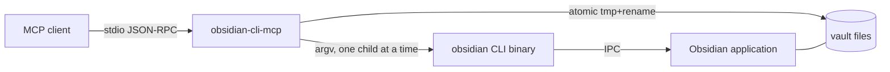
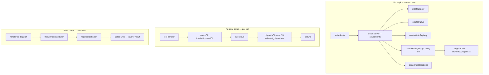
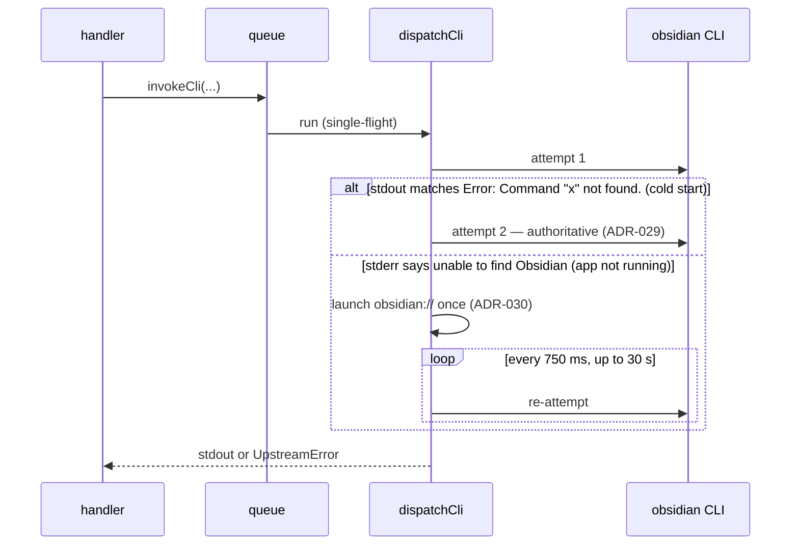

# Architecture

How the server is put together as of the baseline (2026-10-24, `main` at
`b8b6fef`, package version 0.8.11). The rules this structure satisfies live in
[the constitution](../.specify/memory/constitution.md); this page describes how
the code meets them, not what they say.

## What the server is

A Node.js process that speaks MCP over stdio to one client and turns each tool
call into one or more invocations of the **Obsidian Integrated CLI** binary
(`obsidian`), or — for the write cohort — into a direct filesystem write under
the vault root. The CLI talks to a running Obsidian application; the server
never loads Obsidian's code itself. Everything Obsidian-internal it needs
(`app.metadataCache`, `app.workspace`, plugin APIs) is reached through the
CLI's `eval` subcommand.



## Three spines

The code has three independent paths through it. Keeping them separate is
deliberate: the composition root appears in only one of them.



### Boot spine

[src/index.ts](../src/index.ts) calls `createServer()` and connects a
`StdioServerTransport`. It wires stdin `end`/`close` to shutdown explicitly,
because the SDK transport does not detect stdin EOF on its own.

[src/server.ts](../src/server.ts) is the composition root. It is the **only
production file** that constructs `createLogger()`, `createQueue()` and
`createVaultRegistry()`. It builds every tool by calling its
`createXTool({ logger, queue, vaultRegistry? })` factory, then registers two
request handlers on the SDK's low-level `Server`: `ListTools` (returns every
descriptor) and `CallTool` (looks the tool up by name and calls it, or
returns `TOOL_NOT_FOUND`). Handlers never reach back into `server.ts`; their
dependencies arrive through the factory arguments.

Before the server accepts a call, `assertToolDocsExist` checks that every
registered tool has a `docs/tools/<name>.md`. It collects **every** missing
file and throws once, rather than failing on the first. A tool without
documentation stops the server from starting.

The low-level `Server` is used on purpose even though the SDK now marks it
deprecated in favour of `McpServer`. The constitution requires SDK `Server`
registration with explicit handlers, and moving the composition root to
`McpServer` is a separate architectural decision. BI-067 (PR #78) recorded
this as targeted lint disables rather than a migration.

### Registration — the one path from a schema to a published tool

`registerTool` in [src/tools/_register.ts](../src/tools/_register.ts) is the
only route by which a zod schema becomes an MCP tool (ADR-006, Centralized Tool
Registration). It:

1. Converts the input schema to JSON Schema with `toMcpInputSchema`
   ([src/tools/_shared.ts](../src/tools/_shared.ts)) — zod 4's built-in
   `z.toJSONSchema` (draft-7 target), followed by `normalizeToDraft7Parity`, a
   pass that reproduces the retired converter's output byte-for-byte (PR #78).
2. Strips every nested `description` from that JSON Schema
   ([src/help/strip-schema.ts](../src/help/strip-schema.ts)). Per-field
   documentation is served by the `help` tool instead of being sent on every
   `tools/list` (ADR-005, Token-Optimized Tool Definitions via Progressive
   Disclosure).
3. Wraps the handler so that a `ZodError` from **input** parsing becomes
   `VALIDATION_ERROR` (or the tool's own `mapValidationError` shape), an
   `UpstreamError` becomes an MCP `isError` result carrying its `code`,
   `message` and `details`, and a `ZodError` thrown by the handler's own
   **output** check becomes `INTERNAL_ERROR`, not `VALIDATION_ERROR`, because
   the client's input was valid.

Published descriptors are pinned. `src/tools/_register-baseline.json` holds a
fingerprint for every tool, and `_register-baseline.test.ts` fails if a
descriptor changes without the baseline being regenerated with
`npm run baseline:write` (BI-022, PR #24). The zod 4 migration landed with the
baseline unchanged, which is how that PR showed the published surface did not
move.

### Runtime spine

Every CLI invocation goes through one of two facades in
[src/cli-adapter/](../src/cli-adapter/), and both go through the same queue
and the same dispatch primitive (ADR-004, Centralized Obsidian CLI Adapter;
ADR-007, Centralized CLI Bounds with Selective Override):

| Facade | Used by | Timeout | Output cap |
| --- | --- | --- | --- |
| `invokeCli` | every typed tool | fixed 10 s | 10 MiB per stream |
| `invokeBoundedCli` | `obsidian_exec` only | 30 s default, override clamped silently to 120 s | 10 MiB |

`invokeCli` also strips `vault`/`file`/`path` from the parameters in active
mode, as defence in depth behind the schema. And it reclassifies the CLI's
exit-0 `Vault not found.` stdout as `CLI_REPORTED_ERROR`, so every typed tool
gets the same unknown-vault failure.

`createQueue()` ([src/queue.ts](../src/queue.ts)) is a FIFO single-flight
queue: at most one CLI child runs at a time, in arrival order. On shutdown it
rejects everything still pending and reports how many were dropped.

`dispatchCli` ([src/cli-adapter/_dispatch.ts](../src/cli-adapter/_dispatch.ts))
owns argv assembly (`[binary, vault=<v>, command, key=value…, flags…, --copy]`),
the spawn, the timeout and output-cap kills (SIGTERM, then SIGKILL after a
2 s grace), the in-flight child registry used by shutdown, and classification.
It wraps every attempt in two recovery layers:



- **Cold-start retry** (ADR-029, Retry Once on Cold-Start Vault-Launch Failure;
  PR #64). A command sent to a vault that is registered but closed can return
  `Error: Command "<cmd>" not found.` on exit 0 while the vault's command
  registry is still loading. That signature, and only that one, triggers
  exactly one re-spawn whose result is final. `Stream closed` is deliberately
  **not** retried: a dropped pipe gives no evidence of whether a write had
  already landed, so retrying it could apply a mutation twice.
- **Application auto-launch** (ADR-030; PR #65). A non-zero exit whose stderr
  matches `unable to find Obsidian` is tagged `details.reason:
  "obsidian-not-running"`. Dispatch then opens the application once through
  the platform URI opener in
  [src/app-launcher/app-launcher.ts](../src/app-launcher/app-launcher.ts) and
  re-attempts on a bounded poll. Re-attempting is safe because the CLI failed
  before connecting, so the command never ran. Setting `OBSIDIAN_AUTO_LAUNCH`
  to `0`/`false`/`no`/`off` disables the launch and returns the same code with
  a message saying so.

There are exactly two places in the codebase that may spawn a process:
`_dispatch.ts` (the CLI) and `app-launcher.ts` (the URI opener). Only the two
facades may import `dispatchCli`.
[src/cli-adapter/architecture.test.ts](../src/cli-adapter/architecture.test.ts)
enforces both rules, so a tool that tried to reach the CLI without the retry
and recovery layers would fail the build rather than a review.

The CLI binary is found by a three-tier resolver
([src/binary-resolver/](../src/binary-resolver/), PR #19): `OBSIDIAN_BIN`,
then the documented per-platform install path (macOS and Linux), then `PATH`.
Each tier's outcome is recorded in `details.attempts` when it fails
(`CLI_BINARY_NOT_FOUND`).

### Error spine

`UpstreamError` ([src/errors.ts](../src/errors.ts)) is a plain value type with
`code`, `cause`, `details` and a message. It has no behaviour; handlers and
dispatch construct it and `registerTool` turns it into the wire shape. Every
failure the server reports travels this way — no silent empty results, no bare
`throw new Error` at a tool boundary (constitution Principle IV). The one
deliberate exception is boot: `assertToolDocsExist` throws a plain `Error`,
because a missing doc means the server must not start rather than a tool call
failing.

Dispatch classifies a finished child in a fixed priority order:

| Priority | Condition | Code |
| --- | --- | --- |
| (a) | non-zero exit or signal | `CLI_NON_ZERO_EXIT` (with `details.reason` when the app is down) |
| (b) | exit 0, stdout starts `Error: No active file` (case-insensitive) | `ERR_NO_ACTIVE_FILE` |
| (c) | exit 0, stdout starts `Error:` | `CLI_REPORTED_ERROR` |
| (d) | otherwise | success |

Alongside those: `CLI_TIMEOUT`, `CLI_OUTPUT_TOO_LARGE`, `CLI_BINARY_NOT_FOUND`
from dispatch; `VALIDATION_ERROR`, `INTERNAL_ERROR`, `TOOL_NOT_FOUND` from
registration; `FS_WRITE_FAILED`, `FILE_EXISTS`, `PATH_ESCAPES_VAULT` from the
direct-filesystem write cohort; `HELP_TOOL_NOT_FOUND`, `HELP_DOCS_MISSING` from
`help`.

The top-level set is meant to stay small and stable, so clients can switch on
it. Tool-specific conditions are carried **inside** an existing code rather
than added as new codes:

- `details.code` names the specific condition under a broad code — for
  example `CLI_REPORTED_ERROR` with `details.code: "VAULT_NOT_FOUND"`,
  `"FILE_NOT_FOUND"`, `"NOT_MARKDOWN"`, `"FOLDER_NOT_FOUND"`,
  `"SMART_CONNECTIONS_NOT_INSTALLED"`, `"BASE_MALFORMED"`, `"VIEW_NOT_FOUND"`;
  or `VALIDATION_ERROR` with `details.code: "CONTENT_TOO_LARGE"`.
- `details.reason` separates the states of one multi-state condition (ADR-015,
  Sub-Discriminators via details.reason for Multi-State Error Codes) — for
  example `obsidian-not-running` on `CLI_NON_ZERO_EXIT`, and `not-open` for a
  vault that is registered but closed.

The per-tool error roster — which codes and sub-codes a given tool can return
— is in that tool's `docs/tools/<name>.md`.

## Targeting: `target_mode`

Every tool that acts on a note or a vault takes `target_mode` (ADR-003, Enforce
Target Mode in Typed Tools). The primitive lives in
[src/target-mode/target-mode.ts](../src/target-mode/target-mode.ts) as a flat
`z.object` with a refinement. It was a discriminated union until BI-010
(PR #11): the union's published JSON Schema needed a compatibility shim
(PR #10) before strict MCP clients would load it, and flattening let the shim
go.

- `"specific"` — the caller names `vault` and one of `file` (a wikilink-style
  name the CLI resolves) or `path` (vault-relative).
- `"active"` — none of those; the tool acts on whatever Obsidian has focused.
  A write that replaces content (`write_note`) needs `overwrite: true` before
  it will run in active mode; additive writes (`append_note`, `prepend`) do
  not.

Folder-scoped tools use a variant of the refinement that takes `folder`
instead of `file`/`path`. The Bases tools take only an optional `vault`, and
omitting it means the focused vault. (`bases` accepts `vault`, but the CLI
currently ignores it; its doc says so.)

Because active mode is implicit state, `get_active_file` (PR #70) exists so a
client can ask which file is focused before acting on it.

## Two ways to touch a note: through the CLI, or directly

Most tools go through the CLI. The write and edit cohort — `write_note`,
`append_note`, `patch_block`, `patch_heading`, and `find_and_replace`'s commit
step — writes to disk directly (ADR-009, Direct Filesystem Write Path Alongside
CLI Bridge; PR #18). Writing through the CLI puts user content on the argv
pipe, and an upstream defect in the CLI's argv-to-app IPC crashes the
Obsidian host process at roughly 4 KB on Windows. Under the direct path, user
content never crosses argv at any size, so `write_note` has no content cap.

The direct path needs three things the CLI used to provide:

1. **The vault's absolute root.** The vault registry
   ([src/vault-registry/registry.ts](../src/vault-registry/registry.ts)) runs
   `obsidian vaults verbose` once, lazily, on first use. It caches the
   name → path map for the life of the process, retries on failure, and
   de-duplicates concurrent first calls. It is injected only into the tools
   that need it.
2. **A guarantee the target is inside the vault.** Two layers. A schema-level
   check ([src/path-safety/schema.ts](../src/path-safety/schema.ts)) rejects
   `..` segments, absolute markers, drive letters and control characters at
   the boundary. A runtime canonical check
   ([src/path-safety/canonical.ts](../src/path-safety/canonical.ts)) resolves
   symlinks with `realpath` and confirms the result is still under the
   canonical vault root, before any directory is created. A miss is
   `PATH_ESCAPES_VAULT`, and the logger records a `pathEscapeAttempt` event.
3. **An atomic write that Obsidian notices.**
   [src/tools/_note-io.ts](../src/tools/_note-io.ts) writes to a
   UUID-named temporary file and renames it over the target. It then
   invalidates the note's entry in Obsidian's `metadataCache` through a
   best-effort `eval`, so later reads through the CLI see the new content.

`prepend` is the deliberate exception in the write cohort. It wraps the CLI's
own `prepend` subcommand, because the CLI's frontmatter detection is the
behaviour the tool promises. That brings the argv limit back, so `prepend`
caps content at 3072 UTF-16 code units: the original 24576 cap was lowered in
BI-047 (PR #49) after larger writes were seen to leave the GUI degraded.
Content longer than that should go through `write_note`.

## Reaching Obsidian internals: the `eval` template pattern

Tools that need data the CLI has no subcommand for — backlinks, the tag index,
heading trees, focus state, Smart Connections — run JavaScript inside Obsidian
through `obsidian eval code=<js>`. The pattern is the same for every one of
them:

- The JavaScript is a **frozen template** in the tool's `_template.ts`. User
  input is never spliced into the code. The whole input travels as one base64
  JSON payload substituted at a single placeholder (R12 anti-injection).
- `composeEvalCode` and `B64_PAYLOAD_DECODE_EXPR` in
  [src/tools/_shared.ts](../src/tools/_shared.ts) do the encode and the
  in-Obsidian decode. The decode re-reads the bytes as UTF-8, because
  `atob()` alone returns Latin-1 and broke non-ASCII note names (BI-034,
  PR #36).
- The template returns a single JSON envelope, `{ ok: true, … }` or
  `{ ok: false, code, detail }`. The handler parses it in stages — strip the
  `=> ` prefix the CLI adds, `JSON.parse`, zod `safeParse` against the
  envelope schema, branch on `ok` — and maps `ok: false` codes onto
  `CLI_REPORTED_ERROR` with `details.code`.
- A registered-but-closed vault answers `eval` with **empty stdout on exit 0**.
  [src/tools/_eval-vault-closed-detection/](../src/tools/_eval-vault-closed-detection/)
  recognises that signature, confirms against `vaults verbose` that the vault
  exists, and reports `details.reason: "not-open"` rather than an empty
  result.
- [src/tools/_active-file.ts](../src/tools/_active-file.ts) holds the shared
  focused-file and focused-vault templates and the remapping helpers they
  need. They were extracted in the code-quality pass (PR #58) and the
  eval-cohort de-duplication (PR #62), byte-for-byte from the copies that had
  grown in each tool.

Since ADR-031 (Cross-Vault Open via Vault-Targeted Focus; PR #66, verified
across the read and query cohort in PR #67), an `eval` sent with `vault=<name>`
runs against that vault even when another vault has focus. Tools therefore do
not need to switch focus before reading a background vault.

## Documentation as part of the runtime

`docs/tools/` is not prose kept alongside the code. It ships in the npm package
(`package.json` `files`), the `help` tool reads it at runtime
([src/tools/help/handler.ts](../src/tools/help/handler.ts), with a traversal
guard on the requested name), boot refuses to start without it, and
co-located tests check what it says. This is the other half of ADR-005:
descriptors stay short because the long-form contract is one `help` call away.

## Logging and shutdown

[src/logger.ts](../src/logger.ts) writes JSON lines to **stderr**, never
stdout, which belongs to the MCP transport. It records failure-lifecycle
events only: dispatch timeouts, cap kills, child kills, cold-start retries,
recovery attempts, path-escape attempts, and shutdown. Successful calls are
not logged.

`SIGINT`, `SIGTERM` and transport close all lead to `triggerShutdown`, which
runs once. It drains the queue (rejecting pending tasks), kills the in-flight
child, logs a single shutdown event with both counts, and exits 0. A shutdown
that lands between a cold-start's first and second attempt skips the retry, so
it cannot leave an orphaned child.

## Module layout

```
src/
  index.ts, server.ts            boot spine and composition root
  errors.ts, logger.ts, queue.ts cross-cutting primitives
  cli-adapter/                   the two facades, dispatch, the spawn-site guard test
  binary-resolver/, app-launcher/  what dispatch spawns, and how it finds it
  target-mode/, path-safety/     boundary schema primitives
  vault-registry/                vault name → absolute root
  help/                          descriptor stripping
  tools/
    _*.ts, _eval-vault-closed-detection/   cohort-shared helpers (leading underscore)
    <tool>/  schema.ts, handler.ts, index.ts, [_template.ts], *.test.ts
```

Each tool is a folder with a fixed shape (constitution Principle I): `schema.ts`
holds the zod input (and usually output) schemas, `handler.ts` holds the
`executeX(input, deps)` logic, `index.ts` holds the `createXTool` factory that
calls `registerTool`, and eval tools add `_template.ts`. Tests sit beside the
file they test. Imports go one way — tools depend on the shared modules and
the adapter, never the other way round, and nothing imports `server.ts`.

Every production source file starts with an attribution header: either an
upstream reference with SPDX licence and version, or `Original — no upstream`
followed by a one-line summary (constitution Principle V). At the baseline,
every production file carries `Original — no upstream`. In `src/index.ts` the
header follows the shebang line.

## What is deliberately not here

- **No in-process Obsidian.** Everything goes through the CLI or the
  filesystem. A closed Obsidian is recovered by launching it, not worked
  around.
- **No parallel CLI calls.** The queue makes them single-flight. Throughput
  is traded for not driving one Obsidian instance from several children at
  once.
- **No silent empty results.** A closed vault, a missing plugin and an
  unindexed index each have a distinct, reported state.
- **No generic "do anything" typed tool.** `obsidian_exec` is the single
  escape hatch, with its own looser bounds, so that the typed tools keep
  narrow contracts.
