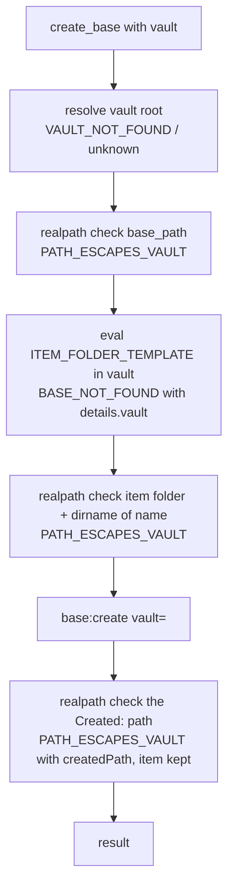

# Obsidian Bases

Tools for Obsidian Bases (`.base` files): list them, list the views inside one,
run a view, and create an item in one. Per-tool contracts are the
`docs/tools/` pages linked below.

| Tool | Pipeline | Contract |
| --- | --- | --- |
| `bases` | native CLI `bases` | [docs/tools/bases.md](../../docs/tools/bases.md) |
| `views_base` | native CLI `base:views`, with an `eval` to focus a named Base | [docs/tools/views_base.md](../../docs/tools/views_base.md) |
| `query_base` | native CLI `base:query`, with `fs.stat` pre-flight | [docs/tools/query_base.md](../../docs/tools/query_base.md) |
| `create_base` | native CLI `base:create`; with `vault`, an `eval` for the item folder and realpath checks before and after | [docs/tools/create_base.md](../../docs/tools/create_base.md) |

## How it is built

`query_base` came first (BI-039, PR #41). `bases`, `views_base` and
`create_base` followed together (PR #56). All four take only an optional
`vault`; none takes `target_mode`. A `.base` file is addressed by a
vault-relative path. The three tools that take one validate it with the same
shared refinement in `src/tools/_base-path.ts`, so an empty, over-long,
traversing or wrong-extension path fails identically everywhere
(`VALIDATION_ERROR` with `INVALID_BASE_PATH` sub-issues, following ADR-015).

What reaches the caller differs. Each sub-issue carries its ADR-015 `params`
(`code`, `reason`, `field`), but `registerTool`'s generic envelope keeps only
each issue's `path`, `message` and `code`. `views_base` uses that envelope,
so the sub-reason survives only as the message prefix
(`INVALID_BASE_PATH/wrong-extension: …`); its help page describes exactly
that. `query_base` used it too until PR #142 (BI-0174, owner ruling Q1 = C),
although its page promised `details.code`. It now lifts the first sub-coded
issue (`INVALID_BASE_PATH` or `INVALID_VIEW_NAME`) with the shared
`liftSubCodedIssue`: every param of that issue into `details`, its message as
the top-level `message`, `details.issues` kept. Lifting `views_base` as well
(option B) would have given the family one shape, but changed an error that
already matched its documentation, which BI-0174 ruled out
([ADR-073](../decisions/ADR-073-validation-sub-codes-are-lifted-only-where-the-help-page-promises-them.md)).
The two tools' validation failures therefore still differ. Since PR #115 (spec 084, FR-008,
Q1 = B) `create_base` has a `mapValidationError` that lifts the first
sub-coded issue — `INVALID_BASE_PATH`, `INVALID_NAME` or `CONTENT_TOO_LARGE`,
in `base_path`, `name`, `content` order — to `details.code`,
`details.reason` (absent for `CONTENT_TOO_LARGE`) and `details.field`, with
that issue's message as the top-level `message`, and keeps the full
`details.issues` beside them. Any other validation failure, including the
deprecated-name conflict, whose issue carries no `params`, keeps the generic
envelope. Its help page had promised those `details` fields before the code
returned them. Since PR #142 that hook is `liftSubCodedIssueKeys(["code",
"reason", "field"])` from `src/tools/_validation-details.ts`, the same loop
`query_base` uses with a key filter, so `create_base` still returns only
those three keys, in the same order (PR #142 code-quality review, finding
F2).

`query_base` runs a staged pipeline before trusting the CLI:

1. Resolve the vault root and run the canonical path check.
2. `fs.stat` the `.base` file. A missing file is `BASE_NOT_FOUND`; an empty
   one is `BASE_MALFORMED`. Both are caught before the CLI is asked.
3. Call `base:query`. Classify a failure from stdout or stderr: an unknown
   view is `VIEW_NOT_FOUND`, invalid YAML is `BASE_MALFORMED`. The YAML
   classifier was broadened in PR #59 to match js-yaml's structural error
   wording. Since PR #111 that pattern is `INVALID_YAML_PATTERN` in
   `src/tools/_base-malformed.ts`, shared with `views_base`; it moved
   unchanged, so `query_base`'s classification did not change.
4. Parse and validate the JSON, then post-process the rows. A reserved `path`
   column (the source note's vault-relative path) always sits at
   `columns[0]`. A view column also called `path` is renamed `path_view`.
5. Cap at 1000 rows. When the cap applies, the result carries
   `truncated: true` and `total_rows`.

`views_base` has two modes (reworked in BI-064, PR #71). Given a `base_path`,
it focuses that Base through `eval`, then reads its views with the CLI's
active-Base subcommand. That works cross-vault, and the named Base wins over
whatever was open. Without `base_path`, it reads the Base already focused in
Obsidian. Both modes end in one `listFocusedViews` call, and one builder,
`focusedBaseError`, makes every typed failure it raises. When nothing is
open, dispatch fails with `ERR_NO_ACTIVE_FILE`, whose message advises
`target_mode` and vault/file, inputs `views_base` does not take. Since
PR #142 (BI-0174) `listFocusedViews` rethrows it through the shared
`throwIfNoActiveFile` with the same code and `details` and the advice "Open
a Base in Obsidian, or call views_base with base_path to name one."
([architecture](../architecture.md#error-spine)). That path was checked by
unit tests only: a live check needs Obsidian running with no file open, and
the owner accepted it as a residual risk (`.specify/bugs/bi-0174/test.md`).

**The named Base must be in front before anything is listed** (BI-0179,
PR #140,
[ADR-072](../decisions/ADR-072-views-base-lists-only-once-the-named-base-is-the-active-file.md)).
`base:views` parses whatever file is active, and until PR #140 the focus
template trusted `openLinkText`, which resolves even when Obsidian drops the
open. After a different malformed Base, a `BASE_MALFORMED` error could
then carry that Base's parser complaint and length (TC-00736). The template
now compares `app.workspace.getActiveFile()` with the named file object,
polling every 50 ms for up to 1 s, and answers `FOCUS_NOT_APPLIED` with the
file still in front if it never lands. `focusNamedBase` maps that to
`CLI_REPORTED_ERROR` with `details: { stage: "focus", base_path, active }`
and throws before `listFocusedViews`, so no listing runs against the wrong
file. It maps each focus envelope code in an exhaustive `switch`, a
structure the PR #140 review asked for.

**A malformed Base is classified, not passed through** (spec 081, PR #111).
Until PR #111 `views_base` recognised only Obsidian's "Active file is not a
base file" report. A `.base` whose YAML Obsidian could not parse reached the
agent as the dispatch layer's generic `CLI_REPORTED_ERROR`, with the raw,
unbounded parser output, though the description advertised `BASE_MALFORMED`.
The T0 probes for PR #111 showed what `base:views` actually does with such a
file: focusing it succeeds, and the complaint (`Error: Flow sequence in block
collection must be sufficiently indented …`) arrives on stdout with exit 0
and empty stderr, in both modes. `listFocusedViews` now checks the report
against `query_base`'s `INVALID_YAML_PATTERN` before the not-a-base check:

- on the dispatch-error path (`CLI_REPORTED_ERROR` or `CLI_NON_ZERO_EXIT`), it
  scans the trimmed stderr and stdout (`upstreamReport`, also shared with
  `query_base` since PR #111);
- on the clean-exit path, it scans stderr plus the stdout lines that are not
  `<name>\t<type>` view lines, so a view named "YAML notes" still lists.

The not-a-base check keeps its pre-081 scope. On a non-zero exit it does not
apply; on a clean exit it still reads the raw stdout and stderr, view lines
included. Review of PR #111 asked whether to read the report there too, and
the owner kept the raw text: reading the report would let a view named
"Active file is not a base file" list instead of failing, which changes
clean-exit listing that spec 081 (FR-012) leaves as shipped. A comment at the
call site carries that reason.

`bases` keeps only clean-exit stdout lines ending in `.base`. BI-065 (PR #72)
added that filter after an empty vault returned the CLI's "no bases" message
as a fake Base entry. An empty vault now returns `count: 0`.

### Routing by the named vault

**All four tools act on the vault the caller names** (spec 083, BI-0139,
PR #114). Before PR #114 only `query_base` and named-mode `views_base` did.
`bases` and open-mode `views_base` spawned in active mode, and `create_base`
spawned `base:create` with no `vault=`, so all three answered for the vault in
front (research F1 to F3). The plan-time probes showed that `bases`,
`base:views` and `base:create` all honour `vault=` (research P1, P3, P4): the
wrapper was dropping the name, not the CLI.

- **One call shape.** `bases` and `views_base`'s listing call now pass
  `target_mode: "specific"` with `vault: input.vault`, the form `read`,
  `outline`, `rename` and `move` use. With no `vault`, `assembleArgv` puts no
  `vault=` on the argv, and neither subcommand takes a parameter that active
  mode would strip, so the argv is the one active mode produced. As first
  written each handler switched `target_mode` on whether `vault` was set; the
  code-quality review of PR #114 removed that switch as dead (commit
  `dc827e2`). Named-mode `views_base`'s listing spawn now carries `vault=`
  too (research D3, FR-013); its focus eval already ran in the named vault.
- **Unknown vault before any spawn.** `resolveVaultRootOrRemap`
  (`src/tools/_active-file.ts`) runs first on all three, so an unregistered
  name fails with `VAULT_NOT_FOUND` / `unknown` and the subcommand never runs.
  `bases` and `create_base` gained a required `vaultRegistry` on their
  `ExecuteDeps`, passed by `createServer()` from the registry it already
  built, and `views_base`'s check moved to the top of the handler so it covers
  both modes.
- **The vault is named in the error.** `views_base`'s `BASE_NOT_FOUND` /
  `not-open` and `create_base`'s `BASE_NOT_FOUND` add `details.vault`, and a
  message naming it, only when a vault is named (research D4).
- **Focus.** None of the three moves Obsidian's focus when the named vault is
  open. The T002 re-probe found `base:create vault=` focus-free in three of
  three calls. A closed vault is brought up by the dispatch layer's
  cold-start retry (ADR-029, Retry Once on Cold-Start Vault-Launch Failure;
  [ADR-045](../decisions/ADR-045-closed-vaults-recovered-only-by-the-dispatch-retry.md)),
  which raises that vault's window (T040 L8). No tool has a closed-vault stage
  of its own.

**`create_base` checks containment in a named vault**
([ADR-053](../decisions/ADR-053-create-base-contains-a-named-vault-item-and-reports-an-escape-it-cannot-prevent.md)).
`create_base` writes through Obsidian, which picks the item's folder and
reports it only on the `Created:` line. With `vault`, the handler runs a
staged pipeline (research D5); with none, it runs `base:create` exactly as
before (FR-011).

`containNamedVaultTarget` in `src/tools/create_base/handler.ts` runs stages
B to E and returns stage G as a closure. `ITEM_FOLDER_TEMPLATE` is the cohort's
second frozen eval template, beside `views_base`'s focus template, and follows
the [eval template pattern](../architecture.md#reaching-obsidian-internals-the-eval-template-pattern).
It reads the `.base` and takes the folder of a single top-level
`file.inFolder("<f>")` filter, or Obsidian's new-note folder otherwise.

**The response reports the `Created:` path** (PR #133, BI-0180). Obsidian's
`Created:` line carries the item's vault-relative path, in the folder the
template above mirrors, joined with any folder part of `name` (spec 083
research P6, P7). `executeCreateBase` returns that value, trimmed and with
backslashes turned to `/`, as `path`, and its last segment as `name`; it
reads nothing from where the `.base` file sits. Stage G checks the same
value, so on a named vault the path the caller receives is the path that was
contained. Before PR #133 the handler built `path` from the `.base` file's
location and returned the raw `Created:` value as `name` (see
[Known limits](#known-limits)). The output schema did not change; the
description's Response paragraph did, so only `create_base`'s description
fingerprint moved in `src/tools/_register-baseline.json`.

The plan had the template parse the `.base` with Obsidian's `parseYaml`
(research F7). That was wrong: in the T040 live run the eval context had
neither `parseYaml` nor `require('obsidian')`, and every filtered Base fell to
the new-note branch, so the first check only ever checked the vault root. The
template now scans the block-style YAML Obsidian writes: a `filters:` scalar,
or a block `and:` list of string entries. Flow style and `or` / `not` groups
are not read, and the post-creation check is what covers them. Review of
PR #114 asked whether to move the scan into a TypeScript function; the owner
kept the template (commit `7e338fb`), and
`src/tools/create_base/_template.test.ts` runs it in `node:vm`, one case per
contract §4 row.

Published surface (PR #90; [architecture](../architecture.md#registration--the-one-path-from-a-schema-to-a-published-tool)):
`bases`, `views_base` and `query_base` carry the read-only hint row;
`create_base` is an additive write (not read-only, not destructive, not
idempotent). `query_base`'s `base_path` publishes
`BASE_PATH_DESCRIPTION` from `src/tools/_base-path.ts`, built from
`BASE_PATH_MAX`, and `create_base`'s `base_path` opens with it and adds
"Required (or the deprecated path)."; `views_base` interpolates `BASE_PATH_MAX` into its
own, so the stated limit cannot drift from the enforced one. `query_base`'s optional
`vault` is the shared `focusedVaultField` (`src/tools/_vault-field.ts`).
Since PR #114 the `vault` descriptions of `bases`, `views_base` and
`create_base` say the call acts on that vault, the three descriptions list
`VAULT_NOT_FOUND` (and `create_base`'s `PATH_ESCAPES_VAULT`), and each
appends `closedVaultNote`. The `bases` description leaves out "Obsidian vault
display name", because the `_surface.test.ts` rule bars tool descriptions
from restating it; its parameter description keeps it.
Since PR #91 all four publish an `outputSchema` and return their result as
`structuredContent` beside the identical text
([typed results](../architecture.md#typed-results-outputschema-and-structuredcontent)).
Since PR #97 the descriptions of `views_base`, `query_base` and `create_base`
carry "Supported file types: bases.", built from each handler's
declaration
([file types](../architecture.md#file-types-check-the-file-that-will-be-acted-on)).
Their behaviour did not change: another file type is still refused with the
existing `INVALID_BASE_PATH`, which spec 070 FR-007a kept rather than rename a
discriminator clients rely on.

**One name for the `.base` file and the view** (PR #101, spec 073). Until
PR #101 `create_base` named the `.base` file `path`, the word every
note-targeting tool uses for a note, and the view `view`, while `views_base`
and `query_base` say `base_path` and `view_name`. It now takes `base_path` and
`view_name`, with the description its siblings use for each. `path` and `view`
are accepted until the next major release, with a `deprecated_parameters`
notice in the result of a successful call
([architecture](../architecture.md#renamed-parameters-deprecated-aliases-folded-before-validation),
[ADR-046](../decisions/ADR-046-shared-parameter-names-within-a-tool-family.md)).
Until PR #135 (BI-0182) `view: ""` was reported at `["view"]` rather than
`["view_name"]`, because the alias kept its own `min(1)`; it now gets the same
issue as `view_name: ""`
([ADR-067](../decisions/ADR-067-deprecated-aliases-carry-the-type-only-and-the-current-name-keeps-its-checks.md)).
All three path-taking tools now validate the field `base_path`, so
`create_base`'s `INVALID_BASE_PATH` issues report `field: "base_path"` where
they used to say `"path"`; that is the PR's one machine-readable change. The
`BASE_NOT_FOUND` details keep their `path` key, and the CLI still receives
`path=` and `view=`. During the transition `base_path` is enforced at parse
time and absent from the published `required` list. A call missing both
`name` and `base_path` now reports only `name is required`, where it used to
report both.

## Failure

Errors are `CLI_REPORTED_ERROR` with `details.code` — `BASE_NOT_FOUND`,
`BASE_MALFORMED`, `VIEW_NOT_FOUND` — or `VALIDATION_ERROR` for bad paths and
view names. Since PR #114 an unregistered `vault` is `CLI_REPORTED_ERROR` with
`details.code: "VAULT_NOT_FOUND"`, `details.reason: "unknown"` and
`details.vault` on all four tools, raised before the subcommand runs; on
`bases` and `create_base` it used to be the front vault's answer, or an
untyped `Vault not found.`. A named-vault `create_base` can also fail with
`PATH_ESCAPES_VAULT`: before creation nothing is written, and after creation
`details.createdPath` names the item, which is kept. Only additive `details`
keys (`vault`, `createdPath`) were added; no code or `details.reason` was.
Since PR #136 (BI-0185) a vault that is registered but whose folder is
missing fails `query_base` and named-vault `create_base` in their
canonical-path check, before any spawn, with `CLI_REPORTED_ERROR` /
`VAULT_NOT_FOUND` / `folder-missing` and `details.vault`; any other failure
to resolve the folder is `CLI_REPORTED_ERROR` with
`details.stage: "vault-root-check"`. Neither carries the disk path. Until
then both tools returned Node's raw `ENOENT … realpath '<absolute vault
path>'` text (TC-00727). `bases` and `views_base` do not run the guard; they
reach Obsidian only through the CLI, whose failures were already typed, and
what Obsidian answers there for a missing folder was not observed
([ADR-068](../decisions/ADR-068-a-vault-root-that-cannot-be-resolved-fails-as-the-vaults-folder.md)).
`create_base` content over 3072 UTF-16 code units fails fast with
`CONTENT_TOO_LARGE`, before the CLI is called, for the same argv reason as
`prepend` ([mutate](mutate.md#the-cli-wrapped-tools)). Unlike `prepend`
since PR #106, it has no UTF-8 byte limit, so non-Latin content inside the
character cap can still reach the size at which Obsidian's command line
fails; spec 078's plan leaves that to its own item
([mutate](mutate.md#prepends-two-content-limits)).

`views_base`'s `BASE_MALFORMED` carries a closed `details.reason` set since
PR #111, a subset of `query_base`'s (ADR-015, Sub-Discriminators via
details.reason for Multi-State Error Codes):

| `details.reason` | Mode | Raised when |
| --- | --- | --- |
| `invalid-yaml` | named or open | the report matches `INVALID_YAML_PATTERN` |
| `unknown` | named only | after focus, Obsidian says the file is not a base file, with no YAML complaint |

In open mode the not-a-base report stays `BASE_NOT_FOUND` / `not-open`
(FR-007): with nothing named, it means no Base is focused. `base_path` is
present only in named mode. Both reasons put the report in `details.message`,
bounded by `boundedExcerpt` (the spec 080 rule from
[architecture](../architecture.md#reaching-obsidian-internals-the-eval-template-pattern): first and last 500
characters around `[… cut …]` when over 1,000), with the raw length in
`details.messageLength`. The headline names the Base and carries no parser
text, and the dispatch error stays as `cause`, which is not serialised. The
`unknown` reason, `message` and `messageLength` on the named-mode not-a-base
error are additions; its headline and `base_path` did not change. A failure
that matches neither pattern is rethrown unchanged, and the `No views defined`
reply never becomes `BASE_MALFORMED` (FR-009, FR-015).

Named mode has one more failure, ahead of both reasons: the named Base did
not become the active file (PR #140). It is `CLI_REPORTED_ERROR` with
`details.stage: "focus"`, `base_path` and `active` (the file still in front,
or `null`), and no `details.code`, `details.reason` or `message`, so
ADR-015's closed sets do not grow and no Base's complaint is attached. The
help page lists it under the generic "Retry" row.

`query_base` on a closed registered vault returns its normal result. In the
T0 check for PR #100, `base:query` answered a closed vault on its first
attempt; where it answers `Error: Command "base:query" not found.` instead,
the dispatch layer's cold-start retry brings the vault up
([architecture](../architecture.md#runtime-spine)). If that fails too, the
retry's `CLI_REPORTED_ERROR` is the tool's documented "vault unavailable"
failure. `query_base` catches `CLI_REPORTED_ERROR` to run its own classifier
in step 3, and none of its patterns matches that text, so the error passes
through unchanged; a handler test pins this, with and without the CLI's
`Did you mean: base:views, base:create?` suffix. Until PR #100 the pipeline
had a further stage between steps 3 and 4 that turned an empty answer into
`VAULT_NOT_FOUND` / `not-open`; it could not fire and was deleted
([ADR-045](../decisions/ADR-045-closed-vaults-recovered-only-by-the-dispatch-retry.md)).

## Known limits

These are inherited from the CLI and documented in each tool's description:

- This page used to say that `bases` and `create_base` accept `vault` but
  the CLI ignores it, and that `views_base` without `base_path` ignores it the
  same way. The behaviour was real, but the cause was wrong: the CLI honours
  `vault=` on all three subcommands, and the wrapper never sent it. PR #114
  routes all three by the named vault ([above](#routing-by-the-named-vault)).
- `create_base` checks containment only when `vault` is named. With no
  `vault` the default path writes where Obsidian puts it, unchecked, as before
  PR #114 (Clarifications Q1; a recorded follow-up).
- `create_base`'s pre-creation folder check reads only block-style filters.
  A flow-style filter or one inside an `or` / `not` group is checked as the
  new-note folder, and only the post-creation check sees the real folder; an
  escape found there leaves the item written
  ([ADR-053](../decisions/ADR-053-create-base-contains-a-named-vault-item-and-reports-an-escape-it-cannot-prevent.md)).
- Until PR #133 this page listed `create_base`'s response `path` as built
  as `<baseDir>/<baseName>/<created>`, which matched neither shape Obsidian
  was seen to use (research P6; visible in PR #114's L4 results). That path
  named a file that did not exist for every Base shape (a folder-filtered
  Base repeated its folder; a Base with no folder rule gave a folder named
  after the `.base` file), and `name` held a whole path whenever the item
  landed outside the vault root. The composition dated from spec 054 R-008,
  whose probes created only root items, so `Created:` looked like a bare
  file name. PR #133 (BI-0180) fixed it: the response now reports the
  `Created:` path ([above](#routing-by-the-named-vault)). Callers that
  stripped a prefix from `path`, or read `name` as a path, now get different
  values. An item at the vault root and a vault whose new-note location is a
  folder were not run live for that fix; unit tests cover both
  ([test.md](../../.specify/bugs/bi-0180/test.md)).
- Left for follow-ups by PR #114: a missing filter folder surfaces as a raw
  `ENOENT` (P8), and folder segments in `name` are not rejected at
  validation (P7).
- `create_base` does not validate `view_name`: the CLI accepts a view name that
  does not exist. On a name collision the CLI auto-increments the new note's
  name, and the response reports the actual name.
- `views_base` with `base_path` changes Obsidian's focus as a side effect.
- PR #140's focus check holds by construction, not by observation.
  TC-00736 did not reproduce on Obsidian 1.15.0 before the fix, no live run
  took the `FOCUS_NOT_APPLIED` path (unit tests cover it), and the live
  checks drove the built handler, not the MCP stdio transport
  (`.specify/bugs/bi-0179/test.md`, Residual Risks; accepted by the owner).
  The reserve retry through `openFile` was not added, so a call whose open
  Obsidian drops fails and the caller must retry. A person
  switching focus between the focus `eval` and `base:views` can still swap
  the file.
- `query_base` and `views_base` validation errors carry no `details.code` or
  `details.reason` ([above](#how-it-is-built)). PR #115 corrected
  `views_base`'s help page, which had claimed `params.*` fields; `query_base`'s
  page still documents `details.reason` for `INVALID_BASE_PATH`. The planned
  fix is to lift `create_base`'s mapper into `_base-path.ts` for all three
  (spec 084 research D3, F5, F8); spec 084 kept the mapper local as the
  minimum its FR-008 needed.
- Four Bases help pages list `UPSTREAM_TIMEOUT`, which nothing raises; a
  timeout is `CLI_TIMEOUT` (spec 084 research F8, a recorded follow-up).
- The two tools bound `BASE_MALFORMED`'s `details.message` differently.
  `views_base` bounds it and adds `messageLength` (PR #111); `query_base`
  still returns the whole report, unbounded, with no `messageLength`. Review
  of PR #111 raised this, and the owner kept `query_base` unchanged, because
  BI-0137 rules out changing it. The difference is stated in
  [docs/tools/query_base.md](../../docs/tools/query_base.md#errors--error-roster);
  bounding it is a candidate backlog item for cohort parity.
- From PR #90 until PR #114 the `vault` field descriptions of `bases` and
  `create_base` said it is accepted but ignored by the CLI; PR #114 replaced
  that wording with the routed behaviour. `create_base`'s `content` ("Default:
  none") and `view` ("omit for the default") descriptions are hedged, because
  the CLI's behaviour when they are omitted was not confirmed; the PR body
  leaves them for the owner to check. PR #101 renamed `view` to `view_name`
  and kept the hedge ("omit for the default").
