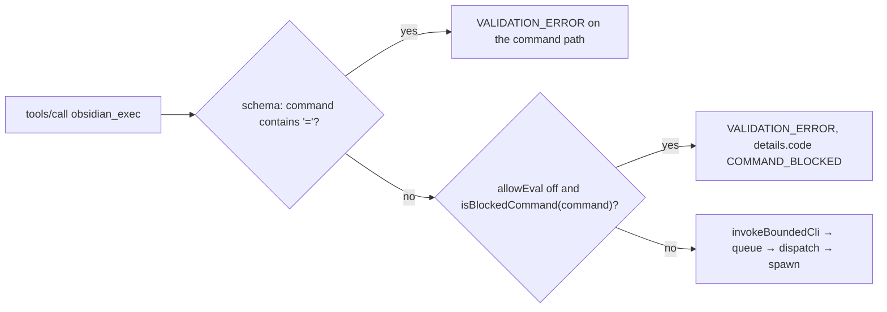

# Escape hatch and meta

The two tools that are not vault primitives: one runs CLI subcommands the
typed tools do not wrap, and one serves the documentation for every other
tool. Per-tool contracts are the `docs/tools/` pages linked below.

| Tool | Pipeline | Contract |
| --- | --- | --- |
| `obsidian_exec` | `invokeBoundedCli` — any subcommand not on the blocked list | [docs/tools/obsidian_exec.md](../../docs/tools/obsidian_exec.md) |
| `help` | reads `docs/tools/` from the installed package | [docs/tools/help.md](../../docs/tools/help.md) |

## `obsidian_exec` — the single escape hatch

The server's stance ([README](../../README.md#vision)) is a small set of typed
tools with narrow contracts, plus **one** explicit escape hatch for the long
tail of subcommands. `obsidian_exec` (part of the original bridge, PR #1) is
that escape hatch, and it is the only caller of `invokeBoundedCli`. It gets
looser bounds than the typed tools: a 30 s default timeout, overridable and
clamped silently to 120 s, against a fixed 10 s for typed tools (ADR-007,
Centralized CLI Bounds with Selective Override). It returns `stdout`,
`stderr`, `exitCode` and the exact `argv`, so a client can see precisely what
ran.

It still goes through the same queue, the same dispatch, the same cold-start
retry, the same auto-launch and the same four-priority classification as
every other tool. Bypassing those is the one thing an escape hatch here
cannot do: `architecture.test.ts` keeps `dispatchCli` reachable only through
the two facades.

Several typed tools point to `obsidian_exec` for what they deliberately do not
cover: `rename` on non-`.md` files, `write_note` templates, `properties`
ordered by frequency.

## The code-execution gate (default off)

Until PR #88, "any subcommand" included `eval`, `devtools`, the `dev:*`
Chrome DevTools Protocol commands, `restart` and the plugin lifecycle. Text a
model read in a note could steer it into running JavaScript inside Obsidian
with the user's rights. PR #88 (BI-0165 C2; spec
`specs/068-modernise-mcp-surface/`, US3, FR-010 to FR-013) closed that by
default. Two checks run, in this order, and neither spawns anything:

1. **The schema refuses `=` in `command`**
   ([src/tools/obsidian_exec/schema.ts](../../src/tools/obsidian_exec/schema.ts)),
   whatever the opt-in says. The T0 probe for PR #88 (`evidence-c2.md`) found
   that the CLI consumes one leading `vault=<name>` token and runs the next
   token as the command. With no `vault` field, `{ command: "vault=X", flags:
   ["eval", …] }` would have spawned `obsidian vault=X eval …`. No real
   command name contains `=`, so refusing it makes `command` the token the
   CLI runs in every case. The refinement does not appear in the published
   JSON Schema, so the descriptor baseline did not move. Why this beat the
   first fix is [ADR-041](../decisions/ADR-041-exec-gate-matches-the-command-field.md).
2. **The handler gate** in `executeObsidianExec`
   ([src/tools/obsidian_exec/handler.ts](../../src/tools/obsidian_exec/handler.ts))
   matches `command`, trimmed and lower-cased, against an exact set
   (`OBSIDIAN_EXEC_BLOCKED_EXACT`: `eval`, `devtools`, `restart`,
   `plugin:install`, `plugin:enable`, `plugin:disable`) and the `dev:` prefix.
   The plugin names are pinned from the live `obsidian help` output.
   Parameter values are never inspected, so `search` with `query: "eval"`
   runs. A hit throws `UpstreamError` `VALIDATION_ERROR` with `details:
   { code: "COMMAND_BLOCKED", command }` — no new top-level code (ADR-015,
   Sub-Discriminators via details.reason for Multi-State Error Codes, in the
   `details.code` form).

The opt-in is `OBSIDIAN_MCP_ALLOW_EVAL`. `createServer()` reads it once at
boot and injects `allowEval` into `createObsidianExecTool`; the handler never
reads the environment (see [architecture](../architecture.md#boot-spine)).
`allowEval` is optional on `ExecuteDeps` and an absent value means off, so a
caller that forgets it fails closed. It lifts the whole list at once; there is
no per-command opt-in.

The gate sits only in the passthrough. The typed tools that run fixed `eval`
templates go through `invokeCli`, not `invokeBoundedCli`, and are unaffected
(FR-013) — PR #88 changed none of their tests.

## `help` — the long reference

`help` (BI-030, PR #6) was built as half of ADR-005 (Token-Optimized Tool
Definitions via Progressive Disclosure): `registerTool` stripped per-field
descriptions from every published input schema so `tools/list` stayed small,
every tool description ended "Call help(...) for full parameter docs", and
`help` served the long form on demand. PR #90 retired the stripping and the
call-help sentence; ADR-040 (Published Parameter Descriptions and Server
Instructions,
[decisions/ADR-040](../decisions/ADR-040-published-parameter-descriptions-and-server-instructions.md))
supersedes ADR-005. Parameter descriptions are now in the published schema,
and `help` stays as the place for what a one-line description cannot hold:
worked examples, error rosters and recovery hints. The server instructions'
last rule points there.

With no argument it returns `docs/tools/index.md`; with `tool_name` it returns
`docs/tools/<tool_name>.md`.

It reads from the package's own `docs/tools/` directory, resolved relative to
the compiled handler, so it works the same from `src/` in development and
from the installed `dist/`. The requested name is checked for path traversal
and NUL bytes before any file is opened. A missing doc is
`HELP_TOOL_NOT_FOUND`, and a missing docs directory is `HELP_DOCS_MISSING`.

Because `help` makes the docs part of the runtime, the server also refuses to
start if any registered tool lacks its doc file
([architecture](../architecture.md#boot-spine)).

## Known limits

- The gate is an exact list by design (FR-010), not an allowlist, so some
  commands that can lead to plugin code still run with the block on: `command`
  (command-palette execution) and `plugin:reload` (spec clarification Q3,
  accepted residual risk), `plugin:uninstall`, `plugins:restrict` (turning
  restricted mode off lets installed community plugins load), `theme:*`,
  `snippet:*`, and commands contributed by plugins. PR #88 lists them for the
  owner; adding any of them is a spec change.
- `obsidian_exec`'s published description
  ([src/tools/obsidian_exec/index.ts](../../src/tools/obsidian_exec/index.ts))
  still reads "Invoke any Obsidian Integrated CLI subcommand". PR #88 left
  every descriptor unchanged. PR #90's descriptor pass removed only its
  call-help sentence and did not add the blocked list, so the `help` page and
  the README are still the only places that carry it. Since PR #90 the tool is
  published with the passthrough hint row — destructive and open-world, the
  only open-world tool. Its optional `vault` is the shared
  `focusedVaultField`.
- `docs/tools/` still holds stub pages for `list_notes`, `list_vaults` and
  `search_vault`. They are not registered tools, so `help` serves a "not yet
  implemented" page for names a client cannot call. `docs/tools/index.md`
  lists them as documentation pending.
