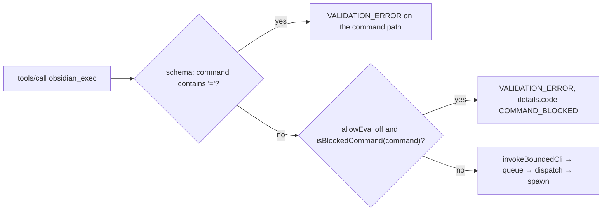

# Escape hatch and meta

The two tools that are not vault primitives: one runs CLI subcommands the
typed tools do not wrap, and one serves the documentation for every other
tool. Per-tool contracts are the `docs/tools/` pages linked below.

| Tool | Pipeline | Contract |
| --- | --- | --- |
| `obsidian_exec` | `invokeBoundedCli` — any subcommand not on the blocked list | [docs/tools/obsidian_exec.md](../../docs/tools/obsidian_exec.md) |
| `help` | reads `docs/tools/` from the installed package | [docs/tools/help.md](../../docs/tools/help.md) |

## `obsidian_exec` — the single escape hatch

The server's stance ([README](../../README.md#what-it-offers)) is a small set of typed
tools with narrow contracts, plus **one** explicit escape hatch for the long
tail of subcommands. `obsidian_exec` (part of the original bridge, PR #1) is
that escape hatch, and it is the only caller of `invokeBoundedCli`. It gets
looser bounds than the typed tools: a 30 s default timeout, overridable up
to 120 s, against a fixed 10 s for typed tools (ADR-007, Centralized CLI
Bounds with Selective Override). This page used to say the override was
"clamped silently to 120 s". The facade did carry such a clamp until PR #92,
but it never fired: the schema already refused `timeoutMs` above 120000 with
`VALIDATION_ERROR`, which is what a caller sees. PR #92 removed the dead
clamp, and the schema now takes both numbers from the facade's constants.
Like every tool since PR #92, a cancelled `obsidian_exec` call kills its
child process ([architecture](../architecture.md#runtime-spine)). It returns `stdout`,
`stderr`, `exitCode` and the exact `argv`, so a client can see precisely what
ran.

It still goes through the same queue, the same dispatch, the same cold-start
retry, the same auto-launch and the same four-priority classification as
every other tool. Bypassing those is the one thing an escape hatch here
cannot do: `architecture.test.ts` keeps `dispatchCli` reachable only through
the two facades.

Since PR #124 (spec 091, BI-0173) it also fails on the CLI's unknown-vault
answer, which every command gives on exit 0. Until then a mistyped `vault`
returned a success whose `stdout` was `Vault not found.`, because only the
typed facade checked for it. The raw facade's rule is stricter than the
typed tools': the call must name a vault (`vault=` inside `parameters` does
not count, since the CLI ignores it after the command) and its whole stdout,
trimmed, must be exactly the sentence. A note or search result that merely
starts with it is still returned. The failure is `CLI_REPORTED_ERROR` with
`message` and `details.message` `Vault not found.`, as the typed tools give
it, plus the raw tool's usual `argv`, `command`, `stdout`, `stderr` and
`exitCode` in `details`. The check sits after dispatch, so the call spawns
once and never launches Obsidian
([architecture](../architecture.md#runtime-spine),
[ADR-061](../decisions/ADR-061-obsidian-exec-fails-an-unknown-vault-only-on-the-exact-answer.md)).

Since PR #137 (BI-0132) it also fails when Obsidian's Command line interface
setting is off. The CLI then answers every command on exit 0 with an
unprefixed notice, and `obsidian_exec` used to return that notice as a
success, with or without `vault`. The rule is not the raw facade's own:
dispatch fails an exit-0 stdout that is exactly the notice, for every tool,
as `CLI_REPORTED_ERROR` with `details.reason: "cli-disabled"`, the notice in
`details.stdout` and the raw tool's usual `argv`, `command`, `stderr` and
`exitCode`. Output that only contains the words is still returned. The call
spawns once and never launches Obsidian
([architecture](../architecture.md#error-spine),
[ADR-069](../decisions/ADR-069-a-disabled-command-line-fails-in-dispatch-on-the-exact-notice.md)).

A passed-through command that acts on the focused file, with none open,
fails in dispatch as `ERR_NO_ACTIVE_FILE`, whose message tells the caller to
use `target_mode: "specific"` — an input `obsidian_exec` does not have. Since
PR #142 (BI-0174) the handler rethrows it through the shared
`throwIfNoActiveFile` with the same code, `cause` and `details` and its own
advice: "Open a note in Obsidian, or name the file in the command's own
parameters (file= or path=) with vault." The blocked-command gate runs
before the call, so the rethrow never sees a blocked command. One existing
assertion in `handler.test.ts` was edited to pin the new message, with the
owner's approval (BI-0174 Q2). Like `views_base`'s, this advice was checked by
unit tests only ([architecture](../architecture.md#error-spine)).

Its `eval` (when the gate below is open) is the one `eval` the server does
not tag. Since PR #110 dispatch reads `eval` output line by line
([architecture](../architecture.md#error-spine)), and for an untagged call any
line starting `=> ` is the answer, so an `obsidian_exec` `eval` that prints an
answer succeeds even when an `Error:` line came first. Without an answer
line, an `Error:` or cold-start line is recognised wherever it starts a line.
The code is sent as given and the result is still the raw `stdout`, `stderr`,
`exitCode` and `argv` (spec 080 FR-012).

Several typed tools point to `obsidian_exec` for what they deliberately do not
cover: `rename` on non-`.md` files, `write_note` templates, `properties`
ordered by frequency.

## The code-execution gate (default off)

Until PR #88, "any subcommand" included `eval`, `devtools`, the `dev:*`
Chrome DevTools Protocol commands, `restart` and the plugin lifecycle. Text a
model read in a note could steer it into running JavaScript inside Obsidian
with the user's rights. PR #88 (BI-0165 C2; spec
`specs/068-modernise-mcp-surface/`, US3, FR-010 to FR-013) closed that by
default. Two checks run, in this order, and neither spawns anything:

1. **The schema refuses `=` in `command`**
   ([src/tools/obsidian_exec/schema.ts](../../src/tools/obsidian_exec/schema.ts)),
   whatever the opt-in says. The T0 probe for PR #88 (`evidence-c2.md`) found
   that the CLI consumes one leading `vault=<name>` token and runs the next
   token as the command. With no `vault` field, `{ command: "vault=X", flags:
   ["eval", …] }` would have spawned `obsidian vault=X eval …`. No real
   command name contains `=`, so refusing it makes `command` the token the
   CLI runs in every case. The refinement does not appear in the published
   JSON Schema, so the descriptor baseline did not move. Why this beat the
   first fix is [ADR-041](../decisions/ADR-041-exec-gate-matches-the-command-field.md).
2. **The handler gate** in `executeObsidianExec`
   ([src/tools/obsidian_exec/handler.ts](../../src/tools/obsidian_exec/handler.ts))
   matches `command`, trimmed and lower-cased, against an exact set
   (`OBSIDIAN_EXEC_BLOCKED_EXACT`: `eval`, `devtools`, `restart`,
   `plugin:install`, `plugin:enable`, `plugin:disable`) and the `dev:` prefix.
   The plugin names are pinned from the live `obsidian help` output.
   Parameter values are never inspected, so `search` with `query: "eval"`
   runs. A hit throws `UpstreamError` `VALIDATION_ERROR` with `details:
   { code: "COMMAND_BLOCKED", command }` — no new top-level code (ADR-015,
   Sub-Discriminators via details.reason for Multi-State Error Codes, in the
   `details.code` form).

The opt-in is `OBSIDIAN_MCP_ALLOW_EVAL`. `createServer()` reads it once at
boot and injects `allowEval` into `createObsidianExecTool`; the handler never
reads the environment (see [architecture](../architecture.md#boot-spine)).
`allowEval` is optional on `ExecuteDeps` and an absent value means off, so a
caller that forgets it fails closed. Since PR #92 the flag is read by
`parseAccessConfig` in `src/server-config.ts` together with the settings that
choose which tools are offered
([owner access settings](../architecture.md#owner-access-settings)), so the
owner can also drop `obsidian_exec` altogether with `OBSIDIAN_MCP_DISABLE`
or `OBSIDIAN_MCP_READ_ONLY` (it is not read-only). It lifts the whole list at once; there is
no per-command opt-in.

The gate sits only in the passthrough. The typed tools that run fixed `eval`
templates go through the typed-tool facade, not `invokeBoundedCli`, and are
unaffected (FR-013) — PR #88 changed none of their tests. That entry point was
`invokeCli` when PR #88 landed; since PR #110 it is `invokeEval`.

## `help` — the long reference

`help` (BI-030, PR #6) was built as half of ADR-005 (Token-Optimized Tool
Definitions via Progressive Disclosure): `registerTool` stripped per-field
descriptions from every published input schema so `tools/list` stayed small,
every tool description ended "Call help(...) for full parameter docs", and
`help` served the long form on demand. PR #90 retired the stripping and the
call-help sentence; ADR-040 (Published Parameter Descriptions and Server
Instructions,
[decisions/ADR-040](../decisions/ADR-040-published-parameter-descriptions-and-server-instructions.md))
supersedes ADR-005. Parameter descriptions are now in the published schema,
and `help` stays as the place for what a one-line description cannot hold:
worked examples, error rosters and recovery hints. The server instructions'
last rule points there.

With no argument it returns `docs/tools/index.md`; with `tool_name` it returns
`docs/tools/<tool_name>.md`. Since PR #142 (BI-0174, TC-00586) every page it
serves has H2 sections beginning `Input`, `Output`, `Errors` and
`Examples`, in that vocabulary, so an agent can find the error roster on any
page by the same name; `docs-sync.test.ts` enforces it
([architecture](../architecture.md#documentation-as-part-of-the-runtime)).
The same PR corrected the pages' quoted errors against the built server —
among them the three shapes an unknown vault really takes, which depend on
how the tool resolves its vault, and every unknown-vault hint now names the
`vaults` tool instead of the `obsidian vaults` CLI command.

It reads from the package's own `docs/tools/` directory, resolved relative to
the compiled handler, so it works the same from `src/` in development and
from the installed `dist/`. The requested name is checked for path traversal
and NUL bytes before any file is opened. A missing doc is
`HELP_TOOL_NOT_FOUND`, and a missing docs directory is `HELP_DOCS_MISSING`.
`HELP_TOOL_NOT_FOUND`'s `details.availableTools` is the directory's page
names, from `listToolPages` (extracted in PR #115 so the drift test reads the
same list), not the registry: `help` deliberately does not import the tool
list, which would be an upward dependency.

Because `help` makes the docs part of the runtime, the server also refuses to
start if any registered tool lacks its doc file
([architecture](../architecture.md#boot-spine)).

## Known limits

- The gate is an exact list by design (FR-010), not an allowlist, so some
  commands that can lead to plugin code still run with the block on: `command`
  (command-palette execution) and `plugin:reload` (spec clarification Q3,
  accepted residual risk), `plugin:uninstall`, `plugins:restrict` (turning
  restricted mode off lets installed community plugins load), `theme:*`,
  `snippet:*`, and commands contributed by plugins. PR #88 lists them for the
  owner; adding any of them is a spec change.
- `obsidian_exec`'s published description
  ([src/tools/obsidian_exec/index.ts](../../src/tools/obsidian_exec/index.ts))
  still reads "Invoke any Obsidian Integrated CLI subcommand". PR #88 left
  every descriptor unchanged. PR #90's descriptor pass removed only its
  call-help sentence and did not add the blocked list, so the `help` page and
  the README are still the only places that carry it. PR #124 added
  `unknown vault` to the description's list of structured failures, and
  regenerated its fingerprint on purpose. Since PR #90 the tool is
  published with the passthrough hint row — destructive and open-world, the
  only open-world tool. Its optional `vault` is the shared
  `focusedVaultField`.
- Until PR #115 this list said `docs/tools/` still held stub pages for
  `list_notes` and `search_vault`, which `help` served and `index.md` listed
  as documentation pending, for names a client cannot call. Spec 084 deleted
  both (research D1): `help` now answers `HELP_TOOL_NOT_FOUND` for them, and a
  test fails if a page or index entry names a tool the server does not offer
  ([architecture](../architecture.md#documentation-as-part-of-the-runtime),
  [ADR-054](../decisions/ADR-054-help-pages-are-checked-against-the-offered-tools-by-a-test.md)).
  The third stub, `list_vaults`, had become the real `docs/tools/vaults.md`
  when PR #91 shipped the tool under the name `vaults`
  ([list and inventory](list-and-inventory.md#vaults)).
- The drift test compares names against a *default* server. A tool the owner
  switches off with `OBSIDIAN_MCP_DISABLE` or read-only mode keeps its page,
  so `help` still serves it and lists it in `availableTools`.
- Neither tool publishes an `outputSchema` (PR #91,
  [typed results](../architecture.md#typed-results-outputschema-and-structuredcontent)):
  `help` returns raw Markdown, and `obsidian_exec` returns free-form CLI
  output with no zod schema. Both stay text-only.
