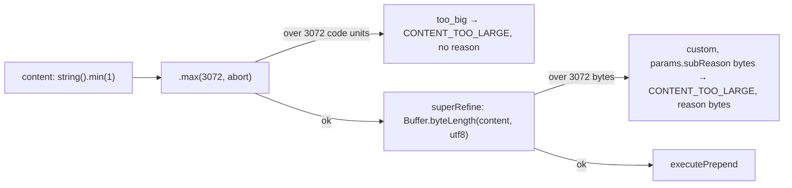
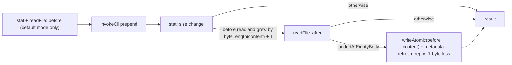
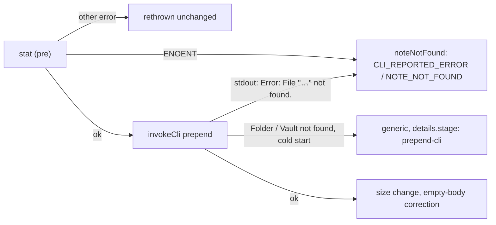

# Mutate (single note and property)

Tools that change the vault. This group is where the server's two write paths
meet: most of the group writes directly to disk under ADR-009, and the rest
wraps a CLI subcommand. Per-tool contracts are the `docs/tools/` pages linked
below.

| Tool | Pipeline | Contract |
| --- | --- | --- |
| `write_note` | direct filesystem (ADR-009) | [docs/tools/write_note.md](../../docs/tools/write_note.md) |
| `append_note` | direct filesystem | [docs/tools/append_note.md](../../docs/tools/append_note.md) |
| `patch_heading` | direct filesystem | [docs/tools/patch_heading.md](../../docs/tools/patch_heading.md) |
| `patch_block` | direct filesystem | [docs/tools/patch_block.md](../../docs/tools/patch_block.md) |
| `find_and_replace` | direct filesystem scan and write | [docs/tools/find_and_replace.md](../../docs/tools/find_and_replace.md) |
| `prepend` | native CLI `prepend`, plus one direct-filesystem correction for a bodiless note (PR #104) and a pre-call missing-note check (PR #105); content capped in characters and UTF-8 bytes (PR #106) | [docs/tools/prepend.md](../../docs/tools/prepend.md) |
| `set_property` | native CLI `property:set` | [docs/tools/set_property.md](../../docs/tools/set_property.md) |
| `delete` | native CLI `delete` | [docs/tools/delete.md](../../docs/tools/delete.md) |
| `rename` | native CLI `rename` | [docs/tools/rename.md](../../docs/tools/rename.md) |
| `move` | native CLI `move` | [docs/tools/move.md](../../docs/tools/move.md) |

## The direct-filesystem cohort

`write_note` moved off the CLI in BI-016 (PR #18) because writing content
through argv crashed the Obsidian host on Windows above roughly 4 KB. The
tools added after it that edit a note's body — `append_note` (PR #46),
`patch_heading` (PR #42), `patch_block` (PR #45), and `find_and_replace`
(PR #40) — followed the same path.

Every one of them runs the same stages:

- **Locator.** In specific mode the vault root comes from the vault registry.
  A wikilink-form `file` is resolved through `obsidian file` first. In active
  mode a focused-file `eval` supplies the path. The helpers are shared in
  `src/tools/_active-file.ts`; since PR #97 `append_note` and `prepend` reach
  them through `resolveFsTarget` in `src/tools/_file-target.ts`, which
  replaced the identical private `resolveLocator` each had.
- **Type check** (PR #97). `write_note` and `append_note` reject a resolved
  path that is not a Markdown note with `UNSUPPORTED_FILE_TYPE` before the
  guard, so nothing is read or written
  ([file types](#file-types)). `patch_heading` and `patch_block` were out of
  spec 070's scope (FR-013) and do not run it; `find_and_replace` keeps its
  own `INVALID_NOTE` rejection.
- **Guard.** Both path-safety layers run before anything touches the disk; a
  miss is `PATH_ESCAPES_VAULT`.
- **Edit.** The change itself is a pure function over the file text — for
  example `appendEdit`, or the heading walk and block scan under
  `patch_heading/` and `patch_block/` — tested separately from the I/O.
- **Write.** `writeAtomic` in `src/tools/_note-io.ts`. `EBUSY` and `EPERM`
  are classified as `EXTERNAL_EDITOR_CONFLICT` — and so is `EACCES`, for
  `append_note` and `patch_heading` but not `patch_block` —
  because on Windows they mean another program holds the file. Anything else
  is `FS_WRITE_FAILED`. The per-tool differences are explicit parameters of
  the shared mapper in `src/tools/_fs-errors.ts` (PR #58). Since PR #102 that
  module also exports `getSyscall` beside `getErrno`; the mapper,
  `find_and_replace`'s own `mapFsError` and `read`'s disk-read failure all
  use it instead of three hand-rolled casts. Since PR #105 it also exports
  `noteNotFound(relPath, vault, cause)`, the one builder of the
  missing-note failure (`CLI_REPORTED_ERROR`, `details.code: NOTE_NOT_FOUND`)
  for `append_note`, `patch_block` and `prepend`. Each caller passes its own
  `vault` value; the builder does not pick one
  ([below](#prepend-on-a-missing-note);
  [ADR-050](../decisions/ADR-050-prepend-checks-the-note-on-disk-before-calling-obsidian.md)).
- **Refresh.** A best-effort `eval` asks Obsidian to recompute its cached
  metadata for the written note, so the next search or property read sees the
  new text (spec 068 FR-001–FR-005, PR #87). `invalidateMetadataCache` in
  `src/tools/_note-io.ts` addresses the note by its vault-relative,
  forward-slash path, and sends the vault exactly as the caller named it:
  `vault=<name>` in specific mode, no `vault=` in active mode, where the write
  went to the open vault. A resolved folder path is never sent as `vault=`.
  A failure does not fail the write, but it is no longer silent: it is logged
  as `bridge.metadata_refresh_failed` with a `reason` of `cli-error`,
  `note-not-found` or `unexpected-output` (see
  [architecture.md](../architecture.md#logging-and-shutdown)). Since PR #110
  the refresh and the editor open go through `invokeEval`, and the refresh
  reads the call's tagged answer. Before that it compared the whole trimmed
  stdout with `=> ok`, so a single plugin line around the answer logged a
  refresh that had worked as `unexpected-output`. The log's `detail` is
  still the first 200 characters of the raw stdout.

  Before PR #87 this step did nothing at all. It passed the note's absolute
  path to `getFileByPath`, which takes a vault-relative one, so the lookup
  returned `null` and the refresh was skipped, and the empty `catch` hid it.
  It also ran in active mode, so with another vault focused it would have
  addressed the wrong vault. Searches still mostly came back fresh only
  because Obsidian's own file watcher usually wins the race
  (`specs/068-modernise-mcp-surface/evidence-a1.md`).

  The template calls `computeFileMetadataAsync(file)`, the method Obsidian's
  file watcher uses. It must not call `computeMetadataAsync(file)`, the call
  ADR-009 (Direct Filesystem Write Path Alongside CLI Bridge) §5 names: that
  method takes the file's bytes, not a `TFile`, and the first live run with a
  correct path wedged the vault's metadata worker until Obsidian reloaded
  (T010). A unit test in `_note-io.test.ts` forbids the old call. ADR-009 §5
  still names it.

### What `bytes_written` reports

Since PR #103 (BI-0116, spec 075 FR-001;
[ADR-048](../decisions/ADR-048-bytes-written-is-the-size-change.md))
`bytes_written` has one meaning on the five single-note text writers —
`write_note`, `append_note`, `prepend`, `patch_heading` and `patch_block`: the
note's size in bytes after the write minus its size before, counting a note
that did not exist as 0. Before PR #103 it meant three things (spec 075
research F1). `append_note` and `prepend` already reported that change;
`patch_heading` and `patch_block` reported the note's **total** size after the
edit; `write_note` reported nothing. Their `docs/tools/` pages said so, and
the patch pages called a near-zero value "a red flag" — advice that was only
sound under the total-size meaning and that PR #103 removed.

Each tool computes the figure from data it already holds, so only
`write_note` gained any I/O:

| Tool | Before | After | Bound in the output schema |
| --- | --- | --- | --- |
| `append_note`, `patch_heading`, `patch_block` | the text read | the edited text | `append_note` `min(1)`; the patch tools none, so 0 and negative values are valid |
| `prepend` | `fs.stat` size before the CLI call | `fs.stat` size after, less the one byte the [empty-body correction](#prepend-on-a-note-with-no-body) removes (PR #104) | `min(1)`; a zero change is the `post-stat-byte-delta-zero` failure [below](#the-cli-wrapped-tools) |
| `write_note` | `fs.stat` size (`overwrite: true`), or 0 (`wx` create) | the content's UTF-8 length | none |

- **One helper for the text case.** `sizeChange(before, after)` in
  `src/tools/_note-io.ts` is the UTF-8 byte difference that `append_note` and
  both patch tools return. Research D1 had rejected a helper as "an
  abstraction for one line"; the PR #103 code-quality review (commit
  `4a203e0`) found the subtraction spelled three ways and added it, knowingly
  lifting the plan's "do not edit `_note-io.ts` / `append_note/handler.ts`"
  constraint. `append_note`'s figure did not change.
- **`write_note`'s probe.** The `overwrite: true` existence check was
  `fs.realpath`; it is now `fs.stat`, which gives existence and the old size in
  one call. `ENOENT` means a create with old size 0; any other errno fails as
  `FS_WRITE_FAILED { errno, syscall: "stat", path }` **before** anything is
  written, so the tool never returns a guessed figure (clarification Q3,
  FR-006a, data-model R4). The `details` shape is unchanged; only `syscall`
  reads `"stat"` where it read `"realpath"`. `ExecuteFs` gained a required `stat`. The
  handler holds one `sizeBefore: number | null`, where `null` means the note
  did not exist: `created` is `sizeBefore === null`, so an existing 0-byte
  note still reports `created: false`.
- **The tolerated race.** When `patch_heading`'s re-walk finds the heading
  unchanged but other bytes moved, the write proceeds (last-write-wins) and
  the figure is still this write's change against the text it edited
  (data-model R5), not against whatever was on disk at the end.
- **One published sentence.** The five output schemas describe the field with
  `BYTES_WRITTEN_DESCRIPTION` from `src/tools/_shared.ts`, and a
  `_surface.test.ts` case checks it on each tool's published `outputSchema`
  through the real `tools/list`
  ([architecture](../architecture.md#typed-results-outputschema-and-structuredcontent)).

A caller that compared `bytes_written` from a patch tool with the note's total
size has to compare it with the intended size change instead, or `read` the
note; the CHANGELOG's `[Unreleased]` entry carries that migration note. PR
#103's live check (T031) drove the built server over stdio against the test
vault and saw the reported figure equal the measured file-size change in all
12 steps, including 0, −15, −18 and −51.

**Concurrency is last-write-wins**, except in `patch_heading`. It walks the
heading tree again just before writing and fails with `HEADING_RACE` if the
section moved. Nothing else detects an editor changing the file between the
read and the write.

**`find_and_replace` is preview-then-commit.** The default call returns every
occurrence it would change. `commit: true` scans again, compares the count
against the preview (`OCCURRENCE_COUNT_DRIFT`), checks the
`OBSIDIAN_FIND_REPLACE_MAX_OCCURRENCES` bound (default 500), and then writes
each note in turn, serialised through the shared queue. Each changed note is
refreshed after its queued write resolves, never inside the `queue.run`
callback: the refresh goes through `invokeCli` and so through the same
single-flight queue, and nesting it would deadlock (T009, PR #87). A write failure
partway through reports which notes were already written, in
`FS_WRITE_FAILED` `details`. By default the scan skips fenced code and HTML
comments. Its scope is the vault, a folder, or — since BI-066 (PR #73;
ADR-032, Find And Replace File Scope via Sibling Locators) — a single note.

Since PR #101 (spec 073) the folder scope is `folder` and case handling is
`case_sensitive`, the names the search tools use. Until then they were
`subfolder` and `case_insensitive`, the only case switch in the server with
the opposite polarity. The default is still case-sensitive (`case_sensitive`
defaults to `true`, as `case_insensitive` defaulted to `false`). Both old
names are accepted until the next major release, with a
`deprecated_parameters` notice on either result branch; `case_insensitive` is
negated onto `case_sensitive`, and its notice carries a polarity `note`
([architecture](../architecture.md#renamed-parameters-deprecated-aliases-folded-before-validation),
[ADR-046](../decisions/ADR-046-shared-parameter-names-within-a-tool-family.md)).
A `subfolder` scope is honoured exactly like `folder` and never widens to the
whole vault. The `INVALID_SUBFOLDER` code, its reasons and its
`details.subfolder` key are unchanged; the path-safety issue moved to
`["folder"]` ("folder is not structurally safe"), and the `SCOPE_CONFLICT` and
not-found messages say `folder`. The internal scope predicate followed:
`effectiveSubfolder` is now `effectiveFolder`. One edge moved in review
(commit `4a00a58`): a call that sends `subfolder` and `folder` together is
rejected with the generic alias-conflict issue before the scope matrix runs,
so `subfolder` + `folder` + `path` no longer reports `SCOPE_CONFLICT`.

Since PR #92 (068 FR-052, FR-054, research R11) the commit loop checks the
call's `signal` before each note. A cancel stops it between notes: notes
already written stay written, and because the SDK sends no response for a
cancelled request, the handler logs `find_and_replace.commit_cancelled`
`{vault, committed, skipped}` to stderr and rethrows the abort reason
([architecture](../architecture.md#logging-and-shutdown)). After each written
note it calls `reportProgress?.(written, total, relPath)`, which sends a
progress notification only when the request carried a token. The two scope
predicates, `isSingleNoteScope` and `effectiveFolder`, are shared by the
confirmation gate and `resolveScope` since the PR #92 review (commit
`ca25c67`), which had found the checks written twice.

## Heading paths

`patch_heading` finds its section with `walkHeadings`
(`src/tools/patch_heading/heading-walk.ts`), a pure scan over the note's ATX
headings. A heading matches the next segment only when its level is one below
the last matched heading and its ancestors are exactly the headings already
matched, so a `#`-separated `heading_path` starts at the note's level-1
heading and names one heading per level (`Project#Tasks#Today` for a level-3
target). `read_heading` resolves its `::` paths by the same rule
([read](read.md#known-limits)).

Until PR #107 the published text did not say so. It said "Minimum two
segments — top-level headings are out of scope", which agents read as "leave
the level-1 heading out": they wrote `Tasks#Today` and got `HEADING_NOT_FOUND`
although both headings exist. The help page also advised wrapping a top-level
heading in a parent, which cannot work, because the parent would then be the
level-1 heading. PR #107 replaced that sentence in the description, the
`heading_path` parameter description and `docs/tools/patch_heading.md` with the
rule, the sections no path can reach (a level-1 section by itself, any section
in a note with no level-1 heading, any section below a skipped level), each
with `write_note` as the whole-note alternative, and the usual cause of
heading-not-found before the advice to call `outline`. The code, the codes and
every runtime message are unchanged (spec 079 Clarifications Q1). The frozen
one-segment validation message still says "top-level headings are out of
scope"; the help page quotes it verbatim and follows each quote with a note
that it refers to a one-segment path. Five characterisation cases in
`heading-walk.test.ts` pin the rule: `null` for a left-out level 1, a skipped
level and a note with no level-1 heading; a match when the skip is below the
target and when the path starts at a second level-1 heading.

The two tools still use different separators (`#` and `::`), kept apart on
purpose ([ADR-046](../decisions/ADR-046-shared-parameter-names-within-a-tool-family.md),
first exception). Aligning them, a
runtime hint in the heading-not-found message, and reaching the unreachable
sections are spec 079 plan Follow-ups.

## Confirmation before irreversible changes

Since PR #92 (068 US14, FR-047 to FR-050, research R12) two actions in this
group ask the human first, through the per-call `Confirmation` that
`registerTool` hands the handler
([architecture](../architecture.md#per-call-scope-cancellation-progress-and-confirmation),
ADR-043):

| Tool | Trigger | Step 1: can the client ask? | Step 2: the question |
| --- | --- | --- | --- |
| `delete` | `permanent: true` | at handler entry | straight after step 1, before the spawn; names the vault and the note, or "the active note" |
| `find_and_replace` | `commit: true` with no `file`, `path` or `active_note` (a `folder` commit still asks) | at handler entry, **before vault resolution**, which spawns Obsidian | after the commit re-scan, before the first write; names the pattern, occurrence and note counts, the vault and the folder |

A client that declares no form elicitation gets `VALIDATION_ERROR` with
`details.code: "CONFIRMATION_UNAVAILABLE"` and a message naming the safe
route (delete to the trash; commit one note at a time); nothing is spawned or
written. A human who does not confirm gives `CONFIRMATION_DECLINED` with
`details.action`, and nothing is changed. A trash delete, a single-note commit,
every preview, and a multi-note commit that finds nothing to write ask
nothing.

`find_and_replace` asks after the re-scan so the question can carry the note
count. The SDK re-enters the handler with the answer, so a confirmed commit
resolves the vault and scans twice; both runs are read-only before the
question, and the drift check (`OCCURRENCE_COUNT_DRIFT`) still guards the
writes against a vault that changed while the human was deciding.

PR #92's T090 live run (test vault, both protocol eras, a v2 client over real
stdio) saw decline change nothing, accept delete permanently and rewrite both
subfolder notes, and a trash delete ask nothing. The same check from Claude
Code was still open for the owner when the PR went to review. Its outcome,
recorded in PR #93's post-implement follow-ups: Claude Code in print mode (the
desktop app's Code tab, `claude -p`, unattended runs) declares form
elicitation and then declines every request, so a permanent `delete` or a
multi-note commit there always returns `CONFIRMATION_DECLINED`, never
`CONFIRMATION_UNAVAILABLE`. The server cannot tell that client apart from a
human who said no; the README documents the limitation, and whether to raise
it upstream is the owner's call.

## The CLI-wrapped tools

`prepend` (PR #47) wraps the CLI, unlike its sibling `append_note`. The CLI's
own frontmatter detection is the behaviour the tool promises: content lands
after a leading YAML block. The cost is the argv limit, so content is capped
at **3072** UTF-16 code units. BI-047 (PR #49) lowered the cap from 24576
after larger writes were seen to leave the Obsidian GUI degraded until
restarted. The same PR added a silent-no-op guard. The file is `stat`ed before
and after the call, and if the CLI reports success but the file did not grow,
the call fails as `FS_WRITE_FAILED` with
`details.reason: "post-stat-byte-delta-zero"`. It is not returned as a success
with `bytes_written: 0`.

### `prepend`'s two content limits

Since PR #106 (spec 078;
[ADR-051](../decisions/ADR-051-prepend-caps-content-in-utf-8-bytes-as-a-second-limit.md))
`content` has a second limit, `MAX_CONTENT_BYTES = 3072` UTF-8 bytes, beside
`MAX_CONTENT_LENGTH = 3072` UTF-16 code units in `src/tools/prepend/schema.ts`.
The fault the character cap guards against follows the content's UTF-8 size:
1,500 CJK characters (4,500 bytes) were inside the character cap and crashed
Obsidian (BI-0123; spec 078 research F2). The two earlier bisects used plain
Latin text, where the two units coincide, so they could not tell the
difference.

Both limits run in the schema, so `registerTool` refuses an oversized call
before target resolution, the filesystem or Obsidian is reached, in every
target mode and with or without `inline`:

- **The size check** is a `superRefine` that measures once and puts the
  final message (`content exceeds maximum size of 3072 UTF-8 bytes (got N)`)
  and `params: { subReason: "bytes", contentBytes }` on its `custom` issue.
  `mapZodIssuesToToolError` in `src/tools/prepend/index.ts` maps that issue
  to `VALIDATION_ERROR` / `details.code: CONTENT_TOO_LARGE` /
  `details.reason: "bytes"` with `contentBytes` and `maxBytes`, taking the
  message and size from the issue. The `params.subReason` key is the
  convention `find_and_replace`'s mapper already used.
- **Precedence lives in the schema.** `{ abort: true }` on `.max()` skips the
  size check once the character limit has failed, so text over both limits
  carries only `too_big` and gets the character-limit error, unchanged byte
  for byte (FR-005). The first version let both issues through and had the
  mapper scan all issues for `too_big` before looking at any `custom` one;
  PR #106's code-quality review (commit `00cccae`) replaced that two-pass
  scan, and a second `Buffer.byteLength` over the raw arguments, with the
  `abort` flag and the measured issue. `abort` and the refine add nothing to
  the emitted JSON Schema, which still publishes only `maxLength: 3072`; the
  byte limit is visible in the `content` description and `PREPEND_DESCRIPTION`,
  both of which interpolate the constants.
- **Behaviour change.** Non-Latin calls between 3,073 bytes and the fault
  (about 4 KB) that sometimes succeeded before are now refused; `write_note`
  is the route for them, as it already was for long Latin text.

### `prepend` on a note with no body

Since PR #104 (spec 076;
[ADR-049](../decisions/ADR-049-prepend-keeps-obsidians-write-and-removes-the-added-line-break.md))
`prepend` is no longer a pure CLI wrap. The spec 076 T0 probe (research F2)
showed that in default mode Obsidian appends one LF after the content on
every call. On an empty note or a properties-only note that LF was an extra
trailing line break: `""` + `"first"` gave `"first\n"` and
`bytes_written: 6`, where `append_note` gave `"first"` and 5. The handler now
takes that byte back:

- **The predicate** is `landedAtEmptyBody(before, content, after)` in
  `src/tools/prepend/empty-body.ts`, pure and tested on its own: `after` must
  be exactly `before + content + "\n"`, and `before` must not end with the
  primitive root of `content + "\n"` (research D2). The wrapper still parses
  no frontmatter (spec 045 FR-005b); it only checks whether Obsidian's
  insertion landed at the very end of the note.
- **The write** reuses this cohort's `writeAtomic` and
  `invalidateMetadataCache` from `src/tools/_note-io.ts`, so `prepend`'s
  `ExecuteFs` gained `readFile`, `writeFile`, `rename` and `unlink`. The
  helper `removeAddedLineBreak` in `src/tools/prepend/handler.ts` returns the
  bytes it removed (0 or 1); the PR #104 code-quality review (commit
  `a90ed90`) moved it out of `executePrepend`, which it had made a nest of
  `try`/`catch` blocks.
- **Inline calls read nothing.** Obsidian's inline write is already exact, so
  `before` stays `null` and the correction is skipped. The first version read
  the note before every call; review finding 3 showed that cost inline calls a
  full-note read and a new failure for nothing, and the owner chose to read in
  default mode only (commit `eaba135`).
- **A concurrent edit wins.** A note another writer changed between the call
  and the read-back fails the predicate, is not rewritten, and reports the
  measured size change (clarification Q1).

Its failures all stay under `FS_WRITE_FAILED`, split by whether the content
landed:

| When | `details` | The note |
| --- | --- | --- |
| the pre-call read fails with anything but `ENOENT` (default mode) | `{ errno, syscall: "open", path }` | unchanged; Obsidian was not called |
| the rewrite fails, or an empty note cannot be read back | `{ reason: "extra-trailing-newline", path, vault, errno? }` | holds the content plus one extra line break |
| a non-empty note cannot be read back | `{ errno, syscall: "open", path }`, no `reason` | holds the content; it may or may not have the extra line break |

An `ENOENT` on the pre-call read leaves `before` `null` and lets the call go
on to Obsidian. Until PR #105 this page said that kept "upstream's
`NOTE_NOT_FOUND`" as the contract for a missing note; in fact no missing note
reached `NOTE_NOT_FOUND` then ([below](#prepend-on-a-missing-note)). Since
PR #105 a plainly missing note fails at the `stat` before this read, so an
`ENOENT` here means the note was removed between the two. A failed metadata
refresh does not fail the call; it is logged as
`bridge.metadata_refresh_failed`, as for the rest of the cohort.

### `prepend` on a missing note

Before PR #105 (spec 077;
[ADR-050](../decisions/ADR-050-prepend-checks-the-note-on-disk-before-calling-obsidian.md))
`prepend` on a missing note returned a generic `CLI_REPORTED_ERROR` with
`details.stage: "prepend-cli"`, though its description and
`docs/tools/prepend.md` promised `NOTE_NOT_FOUND` (research F1). The pre-call
`stat` swallowed `ENOENT`, and the four classifier patterns were placeholders
that never matched Obsidian's real line, `Error: File "<path>" not found.`
(stdout, exit 0; spec 077 T0 probe, research F2). The handler now detects the
case at two points and reports it the same way from both:

- **Before the call** (FR-001a). A `stat` `ENOENT` throws `noteNotFound`
  with the fs error as `cause`, in default and inline mode, so Obsidian is
  not called and nothing is read or written. The check stats the file under
  the vault root the registry resolves, so it does not depend on which vault
  Obsidian has open — the probe saw the CLI act in the open vault despite
  `vault=` (research F2).
- **From Obsidian's report** (FR-001b). `/^\s*Error: File ".*" not found\.\s*$/m`
  now heads `NOTE_NOT_FOUND_PATTERNS` in `src/tools/prepend/handler.ts`, with
  the dispatch error as `cause`. It catches what the `stat` cannot see: a
  path whose letter case differs from the note's (Obsidian's vault paths are
  case-sensitive, while `stat` succeeds on Windows and default macOS) and a
  note removed after the `stat`. The pattern requires `File` and a quoted
  path, so Obsidian's `Error: Folder "x" not found.`, `Vault not found.` and
  a persistent cold start stay generic (FR-007).
- **The same failure as `append_note`.** Both points go through
  `noteNotFound` in `src/tools/_fs-errors.ts`. The plan kept the builder
  private to `prepend/handler.ts` (research D3); PR #105's review moved it
  into the shared module (commit `cdbd8af`), because parity had held only
  through a test comparing the two handlers. `append_note` and `patch_block`
  dropped their inline copies, with byte-identical output.
  `handler.not-found.test.ts` checks the parity and the FR-007 guards.

`set_property` wraps `property:set`. It infers the property type from the JS
value when `type` is omitted, except for `date` and `datetime`, which must be
given explicitly. `delete` is a thin wrapper. It sends a file to the OS trash
unless `permanent: true`, which since PR #92
asks the human first ([above](#confirmation-before-irreversible-changes)). On
the PR #92 test vault, which has no `.trash` folder, trash deletes landed in
the OS Recycle Bin. `rename` and `move` take
the vault's "Automatically update internal links" setting as it is: whether
links are rewritten depends on vault configuration, not on this server.

`rename` and `move` stopped being thin wrappers in PR #97. Each first resolves
the source file, then applies the destination rule below, then forwards the
original `file=`, the `path`, or (active mode) the resolved `path=` with no
`vault=`. `move` still expands a folder-form `to` (trailing `/`) itself only
for a `path` locator; for `file` and active calls it forwards the folder form
as given and the CLI keeps the basename, which keeps Markdown `file`-mode
arguments byte-stable (spec 070 `contracts/tool-support.md` invariant 4,
upheld by review ruling Q2).

## File types

Since PR #97 (BI-0060, spec 070) every tool here that takes a file locator
states in its description which file types it handles, built from the
`X_SUPPORTED` declaration in its handler
([architecture](../architecture.md#file-types-check-the-file-that-will-be-acted-on);
ADR-044, File-Path Tools Check the Resolved File and Keep Its Type).

| Tool | Handles | How a wrong type fails |
| --- | --- | --- |
| `write_note`, `append_note`, `prepend` | notes only | `UNSUPPORTED_FILE_TYPE` (`unsupported-type`) before any write |
| `find_and_replace` | notes only | its existing `INVALID_NOTE` / not-eligible handling, unchanged |
| `rename`, `move` | any file; the type is kept | `UNSUPPORTED_FILE_TYPE` (`type-change`) for a destination of another type |
| `delete` | any file | — |

The destination rule for `rename` and `move` replaced two older ones. `rename`
appended `.md` to any name without it (`appendMdIfMissing`, spec 021 Q1), so
renaming a canvas made it a Markdown note. `move` appended `.md` only to a
`.md` source given as a `path` (spec 030 Q1+Q2), forwarding everything else as
given. Now a destination with no extension gets the source's — the T0 probe
P1 showed this is required for `move` and not just tidy, because the CLI reads
an extensionless `to` as a folder — and one with a different recognised
extension is refused with `alternative: "obsidian_exec"`. Markdown outcomes
did not change, including `Renamed.MD` → `Renamed.MD.md` (FR-012).

`write_note` has no resolver to ask, so it checks the path it computes. Its
short form used to add `.md` to any slash-free name not ending in `.md`, which
made `file: "Plan.canvas"` into `Plan.canvas.md`. Since PR #97 a name ending
in a canvas, base or attachment extension is not a short form; it passes
through as given and the type check rejects it. A deliberate side effect,
found at implement time and listed in spec 070's `tasks.md` Notes:
`file: "Folder/Note"`, which used to write an extensionless file, is now
rejected. In active mode the check runs on the focused file, so
`write_note` with `overwrite: true` no longer replaces a focused canvas.

## Targeting rules specific to writes

`write_note` in active mode requires `overwrite: true`, because replacing the
focused note destroys content. `append_note` and `prepend` need no opt-in in
active mode, because adding cannot destroy anything. `write_note` defaults to
`overwrite: false`, so a collision returns `FILE_EXISTS`. It also does not
create a note for `append_note`/`prepend`: those return `NOTE_NOT_FOUND` for a
missing target. For `prepend` that held only from PR #105; before it, the
failure was a generic upstream error
([above](#prepend-on-a-missing-note)).

## Published surface

Since PR #90 every tool here publishes a title and all four behaviour hints,
from the rows in `src/tools/_shared.ts`
([architecture](../architecture.md#registration--the-one-path-from-a-schema-to-a-published-tool)):

| Row | Tools here | Why |
| --- | --- | --- |
| destructive | `write_note`, `delete`, `move`, `rename`, `find_and_replace` | they overwrite, remove or relocate content, so a client should confirm (the server itself asks only for the two irreversible cases [above](#confirmation-before-irreversible-changes)) |
| additive write | `append_note`, `prepend`, `patch_heading`, `patch_block` | they change a note without destroying it, but a repeat adds again |
| repeat-safe write | `set_property` | setting the same value twice leaves the same note |

None of these tools has `readOnlyHint: true`, so since PR #92 none of them is
offered when the owner sets `OBSIDIAN_MCP_READ_ONLY`, even if
`OBSIDIAN_MCP_TOOLS` names it
([owner access settings](../architecture.md#owner-access-settings)).

`find_and_replace` is marked destructive even though its default call is a
preview, because the tool as a whole can rewrite notes in bulk. The rule
"preview first, then `commit: true`" moved out of its description into the
server instructions' Rules
([server instructions](../architecture.md#server-instructions)).

Since PR #91 every tool here publishes an `outputSchema` and returns its
result as `structuredContent` beside the identical text
([typed results](../architecture.md#typed-results-outputschema-and-structuredcontent)).
`find_and_replace`'s result is a `preview | commit` union (zod `oneOf`); it
publishes with an object root wrapping both variants, and the result data is
not wrapped. Several handlers here (`append_note`, `delete`, `move`,
`write_note` among them) had no trailing output `.parse()` of their own, so
until review finding B2 was fixed (commit `4e35987`) a result that drifted
from their schema would have reached the client as SDK free text rather than
`INTERNAL_ERROR`.

## Known limits

- Until PR #97 this page said "`rename` only handles `.md` notes. Other file
  types go through `obsidian_exec`." That was the spec 021 intent, but the
  code never enforced it: `rename` accepted a canvas and turned it into a
  Markdown note. Since PR #97 `rename` and `move` handle every file and keep
  its type; only a deliberate **type change** goes through `obsidian_exec`.
- `file` and active calls of `rename` and `move` cost one extra CLI
  round-trip to resolve the source; `path` calls do not. An active call can
  still act in another vault if the focused **vault** switches between that
  lookup and the action (ADR-044); the owner accepted the same residual for
  the metadata refresh below.
- `patch_heading` and `patch_block` were outside spec 070 (FR-013): they do
  not run the type check and their descriptions carry no supported-types
  sentence.
- `set_property`, `find_and_replace` and `create_base` report no size at
  all. Spec 075 (clarification Q1) kept the `bytes_written` convention to
  the five single-note text writers; adding a figure to any of the three is
  its own item (PR #103).
- `prepend`'s empty-body correction (PR #104) leaves one shape alone: a
  properties-only note whose end already repeats `content + "\n"`, such as
  `content: "---"`, `"-"` or only line breaks, keeps Obsidian's extra
  trailing line break (spec 076 contract E12). The bytes are the same as an
  insertion into a note with a body, and changing such a note would break
  spec 076 FR-006. `docs/tools/prepend.md` documents it.
- `prepend`'s byte limit (PR #106) counts `content` only. `path` and `vault`
  travel on the same command line and are not counted, so a long non-Latin
  path uses part of the ~1 KB headroom (spec 078 Assumptions). Every other
  tool that passes text on Obsidian's command line has the character-vs-byte
  gap `prepend` had: `create_base`'s `content` is still capped in UTF-16 code
  units only, and `set_property` values are not size-checked
  ([bases](bases.md#failure); spec 078 plan Follow-ups).
- A default-mode `prepend` now reads the whole note before the call and,
  because Obsidian adds one LF on every default call, reads it again after
  almost every successful one. The content cap bounds the predicate, not the
  note.
- `docs/tools/prepend.md`'s *Separator behaviour* is still wrong for notes
  that already have a body. It says a content's trailing `\n` is the
  separator and that the separator follows the note's line endings; the
  spec 076 probe saw `"abc"` + `"def\n"` give `"def\n\nabc"`, and a CRLF note
  get an LF separator (research F3). PR #104 kept separator behaviour out of
  scope and left the correction to its own item, which should fix the page
  and this entry together.
- The missing-note failure's `details.vault` differs per tool in active
  mode: `prepend` echoes the focused vault's name, `append_note` `null`,
  `patch_block` `"<focused>"`. In specific mode all three echo `input.vault`.
  `noteNotFound` passes the caller's value through on purpose; aligning the
  tools is a follow-up in spec 077's plan (PR #105).
- A `prepend` note removed between the pre-call `stat` and the default-mode
  `readFile` still goes to Obsidian and is reported from Obsidian's line.
  Mapping that `readFile` `ENOENT` straight to `NOTE_NOT_FOUND` was left for
  the owner in PR #105's review (commit `cdbd8af`), since spec 077 research
  D1 and FR-001b keep the current behaviour.
- Beside the confirmed pattern, `prepend` still carries four unconfirmed
  placeholder patterns (`note not found`, `file not found`, `no such file`,
  `does not exist`). None matches any output Obsidian is known to produce;
  PR #105 kept them so nothing they match is reported differently, and
  replacing them is its own item.
- `write_note` dropped its `template` parameter in the ADR-009 rewrite;
  template-based creation goes through `obsidian_exec`.
- Writes made by the direct path are visible to Obsidian through the
  metadata refresh and its own file watcher. Nothing confirms that the GUI has
  re-rendered.
- An active-mode write refreshes whichever vault is open when the refresh
  runs. If focus moves to another vault between the write and the refresh,
  the refresh runs there: it is logged as `note-not-found` when that vault
  has no note at the same path, and refreshes the other vault's note, unlogged,
  when it does. The write itself is unaffected. Spec 068 (Assumptions) records
  this as a risk the owner accepted in PR #87's review.
- `write_note open: true` opens the note by its vault-relative path in the
  written vault (`vault=` in specific mode, PR #87). Before that it passed an
  absolute path in active mode. The open is still silent on failure.
- `append_note`, `prepend`, `patch_heading`, `patch_block` and `set_property`
  still keep a "Targeting:" paragraph in their descriptions that restates the
  locator rule the `target_mode` field descriptions now carry (as does
  `backlinks`). PR #90's T051 list did not include them and they use none of
  the banned phrases, so the surface test passes; the PR body leaves their
  removal to the owner.
