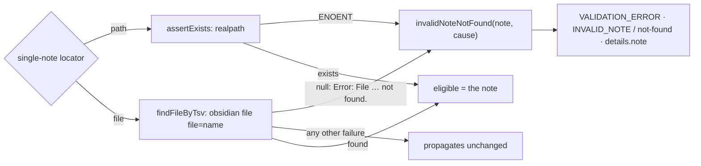
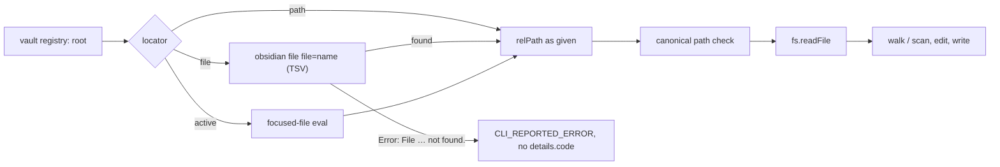
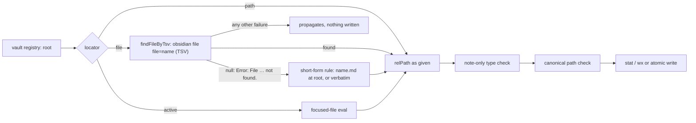
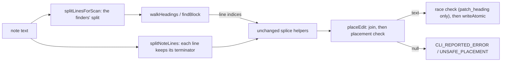
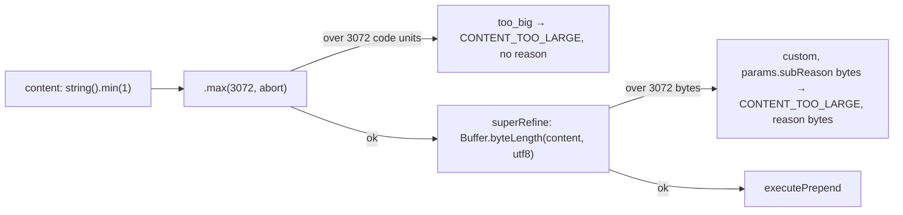
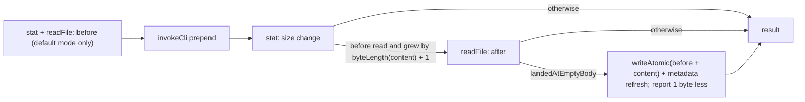
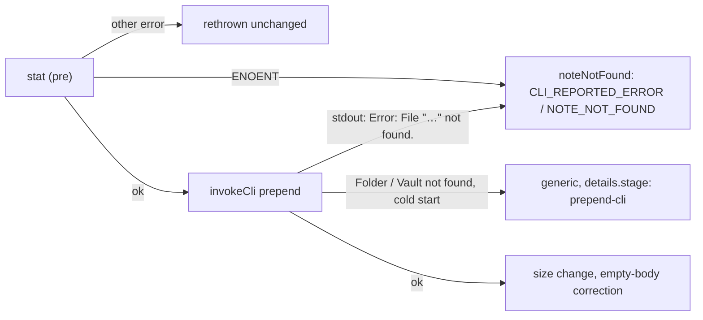
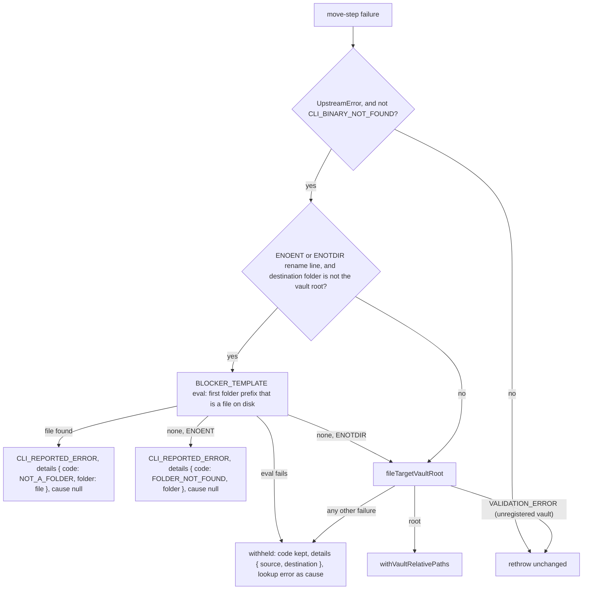
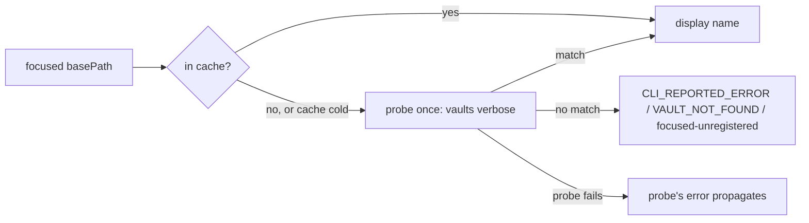

# Mutate (single note and property)

Tools that change the vault. This group is where the server's two write paths
meet: most of the group writes directly to disk under ADR-009, and the rest
wraps a CLI subcommand. Per-tool contracts are the `docs/tools/` pages linked
below.

| Tool | Pipeline | Contract |
| --- | --- | --- |
| `write_note` | direct filesystem (ADR-009) | [docs/tools/write_note.md](../../docs/tools/write_note.md) |
| `append_note` | direct filesystem | [docs/tools/append_note.md](../../docs/tools/append_note.md) |
| `patch_heading` | direct filesystem | [docs/tools/patch_heading.md](../../docs/tools/patch_heading.md) |
| `patch_block` | direct filesystem | [docs/tools/patch_block.md](../../docs/tools/patch_block.md) |
| `find_and_replace` | direct filesystem scan and write | [docs/tools/find_and_replace.md](../../docs/tools/find_and_replace.md) |
| `prepend` | native CLI `prepend`, plus one direct-filesystem correction for a bodiless note (PR #104) and a pre-call missing-note check (PR #105); content capped in characters and UTF-8 bytes (PR #106) | [docs/tools/prepend.md](../../docs/tools/prepend.md) |
| `set_property` | native CLI `property:set` | [docs/tools/set_property.md](../../docs/tools/set_property.md) |
| `delete` | native CLI `delete` | [docs/tools/delete.md](../../docs/tools/delete.md) |
| `rename` | native CLI `rename` | [docs/tools/rename.md](../../docs/tools/rename.md) |
| `move` | native CLI `move` | [docs/tools/move.md](../../docs/tools/move.md) |

## The direct-filesystem cohort

`write_note` moved off the CLI in BI-016 (PR #18) because writing content
through argv crashed the Obsidian host on Windows above roughly 4 KB. The
tools added after it that edit a note's body — `append_note` (PR #46),
`patch_heading` (PR #42), `patch_block` (PR #45), and `find_and_replace`
(PR #40) — followed the same path.

Every one of them runs the same stages:

- **Locator.** In specific mode the vault root comes from the vault registry.
  A wikilink-form `file` is resolved through `obsidian file` first. In active
  mode a focused-file `eval` supplies the path. The helpers are shared in
  `src/tools/_active-file.ts`; since PR #97 `append_note` and `prepend` reach
  them through `resolveFsTarget` in `src/tools/_file-target.ts`, which
  replaced the identical private `resolveLocator` each had. Until PR #122 this
  bullet was wrong for `patch_heading` and `patch_block`: they kept their own
  `resolveLocator`, which used `file` as a literal path from the vault root,
  so a `file` name was never resolved
  ([below](#note-names-in-the-section-editors)). `write_note` resolves its
  own path, because it must also create a note no name matches: since
  BI-0176 (PR #127, PR #128) a `file` name goes through `findFileByTsv`, the
  same `obsidian file` lookup with a `null` for a name Obsidian reports as
  not found ([below](#note-names-in-write_note)). Until then it applied a
  vault-root rule to every name, so this bullet's "resolved through
  `obsidian file` first" was not true of it.
- **Type check** (PR #97). `write_note` and `append_note` reject a resolved
  path that is not a Markdown note with `UNSUPPORTED_FILE_TYPE` before the
  guard, so nothing is read or written
  ([file types](#file-types)). `patch_heading` and `patch_block` were out of
  spec 070's scope (FR-013) and do not run it; `find_and_replace` keeps its
  own `INVALID_NOTE` rejection.
- **Guard.** Both path-safety layers run before anything touches the disk; a
  miss is `PATH_ESCAPES_VAULT`. Since PR #136 (BI-0185) the guard resolves
  the vault's own folder first: a registered vault whose folder is missing
  fails `write_note`, `append_note`, `prepend`, `patch_block`,
  `patch_heading` and `find_and_replace` (both scopes) with
  `CLI_REPORTED_ERROR` / `VAULT_NOT_FOUND` / `folder-missing`, and any other
  failure to resolve it with `details.stage: "vault-root-check"`, before
  any read, write or CLI call and with no disk path in the error. Before,
  it was Node's raw `ENOENT` text with the absolute vault path
  ([ADR-068](../decisions/ADR-068-a-vault-root-that-cannot-be-resolved-fails-as-the-vaults-folder.md)).
- **Edit.** The change itself is a pure function over the file text — for
  example `appendEdit`, or the heading walk and block scan under
  `patch_heading/` and `patch_block/` — tested separately from the I/O.
- **Write.** `writeAtomic` in `src/tools/_note-io.ts`. `EBUSY` and `EPERM`
  are classified as `EXTERNAL_EDITOR_CONFLICT` — and so is `EACCES`, for
  `append_note` and `patch_heading` but not `patch_block` or `write_note` —
  because on Windows they mean another program holds the file. Anything else
  is `FS_WRITE_FAILED`. The per-tool differences are explicit parameters of
  the shared mapper in `src/tools/_fs-errors.ts` (PR #58). `write_note` kept
  a private mapper until BI-0176 (PR #127): a lock was `FS_WRITE_FAILED`
  with the absolute disk path in `details.path`. It now puts its
  `EEXIST → FILE_EXISTS` branch in front of `mapFsWriteError` with
  `{EBUSY, EPERM}`, so a lock is the cohort's `EXTERNAL_EDITOR_CONFLICT` and
  every `FS_WRITE_FAILED` carries the vault-relative path. `EACCES` stays
  `FS_WRITE_FAILED` for it, as ADR-009 (Direct Filesystem Write Path
  Alongside CLI Bridge) Decision point 7 requires
  ([below](#note-names-in-write_note)). Since PR #102 that
  module also exports `getSyscall` beside `getErrno`; the mapper,
  `find_and_replace`'s own `mapFsError` and `read`'s disk-read failure all
  use it instead of three hand-rolled casts. Since PR #105 it also exports
  `noteNotFound(relPath, vault, cause)`, the one builder of the
  missing-note failure (`CLI_REPORTED_ERROR`, `details.code: NOTE_NOT_FOUND`)
  for `append_note`, `patch_block` and `prepend`. Each caller passes its own
  `vault` value; the builder does not pick one
  ([below](#prepend-on-a-missing-note);
  [ADR-050](../decisions/ADR-050-prepend-checks-the-note-on-disk-before-calling-obsidian.md)).
- **Refresh.** A best-effort `eval` asks Obsidian to recompute its cached
  metadata for the written note, so the next search or property read sees the
  new text (spec 068 FR-001–FR-005, PR #87). `invalidateMetadataCache` in
  `src/tools/_note-io.ts` addresses the note by its vault-relative,
  forward-slash path, and sends the vault exactly as the caller named it:
  `vault=<name>` in specific mode, no `vault=` in active mode, where the write
  went to the open vault. A resolved folder path is never sent as `vault=`.
  A failure does not fail the write, but it is no longer silent: it is logged
  as `bridge.metadata_refresh_failed` with a `reason` of `cli-error`,
  `note-not-found` or `unexpected-output` (see
  [architecture.md](../architecture.md#logging-and-shutdown)). Since PR #110
  the refresh and the editor open go through `invokeEval`, and the refresh
  reads the call's tagged answer. Before that it compared the whole trimmed
  stdout with `=> ok`, so a single plugin line around the answer logged a
  refresh that had worked as `unexpected-output`. The log's `detail` is
  still the first 200 characters of the raw stdout.

  Before PR #87 this step did nothing at all. It passed the note's absolute
  path to `getFileByPath`, which takes a vault-relative one, so the lookup
  returned `null` and the refresh was skipped, and the empty `catch` hid it.
  It also ran in active mode, so with another vault focused it would have
  addressed the wrong vault. Searches still mostly came back fresh only
  because Obsidian's own file watcher usually wins the race
  (`specs/068-modernise-mcp-surface/evidence-a1.md`).

  The template calls `computeFileMetadataAsync(file)`, the method Obsidian's
  file watcher uses. It must not call `computeMetadataAsync(file)`, the call
  ADR-009 (Direct Filesystem Write Path Alongside CLI Bridge) §5 names: that
  method takes the file's bytes, not a `TFile`, and the first live run with a
  correct path wedged the vault's metadata worker until Obsidian reloaded
  (T010). A unit test in `_note-io.test.ts` forbids the old call. ADR-009 §5
  still names it.

### What `bytes_written` reports

Since PR #103 (BI-0116, spec 075 FR-001;
[ADR-048](../decisions/ADR-048-bytes-written-is-the-size-change.md))
`bytes_written` has one meaning on the five single-note text writers —
`write_note`, `append_note`, `prepend`, `patch_heading` and `patch_block`: the
note's size in bytes after the write minus its size before, counting a note
that did not exist as 0. Before PR #103 it meant three things (spec 075
research F1). `append_note` and `prepend` already reported that change;
`patch_heading` and `patch_block` reported the note's **total** size after the
edit; `write_note` reported nothing. Their `docs/tools/` pages said so, and
the patch pages called a near-zero value "a red flag" — advice that was only
sound under the total-size meaning and that PR #103 removed.

Each tool computes the figure from data it already holds, so only
`write_note` gained any I/O:

| Tool | Before | After | Bound in the output schema |
| --- | --- | --- | --- |
| `append_note`, `patch_heading`, `patch_block` | the text read | the edited text | `append_note` `min(1)`; the patch tools none, so 0 and negative values are valid |
| `prepend` | `fs.stat` size before the CLI call | `fs.stat` size after, less the one byte the [empty-body correction](#prepend-on-a-note-with-no-body) removes (PR #104) | `min(1)`; a zero change is the `post-stat-byte-delta-zero` failure [below](#the-cli-wrapped-tools) |
| `write_note` | `fs.stat` size (`overwrite: true`), or 0 (`wx` create) | the content's UTF-8 length | none |

- **One helper for the text case.** `sizeChange(before, after)` in
  `src/tools/_note-io.ts` is the UTF-8 byte difference that `append_note` and
  both patch tools return. Research D1 had rejected a helper as "an
  abstraction for one line"; the PR #103 code-quality review (commit
  `4a203e0`) found the subtraction spelled three ways and added it, knowingly
  lifting the plan's "do not edit `_note-io.ts` / `append_note/handler.ts`"
  constraint. `append_note`'s figure did not change.
- **`write_note`'s probe.** The `overwrite: true` existence check was
  `fs.realpath`; it is now `fs.stat`, which gives existence and the old size in
  one call. `ENOENT` means a create with old size 0; any other errno fails as
  `FS_WRITE_FAILED { errno, syscall: "stat", path }` **before** anything is
  written, so the tool never returns a guessed figure (clarification Q3,
  FR-006a, data-model R4). The `details` shape is unchanged; only `syscall`
  reads `"stat"` where it read `"realpath"`. `ExecuteFs` gained a required `stat`. The
  handler holds one `sizeBefore: number | null`, where `null` means the note
  did not exist: `created` is `sizeBefore === null`, so an existing 0-byte
  note still reports `created: false`.
- **The tolerated race.** When `patch_heading`'s re-walk finds the heading
  unchanged but other bytes moved, the write proceeds (last-write-wins) and
  the figure is still this write's change against the text it edited
  (data-model R5), not against whatever was on disk at the end.
- **One published sentence.** The five output schemas describe the field with
  `BYTES_WRITTEN_DESCRIPTION` from `src/tools/_shared.ts`, and a
  `_surface.test.ts` case checks it on each tool's published `outputSchema`
  through the real `tools/list`
  ([architecture](../architecture.md#typed-results-outputschema-and-structuredcontent)).

A caller that compared `bytes_written` from a patch tool with the note's total
size has to compare it with the intended size change instead, or `read` the
note; the CHANGELOG's `[Unreleased]` entry carries that migration note. PR
#103's live check (T031) drove the built server over stdio against the test
vault and saw the reported figure equal the measured file-size change in all
12 steps, including 0, −15, −18 and −51.

**Concurrency is last-write-wins**, except in `patch_heading`. It walks the
heading tree again just before writing and fails with `HEADING_RACE` if the
section moved. Nothing else detects an editor changing the file between the
read and the write.

**`find_and_replace` is preview-then-commit.** The default call returns every
occurrence it would change. `commit: true` scans again, compares the count
against the preview (`OCCURRENCE_COUNT_DRIFT`), checks the
`OBSIDIAN_FIND_REPLACE_MAX_OCCURRENCES` bound (default 500), and then writes
each note in turn, serialised through the shared queue. Each changed note is
refreshed after its queued write resolves, never inside the `queue.run`
callback: the refresh goes through `invokeCli` and so through the same
single-flight queue, and nesting it would deadlock (T009, PR #87). A write failure
partway through reports which notes were already written, in
`FS_WRITE_FAILED` `details`. By default the scan skips fenced code and HTML
comments. Its scope is the vault, a folder, or — since BI-066 (PR #73;
ADR-032, Find And Replace File Scope via Sibling Locators) — a single note.

Since PR #101 (spec 073) the folder scope is `folder` and case handling is
`case_sensitive`, the names the search tools use. Until then they were
`subfolder` and `case_insensitive`, the only case switch in the server with
the opposite polarity. The default is still case-sensitive (`case_sensitive`
defaults to `true`, as `case_insensitive` defaulted to `false`). Both old
names are accepted until the next major release, with a
`deprecated_parameters` notice on either result branch; `case_insensitive` is
negated onto `case_sensitive`, and its notice carries a polarity `note`
([architecture](../architecture.md#renamed-parameters-deprecated-aliases-folded-before-validation),
[ADR-046](../decisions/ADR-046-shared-parameter-names-within-a-tool-family.md)).
A `subfolder` scope is honoured exactly like `folder` and never widens to the
whole vault. The `INVALID_SUBFOLDER` code, its reasons and its
`details.subfolder` key are unchanged, and by owner ruling on BI-0182 (PR #135)
stay so until the next major release, which the help page now states; the path-safety issue moved to
`["folder"]` ("folder is not structurally safe"), and the `SCOPE_CONFLICT` and
not-found messages say `folder`. The internal scope predicate followed:
`effectiveSubfolder` is now `effectiveFolder`. One edge moved in review
(commit `4a00a58`): a call that sends `subfolder` and `folder` together is
rejected with the generic alias-conflict issue before the scope matrix runs,
so `subfolder` + `folder` + `path` no longer reports `SCOPE_CONFLICT`.

Since PR #92 (068 FR-052, FR-054, research R11) the commit loop checks the
call's `signal` before each note. A cancel stops it between notes: notes
already written stay written, and because the SDK sends no response for a
cancelled request, the handler logs `find_and_replace.commit_cancelled`
`{vault, committed, skipped}` to stderr and rethrows the abort reason
([architecture](../architecture.md#logging-and-shutdown)). After each written
note it calls `reportProgress?.(written, total, relPath)`, which sends a
progress notification only when the request carried a token. The two scope
predicates, `isSingleNoteScope` and `effectiveFolder`, are shared by the
confirmation gate and `resolveScope` since the PR #92 review (commit
`ca25c67`), which had found the checks written twice.

**Each match carries its own replacement.** Since PR #149 (BI-0202)
`compileFinder` in `src/tools/find_and_replace/replace.ts` builds the global
find regex and a sticky (`y`) copy of it once per scan and returns a per-line
iterator; `scanNotes` in `handler.ts` uses the `replacementSubstring` each
match yields for both the preview occurrence and the rewrite, so the two
cannot differ. In regex mode the expansion runs the sticky copy from the
match's start against the whole line through native `String.prototype.replace`
and slices the expanded text out, which keeps the ECMAScript `$`-substitution
semantics and gives lookbehind and lookahead the context they look at. Until
then `applyReplacement` re-ran the regex against the matched substring alone:
any lookaround then matched nothing, the preview showed the original text as
`replacement_substring`, and a commit counted the occurrence and listed the
note as changed while leaving the file byte-identical — a false success on a
destructive tool (TC-00903, reproduced on 0.9.0). Two consequences are
observable. `` $` `` and `$'` now insert the line text before and after the
match instead of always being empty; the published contract names only `$1`,
`$&` and `$$`, so the PR treats this as a correction. Lookarounds still see
only the match's own line, as the scan is per line. Literal mode inserts the
replacement verbatim, as before. The PR #149 code-quality review moved the
expansion into the iterator (commit `d104b82`): the first fix computed it in a
second call that re-derived the match's line offsets and built a sticky regex
per occurrence. Known open, by Relay ruling on the assessment (Q1, option A):
a replacement that leaves the text unchanged, such as `(a)` → `$1`, still
counts as an occurrence and lists the note as changed; a guard would touch
literal mode and the preview/commit count contract `OCCURRENCE_COUNT_DRIFT`
relies on, so it is left for its own BI. The fix's records are in
`.specify/bugs/bi-0202/`.

### A missing note in `find_and_replace`'s single-note scope

A single-note scope that names no existing note fails with
`VALIDATION_ERROR`, `details.code: "INVALID_NOTE"`,
`details.reason: "not-found"` and `details.note` echoing the locator, by
`path` or by `file` name (spec 066 FR-008). Until PR #134 (BI-0178) that was
true of `path` only. `resolveSingleNoteScope` looked a `file` name up with
`resolveFileByTsv`, which throws Obsidian's `Error: File "<name>" not found.`
as a pass-through `CLI_REPORTED_ERROR` (`details.command: "file"`, the line
in `details.stdout`) before `assertExists`, which builds the documented
envelope, could run. The tool's description and help page already promised
the envelope for both forms, so they were right and the code was wrong.

- **The lookup is `findFileByTsv`**, the null-on-miss variant `write_note`
  uses ([below](#note-names-in-write_note)). Only Obsidian's not-found line
  maps; an unknown vault, an answer with no `path` line
  (`details.stage: "file-tsv-parse"`) or a missing binary fails as before.
  The handler does not re-test Obsidian's text; the lookup module owns it.
- **One envelope.** The private `invalidNoteNotFound(note, cause)` in
  `src/tools/find_and_replace/handler.ts` builds the error for both forms,
  byte-identical to what `assertExists` built before; `details.note` is the
  name or path as given. It is not called `noteNotFound`, because that name
  is the shared `NOTE_NOT_FOUND` builder in `_fs-errors.ts`.
- **Nothing runs first.** The failure comes from `resolveScope`, before any
  read and before the commit confirmation, so a `commit: true` call with a
  confirming client is asked nothing and nothing is written. PR #134's live
  check (TC-00783, TC-00784, the name preview) saw the same envelope for
  both forms and no elicitation request.
- **Accepted divergence.** A missing name is `INVALID_NOTE` here and
  Obsidian's pass-through in `read`, `append_note`, `prepend`,
  `patch_heading` and `patch_block`
  ([below](#note-names-in-the-section-editors)), as the `path` form already
  was. The owner chose the documented envelope over that pass-through
  (BI-0178 Q1 = A;
  [ADR-066](../decisions/ADR-066-find-and-replace-reports-a-missing-named-note-as-invalid-note.md)).
  Callers that matched Obsidian's text in `details.stdout` must branch on
  `details.code` instead; the CHANGELOG entry says so.

## Heading paths

`patch_heading` finds its section with `walkHeadings`
(`src/tools/patch_heading/heading-walk.ts`), a pure scan over the note's ATX
headings. A heading matches the next segment only when its level is one below
the last matched heading and its ancestors are exactly the headings already
matched, so a `#`-separated `heading_path` starts at the note's level-1
heading and names one heading per level (`Project#Tasks#Today` for a level-3
target). `read_heading` resolves its `::` paths by the same rule
([read](read.md#known-limits)).

Until PR #107 the published text did not say so. It said "Minimum two
segments — top-level headings are out of scope", which agents read as "leave
the level-1 heading out": they wrote `Tasks#Today` and got `HEADING_NOT_FOUND`
although both headings exist. The help page also advised wrapping a top-level
heading in a parent, which cannot work, because the parent would then be the
level-1 heading. PR #107 replaced that sentence in the description, the
`heading_path` parameter description and `docs/tools/patch_heading.md` with the
rule, the sections no path can reach (a level-1 section by itself, any section
in a note with no level-1 heading, any section below a skipped level), each
with `write_note` as the whole-note alternative, and the usual cause of
heading-not-found before the advice to call `outline`. The code, the codes and
every runtime message are unchanged (spec 079 Clarifications Q1). The frozen
one-segment validation message still says "top-level headings are out of
scope"; the help page quotes it verbatim and follows each quote with a note
that it refers to a one-segment path. Five characterisation cases in
`heading-walk.test.ts` pin the rule: `null` for a left-out level 1, a skipped
level and a note with no level-1 heading; a match when the skip is below the
target and when the path starts at a second level-1 heading.

The two tools still use different separators (`#` and `::`), kept apart on
purpose ([ADR-046](../decisions/ADR-046-shared-parameter-names-within-a-tool-family.md),
first exception). Aligning them, a
runtime hint in the heading-not-found message, and reaching the unreachable
sections are spec 079 plan Follow-ups.

## Note names in the section editors

`patch_heading` and `patch_block` publish the shared `file` description, "a
note name resolved like a wikilink". Until PR #122 (spec 089, BI-0171) that
was not true. Each handler had a private `resolveLocator` that joined `file`
to the vault root as a literal path (spec 089 research F1), so a note in a
sub-folder could not be edited by its bare name, a root note needed its
`.md`, and a name that matched nothing failed as a filesystem error on a file
that was never going to exist.

Since PR #122 both copies are deleted and each handler calls
`resolveFsTarget(input, deps, "<tool>")`, the locator `append_note` and
`prepend` already used:

- **Order.** The registry resolves the vault before the lookup, so an
  unknown vault still fails with no spawn. A `file` name costs one
  `obsidian file` call before any filesystem access; `path` and active mode
  make the same spawns, filesystem calls and errors as before (FR-007).
- **The resolved path is used everywhere after it.** The canonical path
  check, the read, the write, the metadata refresh and the response's `path`
  all use the path the name resolved to, so a name cannot reach outside the
  vault any more than a `path` can. A name two notes share edits the note
  `read` picks (research F12); no ambiguous-name error was added.
- **No new error.** A name that matches no note fails with the resolver's
  failure unchanged: `CLI_REPORTED_ERROR` whose message is Obsidian's own
  `Error: File "<name>" not found.`, with no `details.code` — the failure
  `read`, `append_note` and `prepend` give for that name (Clarification Q2;
  [ADR-059](../decisions/ADR-059-section-editors-resolve-note-names-through-the-shared-lookup.md)).
  An unparseable answer fails `details.stage: "file-tsv-parse"`. A note
  removed between the lookup and the read still gets each tool's old
  missing-file failure.
- **Tests.** Rows N1–N9 of `specs/089-resolve-note-names/contracts/note-name-contract.md`
  run once per editor from `describeNoteNameLocator` in
  `src/tools/_note-name-locator-cases.ts`. Each editor keeps its co-located
  `handler.note-name.test.ts`, which supplies only the handler call, its
  fixture note, the edit check and its `HEADING_NOT_FOUND` /
  `BLOCK_NOT_FOUND` code. As first implemented the two suites were
  near-copies; the PR #122 code-quality review moved the rows into the
  shared module (commit `f69c5f6`), which imports vitest and so is excluded
  from the build ([tech stack](../tech-stack.md)).

The descriptions, schemas, annotations and `_register-baseline.json` did not
move. PR #122's live check drove the built server over stdio against the
test vault: both editors edited a note two folders down by its bare name,
an unmatched name created nothing, and a duplicate name edited the note
`read` returned.

## Note names in `write_note`

`write_note` publishes the same shared `file` description, and until
BI-0176 (PR #127) it did not honour it either. `resolveSpecificModePath`
applied a lexical vault-root rule to every name (`<name>.md` at the root for
a short form, the name verbatim otherwise). PR #122 moved the section
editors onto `resolveFsTarget` and left `write_note` out, because that
resolver fails on a miss, which is right for an editor and wrong for the one
tool here that creates notes. So `file: "Alpha"` with `overwrite: true`
for an existing `Sub/Alpha.md` created a second `Alpha.md` at the vault
root and reported `created: true`, and the same call with
`overwrite: false` created it too instead of returning `FILE_EXISTS`
(`.specify/bugs/bi-0176/assessment.md`).

Since PR #127 a `file` name is looked up first, and the old rule applies only
to a name Obsidian says no note has:

- **The lookup is the shared one.** `findFileByTsv` in
  `src/tools/_active-file.ts` is `resolveFileByTsv` returning `null` only for
  a `CLI_REPORTED_ERROR` whose `details.message` matches
  `FILE_NOT_FOUND_LINE`, Obsidian's `Error: File "<name>" not found.`
  `resolveFileByTsv` itself is unchanged, so the tools that fail on a miss
  still do. Since PR #134 `find_and_replace` is its second consumer, with
  the opposite miss policy: a `null` fails as `INVALID_NOTE` / `not-found`
  ([above](#a-missing-note-in-find_and_replaces-single-note-scope)). The PR
  #134 review (commit `1580876`) rewrote the helper's doc comment, which
  still called it `write_note`'s create-by-name variant, to say the caller
  decides what a miss means. A name two notes share writes the note `read` returns; no
  ambiguity error was added. The registry runs first, so an unknown vault
  still costs no spawn; `path` and active mode make no lookup.
- **A write never guesses its target.** Any other lookup failure — an
  answer without a `path` line (`details.stage: "file-tsv-parse"`), another
  `Error:` line, Obsidian not answering — fails the call before anything is
  written. A registered vault that is not open yet is opened by the dispatch
  retry and the lookup runs there.
- **The resolved path is used everywhere after it**: the type check, the
  canonical path check, the write, `created`, the response's `path`, the
  metadata refresh and `open`. A name resolving to a canvas or attachment is
  `UNSUPPORTED_FILE_TYPE`, and `overwrite: false` on an existing sub-folder
  note is `FILE_EXISTS` for that note.
- **Where the not-found text lives.** As first written in PR #127 the handler
  caught the lookup's error and tested its message with a local regex, a
  byte copy of the first entry of `prepend`'s `NOTE_NOT_FOUND_PATTERNS`. The
  PR #127 code-quality review (its blocking finding, landed in PR #128,
  commit `72f63c5`) moved the text to the module that runs the lookup:
  `_active-file.ts` exports `FILE_NOT_FOUND_LINE` and `findFileByTsv`, and
  `prepend` now takes its first pattern from that constant (the same regex,
  so `prepend` is unchanged). The same review made `write_note`'s
  `mapFsError` a closure built once after the path resolves, as in the
  sibling writers.
- **The error mapping moved with it** (PR #127). `EBUSY` / `EPERM` are
  `CLI_REPORTED_ERROR` / `EXTERNAL_EDITOR_CONFLICT` (`reason: "file-locked"`),
  and `FS_WRITE_FAILED`, `EACCES` included, gives the vault-relative path. The
  conflict set is `patch_block`'s `{EBUSY, EPERM}`, not the `EACCES`-inclusive
  set of `append_note` and `patch_heading`, because ADR-009 Decision point 7
  names `EACCES` a generic failure and `write_note`'s page routes OS-reserved
  names (typically `EACCES`) to `FS_WRITE_FAILED`.
- **No new error code** (constitution Principle IV): every failure is an
  existing code or the lookup's own
  ([ADR-062](../decisions/ADR-062-write-note-resolves-names-through-the-shared-lookup-and-creates-only-on-obsidians-not-found.md)).

The `file` description in `src/tools/write_note/schema.ts` gained "An
existing note of that name is the one written, wherever it is; a name no note
has is created at the vault root.", which moved `write_note`'s fingerprint in
`_register-baseline.json`. The bug's live check (`.specify/bugs/bi-0176/test.md`)
drove the built server against the test vault: a sub-folder note overwritten
by bare name in place with nothing at the root, `read` by name returning the
new text, `FILE_EXISTS` with `overwrite: false`, the same overwrite with the
vault open but not focused, and a held file returning
`EXTERNAL_EDITOR_CONFLICT` (`EPERM`) with the note unchanged and no absolute
path in the envelope. The vault-root fallback for a bare name was not run
live, because the test vault's rules forbid root writes; unit tests cover it
with Obsidian's real not-found line.

## Line endings and the placement check

`patch_heading` and `patch_block` find their target with a pure scanner
(`walkHeadings`, `findBlock`) that returns **line indices**, and then splice
an array of the note's lines at those indices. The two arrays have to be
split at the same places, or the indices address the wrong lines. Until PR
#119 (spec 086, BI-0168) they were not. The scanners split on every line feed
and stripped one `\r`; the handlers split on `\r\n` alone as soon as
`detectLineEnding` found a single CRLF anywhere in the note. On a note that
mixes LF and CRLF — most often an LF frontmatter that a property edit left on
a CRLF note on Windows — a run of LF-only lines collapsed into one element of
the edit array, and the edit landed lower down the note, over unrelated
text, while the call reported success (spec 086 research F1, F2). With a CRLF
frontmatter over an LF body the indices ran past the end of the array and the
new text was appended at the end of the note. All three `patch_heading`
modes and `patch_block` had the fault; `patch_heading`'s race check compares
heading identity, not the edit array, so it never caught it (F3), and
`patch_block` has no race check at all.

Since PR #119 both tools edit through one cohort leaf,
[src/tools/_note-lines.ts](../../src/tools/_note-lines.ts), which imports
nothing and is imported only by the two tools:

- **One split rule.** `splitLinesForScan` — `split("\n")`, then one trailing
  `\r` dropped per line — is the finders' view of the note, and since the PR
  #119 review (commit `c069194`, finding F1) it lives only here:
  `heading-walk.ts` and `block-scan.ts` import it instead of each carrying a
  private copy. `splitNoteLines` splits the same text after each `\n` but
  keeps every line's own terminator (`\r\n`, `\n`, or none on an
  unterminated last line), so element `i` is the line both finders call line
  `i` by construction, on uniform and mixed notes alike. The review moved the
  split because the bug was two copies of a split rule disagreeing; as first
  implemented, the fix had added a third copy and kept the agreement by
  convention.
- **Kept lines keep their bytes; added lines take the anchor's ending.**
  `joinNoteLines` writes an element that already ends in `\n` exactly as it
  is, and follows every other element with one ending: the terminator of the
  anchor line (the heading line, or the block's marker line), else of the
  nearest earlier line that has one, else LF (`insertEnding`). The note's
  final-line-break state is then restored as before. On a uniform note every
  terminator is the note's one ending, so the bytes are what the old
  file-wide `detectLineEnding` produced (spec 086 FR-008, rows H9 and B5).
  Both tools' `detectLineEnding` exports were deleted, with the owner's
  conditional approval, once no caller remained.
- **The splice helpers did not change.** `applyAppend`, `applyPrepend`,
  `applyReplace`, `applyDetachReattach` and `applyVerbatimMarkerPreserve`
  only slice and insert at indices and never read an existing line's text
  (research F6), so they work unchanged on the new array, and their tests
  were not edited.
- **The placement check.** `placeEdit` joins the edited lines and then
  checks two things before anything else happens: the anchor line in the
  edit array reads the finder's text, and the original bytes before and
  after the edit are still at the start and end of the result. For
  `patch_heading` the kept prefix runs to the end of the heading's text and
  the kept suffix starts at the next same-or-higher heading, the same bounds
  in all three modes. For `patch_block` they are the start of the block and
  the line after it. A miss returns `null`, and the handler throws
  `CLI_REPORTED_ERROR` with `details.code: "UNSAFE_PLACEMENT"` plus
  `heading_path` or `block_id` and `path`: nothing is written, and in
  `patch_heading` the check runs before the race re-read, so a refusal costs
  no second read. `placeEdit` was extracted in the same review (finding F2);
  before it, both handlers carried the same join-and-check block. With the
  fixed split the check is not expected to fire on any note — it exists so
  that any future disagreement between finder and editor is a loud refusal
  rather than silent damage
  ([ADR-056](../decisions/ADR-056-section-edits-keep-each-lines-ending-and-refuse-an-unsafe-placement.md)).

The refusal is tested through the real handlers by
`handler.unsafe-placement.test.ts` in each tool, which shifts the real
finder's result by one line with `vi.mock` — the repository's first use of
it, confined to those two files (research D4). The placement rows on both
mixes are in each tool's `handler.line-endings.test.ts`, and the model rows,
including index agreement checked through the real `walkHeadings`, in
`_note-lines.test.ts`. Inputs, outputs, annotations and `bytes_written` are
unchanged; `UNSAFE_PLACEMENT` joined each tool's published typed-error list,
which moved exactly the two description fingerprints.

## Confirmation before irreversible changes

Since PR #92 (068 US14, FR-047 to FR-050, research R12) two actions in this
group ask the human first, through the per-call `Confirmation` that
`registerTool` hands the handler
([architecture](../architecture.md#per-call-scope-cancellation-progress-and-confirmation),
ADR-043):

| Tool | Trigger | Step 1: can the client ask? | Step 2: the question |
| --- | --- | --- | --- |
| `delete` | `permanent: true` | at handler entry | straight after step 1, before the spawn; names the vault and the note, or "the active note" |
| `find_and_replace` | `commit: true` with no `file`, `path` or `active_note` (a `folder` commit still asks) | at handler entry, **before vault resolution**, which spawns Obsidian | after the commit re-scan, before the first write; names the pattern, occurrence and note counts, the vault and the folder |

A client that declares no form elicitation gets `VALIDATION_ERROR` with
`details.code: "CONFIRMATION_UNAVAILABLE"` and a message naming the safe
route (delete to the trash; commit one note at a time); nothing is spawned or
written. A human who does not confirm gives `CONFIRMATION_DECLINED` with
`details.action`, and nothing is changed. A trash delete, a single-note commit,
every preview, and a multi-note commit that finds nothing to write ask
nothing.

`find_and_replace` asks after the re-scan so the question can carry the note
count. The SDK re-enters the handler with the answer, so a confirmed commit
resolves the vault and scans twice; both runs are read-only before the
question, and the drift check (`OCCURRENCE_COUNT_DRIFT`) still guards the
writes against a vault that changed while the human was deciding.

PR #92's T090 live run (test vault, both protocol eras, a v2 client over real
stdio) saw decline change nothing, accept delete permanently and rewrite both
subfolder notes, and a trash delete ask nothing. The same check from Claude
Code was still open for the owner when the PR went to review. Its outcome,
recorded in PR #93's post-implement follow-ups: Claude Code in print mode (the
desktop app's Code tab, `claude -p`, unattended runs) declares form
elicitation and then declines every request, so a permanent `delete` or a
multi-note commit there always returns `CONFIRMATION_DECLINED`, never
`CONFIRMATION_UNAVAILABLE`. The server cannot tell that client apart from a
human who said no; the README documents the limitation, and whether to raise
it upstream is the owner's call.

## The CLI-wrapped tools

`prepend` (PR #47) wraps the CLI, unlike its sibling `append_note`. The CLI's
own frontmatter detection is the behaviour the tool promises: content lands
after a leading YAML block. The cost is the argv limit, so content is capped
at **3072** UTF-16 code units. BI-047 (PR #49) lowered the cap from 24576
after larger writes were seen to leave the Obsidian GUI degraded until
restarted. The same PR added a silent-no-op guard. The file is `stat`ed before
and after the call, and if the CLI reports success but the file did not grow,
the call fails as `FS_WRITE_FAILED` with
`details.reason: "post-stat-byte-delta-zero"`. It is not returned as a success
with `bytes_written: 0`.

### `prepend`'s two content limits

Since PR #106 (spec 078;
[ADR-051](../decisions/ADR-051-prepend-caps-content-in-utf-8-bytes-as-a-second-limit.md))
`content` has a second limit, `MAX_CONTENT_BYTES = 3072` UTF-8 bytes, beside
`MAX_CONTENT_LENGTH = 3072` UTF-16 code units in `src/tools/prepend/schema.ts`.
The fault the character cap guards against follows the content's UTF-8 size:
1,500 CJK characters (4,500 bytes) were inside the character cap and crashed
Obsidian (BI-0123; spec 078 research F2). The two earlier bisects used plain
Latin text, where the two units coincide, so they could not tell the
difference.

Both limits run in the schema, so `registerTool` refuses an oversized call
before target resolution, the filesystem or Obsidian is reached, in every
target mode and with or without `inline`:

- **The size check** is a `superRefine` that measures once and puts the
  final message (`content exceeds maximum size of 3072 UTF-8 bytes (got N)`)
  and `params: { subReason: "bytes", contentBytes }` on its `custom` issue.
  `mapZodIssuesToToolError` in `src/tools/prepend/index.ts` maps that issue
  to `VALIDATION_ERROR` / `details.code: CONTENT_TOO_LARGE` /
  `details.reason: "bytes"` with `contentBytes` and `maxBytes`, taking the
  message and size from the issue. The `params.subReason` key is the
  convention `find_and_replace`'s mapper already used.
- **Precedence lives in the schema.** `{ abort: true }` on `.max()` skips the
  size check once the character limit has failed, so text over both limits
  carries only `too_big` and gets the character-limit error, unchanged byte
  for byte (FR-005). The first version let both issues through and had the
  mapper scan all issues for `too_big` before looking at any `custom` one;
  PR #106's code-quality review (commit `00cccae`) replaced that two-pass
  scan, and a second `Buffer.byteLength` over the raw arguments, with the
  `abort` flag and the measured issue. `abort` and the refine add nothing to
  the emitted JSON Schema, which still publishes only `maxLength: 3072`; the
  byte limit is visible in the `content` description, which interpolates the
  constants. `PREPEND_DESCRIPTION` interpolated them too until PR #143
  (spec 092), which cut it to a routing text; it now says only that
  `write_note` has no size limit, and the limits are on the help page.
- **Behaviour change.** Non-Latin calls between 3,073 bytes and the fault
  (about 4 KB) that sometimes succeeded before are now refused; `write_note`
  is the route for them, as it already was for long Latin text.

### `prepend` on a note with no body

Since PR #104 (spec 076;
[ADR-049](../decisions/ADR-049-prepend-keeps-obsidians-write-and-removes-the-added-line-break.md))
`prepend` is no longer a pure CLI wrap. The spec 076 T0 probe (research F2)
showed that in default mode Obsidian appends one LF after the content on
every call. On an empty note or a properties-only note that LF was an extra
trailing line break: `""` + `"first"` gave `"first\n"` and
`bytes_written: 6`, where `append_note` gave `"first"` and 5. The handler now
takes that byte back:

- **The predicate** is `landedAtEmptyBody(before, content, after)` in
  `src/tools/prepend/empty-body.ts`, pure and tested on its own: `after` must
  be exactly `before + content + "\n"`, and `before` must not end with the
  primitive root of `content + "\n"` (research D2). The wrapper still parses
  no frontmatter (spec 045 FR-005b); it only checks whether Obsidian's
  insertion landed at the very end of the note.
- **The write** reuses this cohort's `writeAtomic` and
  `invalidateMetadataCache` from `src/tools/_note-io.ts`, so `prepend`'s
  `ExecuteFs` gained `readFile`, `writeFile`, `rename` and `unlink`. The
  helper `removeAddedLineBreak` in `src/tools/prepend/handler.ts` returns the
  bytes it removed (0 or 1); the PR #104 code-quality review (commit
  `a90ed90`) moved it out of `executePrepend`, which it had made a nest of
  `try`/`catch` blocks.
- **Inline calls read nothing.** Obsidian's inline write is already exact, so
  `before` stays `null` and the correction is skipped. The first version read
  the note before every call; review finding 3 showed that cost inline calls a
  full-note read and a new failure for nothing, and the owner chose to read in
  default mode only (commit `eaba135`).
- **A concurrent edit wins.** A note another writer changed between the call
  and the read-back fails the predicate, is not rewritten, and reports the
  measured size change (clarification Q1).

Its failures all stay under `FS_WRITE_FAILED`, split by whether the content
landed:

| When | `details` | The note |
| --- | --- | --- |
| the pre-call read fails with anything but `ENOENT` (default mode) | `{ errno, syscall: "open", path }` | unchanged; Obsidian was not called |
| the rewrite fails, or an empty note cannot be read back | `{ reason: "extra-trailing-newline", path, vault, errno? }` | holds the content plus one extra line break |
| a non-empty note cannot be read back | `{ errno, syscall: "open", path }`, no `reason` | holds the content; it may or may not have the extra line break |

An `ENOENT` on the pre-call read leaves `before` `null` and lets the call go
on to Obsidian. Until PR #105 this page said that kept "upstream's
`NOTE_NOT_FOUND`" as the contract for a missing note; in fact no missing note
reached `NOTE_NOT_FOUND` then ([below](#prepend-on-a-missing-note)). Since
PR #105 a plainly missing note fails at the `stat` before this read, so an
`ENOENT` here means the note was removed between the two. A failed metadata
refresh does not fail the call; it is logged as
`bridge.metadata_refresh_failed`, as for the rest of the cohort.

### `prepend` on a missing note

Before PR #105 (spec 077;
[ADR-050](../decisions/ADR-050-prepend-checks-the-note-on-disk-before-calling-obsidian.md))
`prepend` on a missing note returned a generic `CLI_REPORTED_ERROR` with
`details.stage: "prepend-cli"`, though its description and
`docs/tools/prepend.md` promised `NOTE_NOT_FOUND` (research F1). The pre-call
`stat` swallowed `ENOENT`, and the four classifier patterns were placeholders
that never matched Obsidian's real line, `Error: File "<path>" not found.`
(stdout, exit 0; spec 077 T0 probe, research F2). The handler now detects the
case at two points and reports it the same way from both:

- **Before the call** (FR-001a). A `stat` `ENOENT` throws `noteNotFound`
  with the fs error as `cause`, in default and inline mode, so Obsidian is
  not called and nothing is read or written. The check stats the file under
  the vault root the registry resolves, so it does not depend on which vault
  Obsidian has open — the probe saw the CLI act in the open vault despite
  `vault=` (research F2).
- **From Obsidian's report** (FR-001b). `/^\s*Error: File ".*" not found\.\s*$/m`
  now heads `NOTE_NOT_FOUND_PATTERNS` in `src/tools/prepend/handler.ts`, with
  the dispatch error as `cause`. Since PR #128 that entry is
  `FILE_NOT_FOUND_LINE`, exported from `src/tools/_active-file.ts` and shared
  with `write_note`'s name lookup
  ([above](#note-names-in-write_note)); the regex did not change. It catches what the `stat` cannot see: a
  path whose letter case differs from the note's (Obsidian's vault paths are
  case-sensitive, while `stat` succeeds on Windows and default macOS) and a
  note removed after the `stat`. The pattern requires `File` and a quoted
  path, so Obsidian's `Error: Folder "x" not found.`, `Vault not found.` and
  a persistent cold start stay generic (FR-007).
- **The same failure as `append_note`.** Both points go through
  `noteNotFound` in `src/tools/_fs-errors.ts`. The plan kept the builder
  private to `prepend/handler.ts` (research D3); PR #105's review moved it
  into the shared module (commit `cdbd8af`), because parity had held only
  through a test comparing the two handlers. `append_note` and `patch_block`
  dropped their inline copies, with byte-identical output.
  `handler.not-found.test.ts` checks the parity and the FR-007 guards.

`set_property` wraps `property:set`. It infers the property type from the JS
value when `type` is omitted, except for `date` and `datetime`, which must be
given explicitly. `delete` is a thin wrapper. It sends a file to the OS trash
unless `permanent: true`, which since PR #92
asks the human first ([above](#confirmation-before-irreversible-changes)). On
the PR #92 test vault, which has no `.trash` folder, trash deletes landed in
the OS Recycle Bin. `rename` and `move` take
the vault's "Automatically update internal links" setting as it is: whether
links are rewritten depends on vault configuration, not on this server.

`rename` and `move` stopped being thin wrappers in PR #97. Each first resolves
the source file, then applies the destination rule below, then forwards the
original `file=`, the `path`, or (active mode) the resolved `path=` with no
`vault=`. `move` still expands a folder-form `to` (trailing `/`) itself only
for a `path` locator; for `file` and active calls it forwards the folder form
as given and the CLI keeps the basename, which keeps Markdown `file`-mode
arguments byte-stable (spec 070 `contracts/tool-support.md` invariant 4,
upheld by review ruling Q2).

### Missing destination folder and vault-relative failures

Until PR #123 (spec 090, BI-0172) a `move` into a folder that does not exist
came back as the CLI's raw line, `Error: ENOENT: no such file or directory,
rename '<abs>' -> '<abs>'`, passed through as `CLI_REPORTED_ERROR` with no
`details.code` and the vault's absolute folder twice in the payload. The CLI
reports it on exit 0, moves nothing and creates no folder (research F1, F2).

`executeMove` now wraps the CLI call and the response parse in one `try`, and
its catch is `throw await moveFailure(e, target, resolvedTo, deps)` (PR #123
passed `vaultRegistry` alone; since PR #139 it passes the whole
`ExecuteDeps`, which the blocked-file check's `invokeEval` needs). Classification happens only after the
CLI has reported the failure; a successful move makes exactly the calls it
made before
([ADR-060](../decisions/ADR-060-move-classifies-its-failure-after-the-cli-and-keeps-the-vault-folder-out.md)).

- **`FOLDER_NOT_FOUND`.** A `CLI_REPORTED_ERROR` whose `details.message`
  starts with the ENOENT rename line, and whose destination has no file in
  the way (next bullet), is a missing destination: the CLI reports a missing
  source with its own line before it attempts the rename (research F3).
  `details.folder` is the folder part of the already-computed `resolvedTo`,
  with forward slashes; nested missing folders report the one the caller
  asked for. `cause` is `null` because the CLI's error carries the absolute
  paths. A root-level destination that gets ENOENT is not reported as a
  missing folder, since the vault root exists. The message names the only
  recovery today: write a note into the folder with `write_note`, which
  creates it, then retry. Until PR #139 this bullet said "so no lookup is
  made": PR #123 read every non-root ENOENT rename line as a missing folder.
  That was wrong for a file in the way, which gives the same line on Windows.
- **`NOT_A_FOLDER`** (PR #139, BI-0177). For a `path` locator `move`
  expands the folder form into a full path through the file
  (`to=Inbox/Note.md/MoveMe.md`), and the CLI's rename fails with ENOENT on
  Windows (T0 probe) or, inferred from libuv, ENOTDIR on POSIX. So on either
  line `moveFailure` first runs one `invokeEval` in the vault the move used
  (no `vault=` in active mode) with the frozen `BLOCKER_TEMPLATE`
  (`src/tools/move/_template.ts`). It walks the folder's prefixes from the
  shortest through `app.vault.adapter.stat`, the check `paths` already uses,
  and returns the first one that exists and is not a folder; a missing prefix
  ends the walk with `null`. The folder goes in only through the base64
  payload, and the answer is parsed by `moveBlockerEnvelopeSchema`. A file
  found gives `details: { code: "NOT_A_FOLDER", folder: <file> }`, the pair
  [`paths`](list-and-inventory.md#failure) publishes, with "rename or remove
  that file, or pick another destination" and no create-folder advice. None
  found gives `FOLDER_NOT_FOUND` for ENOENT and the rewrite below for
  ENOTDIR. If the eval itself fails, the CLI text is withheld as for a failed
  root lookup, never `FOLDER_NOT_FOUND`
  ([ADR-071](../decisions/ADR-071-move-checks-a-blocked-destination-on-disk-after-the-rename-fails.md)).
  The first implementation asked Obsidian's index
  (`getAbstractFileByPath`); the PR #139 review showed it case-sensitive and
  blind to unindexed files, and the owner ruled for the disk (commit
  `3a23d9d`).
- **Every other failure** from the move step keeps its code and wording, with
  the vault's folder rewritten out by the shared `withVaultRelativePaths`
  ([architecture](../architecture.md#error-spine)). The root comes from
  `fileTargetVaultRoot`: the focused-file eval's `base` in active mode, the
  vault registry in specific mode, consulted only after the failure so an
  unknown vault still fails at the CLI. `createServer` now passes
  `vaultRegistry` to `createMoveTool`; that argument is PR #123's only change
  to the boot spine.
- **Lookup failures.** An unregistered vault (the registry's
  `VALIDATION_ERROR`) is one the CLI did not act on, so its `Vault not found.`
  failure is rethrown untouched. Any other lookup failure, such as a cold
  registry whose probe times out, leaves the root unknown, so the CLI text is
  withheld: the code is kept, `details` is `{ source, destination }`, and the
  lookup error is the `cause`. The plan first rethrew the original on any
  lookup failure; the pre-implement analysis (finding U1) showed that leaked
  the root on a cold-cache probe, and the owner ruled for withholding. Since
  PR #139 a failed blocked-file check is withheld the same way, through the
  same `withheldFailure`; a closed key picks the clause that says which
  lookup failed, so PR #123's message is unchanged.
- **Exceptions.** `CLI_BINARY_NOT_FOUND` passes through: its search paths
  describe the CLI install, not a vault (Clarification Q1). Cancellation is
  not an `UpstreamError` and is rethrown untouched.

PR #123's review (commit `7c42952`) moved the rewrite out of `move`'s handler
into the leaf module, so another tool can use it, and gave `read` and `move`
one shared `fileTargetVaultRoot` in place of `read`'s inline copy. The live
check drove the built server over stdio against the test vault, L1–L7 all
passing, with no failure payload carrying the vault's path.

## File types

Since PR #97 (BI-0060, spec 070) every tool here that takes a file locator
states in its description which file types it handles, built from the
`X_SUPPORTED` declaration in its handler
([architecture](../architecture.md#file-types-check-the-file-that-will-be-acted-on);
ADR-044, File-Path Tools Check the Resolved File and Keep Its Type).

| Tool | Handles | How a wrong type fails |
| --- | --- | --- |
| `write_note`, `append_note`, `prepend` | notes only | `UNSUPPORTED_FILE_TYPE` (`unsupported-type`) before any write |
| `find_and_replace` | notes only | its existing `INVALID_NOTE` / not-eligible handling, unchanged |
| `rename`, `move` | any file; the type is kept | `UNSUPPORTED_FILE_TYPE` (`type-change`) for a destination of another type |
| `delete` | any file | — |

The destination rule for `rename` and `move` replaced two older ones. `rename`
appended `.md` to any name without it (`appendMdIfMissing`, spec 021 Q1), so
renaming a canvas made it a Markdown note. `move` appended `.md` only to a
`.md` source given as a `path` (spec 030 Q1+Q2), forwarding everything else as
given. Now a destination with no extension gets the source's — the T0 probe
P1 showed this is required for `move` and not just tidy, because the CLI reads
an extensionless `to` as a folder — and one with a different recognised
extension is refused with `alternative: "obsidian_exec"`. Markdown outcomes
did not change, including `Renamed.MD` → `Renamed.MD.md` (FR-012).

A `name` containing `/` or `\` is rejected at validation by the schema's own
`.regex` message. Until PR #115 that message ended "use move_note to relocate
the file to a different folder", naming a tool the server no longer offers;
since then it names `move` (spec 084 FR-004). Only the message changed: the
pattern, and so the published schema, did not.

`write_note` checks the path it ends up with. Until BI-0176 it had no
resolver to ask and computed every path; since PR #127 a `file` name that
matches a note is checked at the path the lookup returns, and only a name
Obsidian does not find goes through the short form
([above](#note-names-in-write_note)). Its
short form used to add `.md` to any slash-free name not ending in `.md`, which
made `file: "Plan.canvas"` into `Plan.canvas.md`. Since PR #97 a name ending
in a canvas, base or attachment extension is not a short form; it passes
through as given and the type check rejects it. A deliberate side effect,
found at implement time and listed in spec 070's `tasks.md` Notes:
`file: "Folder/Note"`, which used to write an extensionless file, is now
rejected. In active mode the check runs on the focused file, so
`write_note` with `overwrite: true` no longer replaces a focused canvas.

## Targeting rules specific to writes

`write_note` in active mode requires `overwrite: true`, because replacing the
focused note destroys content. `append_note` and `prepend` need no opt-in in
active mode, because adding cannot destroy anything. `write_note` defaults to
`overwrite: false`, so a collision returns `FILE_EXISTS`. It also does not
create a note for `append_note`/`prepend`: those return `NOTE_NOT_FOUND` for a
missing target. For `prepend` that held only from PR #105; before it, the
failure was a generic upstream error
([above](#prepend-on-a-missing-note)).

### The focused vault's name in active mode

The focused-file `eval` reports the focused vault's absolute folder, not its
name. `append_note`, `prepend`, `patch_heading` and `patch_block` need the
name for the result's `vault`, and `prepend` also sends it to Obsidian as
`vault=`; they get it through `resolveFsTarget` →
`resolveActiveLocatorWithVault` → `requireFocusedVaultName` in
`src/tools/_active-file.ts`. `find_and_replace`'s single-note scope calls
`requireFocusedVaultName` directly when it has a `file` and no `vault`, for
its `obsidian file vault=…` lookup, passing the raw `basePath` rather than the
realpathed root, because the registry keys on what Obsidian reports.

Until PR #138 (BI-0121) this used the cache only, and a miss returned the
folder path as the name. Nothing fills the cache at start-up, so the first
call of a process went wrong whenever no earlier call had named a vault:
active-mode `prepend` and `find_and_replace` with a `file` and no `vault` sent
`vault=<absolute folder>` and failed with Obsidian's `Vault not found.`, and
the other three succeeded but reported the folder as `vault`. Since PR #138
the lookup probes once on a miss, and a folder that still matches no listed
vault fails with `focused-unregistered` before anything is read or written,
with no disk path in the message or `details`. The `vault` in a result is
therefore always a name Obsidian lists
([ADR-070](../decisions/ADR-070-the-focused-vaults-name-is-looked-up-again-on-a-miss-and-never-falls-back-to-its-folder.md)).
`write_note` and the CLI pass-through tools never asked for the name and
are unchanged.

## Published surface

Since PR #90 every tool here publishes a title and all four behaviour hints,
from the rows in `src/tools/_shared.ts`
([architecture](../architecture.md#registration--the-one-path-from-a-schema-to-a-published-tool)):

| Row | Tools here | Why |
| --- | --- | --- |
| destructive | `write_note`, `delete`, `move`, `rename`, `find_and_replace` | they overwrite, remove or relocate content, so a client should confirm (the server itself asks only for the two irreversible cases [above](#confirmation-before-irreversible-changes)) |
| additive write | `append_note`, `prepend`, `patch_heading`, `patch_block` | they change a note without destroying it, but a repeat adds again |
| repeat-safe write | `set_property` | setting the same value twice leaves the same note |

None of these tools has `readOnlyHint: true`, so since PR #92 none of them is
offered when the owner sets `OBSIDIAN_MCP_READ_ONLY`, even if
`OBSIDIAN_MCP_TOOLS` names it
([owner access settings](../architecture.md#owner-access-settings)).

`find_and_replace` is marked destructive even though its default call is a
preview, because the tool as a whole can rewrite notes in bulk. The rule
"preview first, then `commit: true`" moved out of its description into the
server instructions' Rules
([server instructions](../architecture.md#server-instructions)).

Since PR #143 (spec 092,
[ADR-074](../decisions/ADR-074-tool-descriptions-route-within-a-budget-and-the-help-page-holds-the-contract.md))
each description here is at most 400 characters. The six note writers
(`write_note`, `append_note`, `prepend`, `patch_heading`, `patch_block`,
`find_and_replace`) each name the other five by job, and `move`, `rename`
and `delete` name each other. What a description must still say is the
data-loss caveat: `write_note` replaces the whole note with
`overwrite: true`; `delete` goes to the trash unless `permanent: true`,
which is irreversible; `move` and `rename` rewrite links per the vault's
setting and keep the file's type; `find_and_replace` is vault-wide by
default and changes nothing until `commit: true`. `set_property`'s old
client caveat (pass an explicit `type` for non-string values) was dropped as
stale rather than moved (contract S8, clarification Q3). Its help page never
stated it, so it is now published nowhere; the reviewer record's `detail`
note says so.

Since PR #91 every tool here publishes an `outputSchema` and returns its
result as `structuredContent` beside the identical text
([typed results](../architecture.md#typed-results-outputschema-and-structuredcontent)).
`find_and_replace`'s result is a `preview | commit` union (zod `oneOf`); it
publishes with an object root wrapping both variants, and the result data is
not wrapped. Several handlers here (`append_note`, `delete`, `move`,
`write_note` among them) had no trailing output `.parse()` of their own, so
until review finding B2 was fixed (commit `4e35987`) a result that drifted
from their schema would have reached the client as SDK free text rather than
`INTERNAL_ERROR`.

## Known limits

- Until PR #97 this page said "`rename` only handles `.md` notes. Other file
  types go through `obsidian_exec`." That was the spec 021 intent, but the
  code never enforced it: `rename` accepted a canvas and turned it into a
  Markdown note. Since PR #97 `rename` and `move` handle every file and keep
  its type; only a deliberate **type change** goes through `obsidian_exec`.
- `file` and active calls of `rename` and `move` cost one extra CLI
  round-trip to resolve the source; `path` calls do not. An active call can
  still act in another vault if the focused **vault** switches between that
  lookup and the action (ADR-044); the owner accepted the same residual for
  the metadata refresh below.
- No tool creates an empty folder, and the CLI has no `mkdir` subcommand.
  `move`'s `FOLDER_NOT_FOUND` recovery therefore goes through `write_note`,
  which creates parent folders but also creates a note (spec 090 research
  F12). A folder-creation capability is a follow-up of PR #123.
- PR #123 keeps the vault's absolute folder out of `move`'s failures only.
  `rename` still passes Node's file error text, absolute paths included,
  straight through, and the resolution-stage failures every file-path tool
  shares (`_active-file.ts`) are not rewritten; their observed forms carry no
  absolute path, but a malformed focused-file eval answer could echo one
  (spec 090 research Follow-ups). One shared failure did carry it: a
  registered vault whose folder was missing gave the canonical guard's raw
  `ENOENT … realpath '<absolute vault path>'`, until PR #136 typed it.
- The canonical guard types only a failure of the vault root (PR #136). An
  errno from a segment *below* a root that exists — `ENOTDIR` for
  `Welcome.md/x.md` on Linux, `EACCES` on a sub-folder, `ELOOP` — still
  escapes as Node's raw error, as before; it is outside BI-0185 by ruling
  and a candidate BI (`.specify/bugs/bi-0185/fix.md` Follow-ups).
- `move`'s missing-folder test reads the source as checked first. If the
  source is deleted between Obsidian's own check and the rename, that ENOENT
  is reported as `FOLDER_NOT_FOUND`; the retry then reports the missing
  source (spec 090 research D2, an accepted residual).
- Since PR #139 a `move` into a missing folder costs one extra CLI call, the
  blocked-file eval, before it reports `FOLDER_NOT_FOUND`; spec 090 research
  F7's "needs no vault lookup" no longer holds for that branch. Success and
  every other failure are unchanged.
- The blocked-file check asks the disk, so a name that differs from the
  file's only in case finds the file where the file system ignores case
  (Windows, default macOS volumes), and `details.folder` carries the name as
  written in `to`. A `stat` that rejects reads as a missing prefix, so the
  result is `FOLDER_NOT_FOUND`, not a withheld failure.
- The POSIX `ENOTDIR` rename line is inferred from libuv and covered only by
  unit rows; PR #139's live runs were on Windows, and a POSIX capture is a
  residual (`.specify/bugs/bi-0177/test.md`).
- `patch_heading` and `patch_block` were outside spec 070 (FR-013): they do
  not run the type check and their descriptions carry no supported-types
  sentence. PR #122 gave them the shared resolver but still no type check
  (spec 089 research D2).
- A missing note fails three ways in the section editors since PR #122: a
  `file` name with the resolver's `CLI_REPORTED_ERROR` and no
  `details.code`, a missing `path` in `patch_block` with `NOTE_NOT_FOUND`,
  and a missing `path` in `patch_heading` with `FS_WRITE_FAILED` (`ENOENT`).
  `PATCH_HEADING_DESCRIPTION` listed `NOTE_NOT_FOUND`, which the handler
  never throws (spec 089 research F9). This item also said the help page
  listed it; by the time PR #143 was opened it did not, and its roster gives
  `FS_WRITE_FAILED` for `ENOENT`. PR #143 (spec 092) dropped the stale code
  from the description instead of carrying it to the page, since the
  description no longer lists error codes. No behaviour changed.
- `write_note`'s create-by-name (PR #127) depends on Obsidian's exact
  not-found wording. If it changes, a new name fails with the lookup's
  `CLI_REPORTED_ERROR` instead of being created: loud, and never a write to
  the wrong note. A `file` write now needs Obsidian to answer the lookup,
  and a note moved or deleted between the lookup and the write is written at
  its old path (an accepted residual in the BI-0176 assessment).
- Each writer still passes its editor-conflict errno set inline:
  `{EBUSY, EPERM}` in `patch_block` and `write_note`,
  `{EBUSY, EPERM, EACCES}` in `append_note` and `patch_heading`. The PR #127
  review proposed naming the two sets in `_fs-errors.ts`; the owner kept it
  out of BI-0176, whose scope excludes the append and patch handlers, and
  it is a no-behaviour-change follow-up for the next change to them
  (`.specify/bugs/bi-0176/fix.md`, PR #128 commit `5f943b6`).
- The section editors' `file` field still accepts `[[` / `]]`, which
  `append_note` and `prepend` reject; aligning them changes the published
  schema (spec 089 follow-ups).
- PR #119 fixed where the patch tools write on a mixed-ending note, not how
  notes become mixed. `set_property` writing an LF frontmatter on a CRLF
  note, the usual cause, is tracked as its own item. `patch_block` still has
  no re-read race check, and `append_note` keeps its own `detectLineEnding`,
  which reads the first line break; it uses no line indices, so it never had
  this fault (spec 086 research F11).
- `placeEdit` takes the note's `trailingNewline` as a parameter rather than
  deriving it from the original text. Deriving it would orphan both tools'
  `detectTrailingNewline` exports, and deleting those with their tests needs
  the owner's approval, which the PR #119 review did not seek (commit
  `c069194`).
- `set_property`, `find_and_replace` and `create_base` report no size at
  all. Spec 075 (clarification Q1) kept the `bytes_written` convention to
  the five single-note text writers; adding a figure to any of the three is
  its own item (PR #103).
- `prepend`'s empty-body correction (PR #104) leaves one shape alone: a
  properties-only note whose end already repeats `content + "\n"`, such as
  `content: "---"`, `"-"` or only line breaks, keeps Obsidian's extra
  trailing line break (spec 076 contract E12). The bytes are the same as an
  insertion into a note with a body, and changing such a note would break
  spec 076 FR-006. `docs/tools/prepend.md` documents it.
- `prepend`'s byte limit (PR #106) counts `content` only. `path` and `vault`
  travel on the same command line and are not counted, so a long non-Latin
  path uses part of the ~1 KB headroom (spec 078 Assumptions). Every other
  tool that passes text on Obsidian's command line has the character-vs-byte
  gap `prepend` had: `create_base`'s `content` is still capped in UTF-16 code
  units only, and `set_property` values are not size-checked
  ([bases](bases.md#failure); spec 078 plan Follow-ups).
- A default-mode `prepend` now reads the whole note before the call and,
  because Obsidian adds one LF on every default call, reads it again after
  almost every successful one. The content cap bounds the predicate, not the
  note.
- `docs/tools/prepend.md`'s *Separator behaviour* is still wrong for notes
  that already have a body. It says a content's trailing `\n` is the
  separator and that the separator follows the note's line endings; the
  spec 076 probe saw `"abc"` + `"def\n"` give `"def\n\nabc"`, and a CRLF note
  get an LF separator (research F3). PR #104 kept separator behaviour out of
  scope and left the correction to its own item, which should fix the page
  and this entry together.
- The missing-note failure's `details.vault` differs per tool in active
  mode: `prepend` echoes the focused vault's name, `append_note` `null`,
  `patch_block` `"<focused>"`. In specific mode all three echo `input.vault`.
  `noteNotFound` passes the caller's value through on purpose; aligning the
  tools is a follow-up in spec 077's plan (PR #105).
- A `prepend` note removed between the pre-call `stat` and the default-mode
  `readFile` still goes to Obsidian and is reported from Obsidian's line.
  Mapping that `readFile` `ENOENT` straight to `NOTE_NOT_FOUND` was left for
  the owner in PR #105's review (commit `cdbd8af`), since spec 077 research
  D1 and FR-001b keep the current behaviour.
- Beside the confirmed pattern, `prepend` still carries four unconfirmed
  placeholder patterns (`note not found`, `file not found`, `no such file`,
  `does not exist`). None matches any output Obsidian is known to produce;
  PR #105 kept them so nothing they match is reported differently, and
  replacing them is its own item.
- The focused vault's name is found by comparing Obsidian's `basePath` with
  the folder `vaults verbose` lists as exact strings. They agree on the test
  host; where they differ (letter case, separators), active-mode calls of
  the five name-using tools fail with `focused-unregistered` rather than
  guess. Normalising the comparison was out of PR #138's scope, and the
  `focused-unregistered` path was tested in-process only, since no focused
  vault outside Obsidian's list could be set up live
  ([above](#the-focused-vaults-name-in-active-mode)).
- `write_note` dropped its `template` parameter in the ADR-009 rewrite;
  template-based creation goes through `obsidian_exec`.
- Writes made by the direct path are visible to Obsidian through the
  metadata refresh and its own file watcher. Nothing confirms that the GUI has
  re-rendered.
- An active-mode write refreshes whichever vault is open when the refresh
  runs. If focus moves to another vault between the write and the refresh,
  the refresh runs there: it is logged as `note-not-found` when that vault
  has no note at the same path, and refreshes the other vault's note, unlogged,
  when it does. The write itself is unaffected. Spec 068 (Assumptions) records
  this as a risk the owner accepted in PR #87's review.
- `write_note open: true` opens the note by its vault-relative path in the
  written vault (`vault=` in specific mode, PR #87). Before that it passed an
  absolute path in active mode. The open is still silent on failure.
- `append_note`, `prepend`, `patch_heading`, `patch_block` and `set_property`
  still keep a "Targeting:" paragraph in their descriptions that restates the
  locator rule the `target_mode` field descriptions now carry (as does
  `backlinks`). PR #90's T051 list did not include them and they use none of
  the banned phrases, so the surface test passes; the PR body leaves their
  removal to the owner.
- Until PR #142 `patch_block` had no `mapValidationError`, so a malformed
  `block_id` came back as the generic `VALIDATION_ERROR` envelope, with the
  reason only in the issue's message, while its published description listed
  `INVALID_BLOCK_ID`. PR #115 had corrected its help page to match, and this
  bullet called the description a spec 084 follow-up. PR #142 (BI-0174, owner
  ruling Q1 = C) went the other way and made the error match the
  description: `patch_block` and `patch_heading` now lift the first
  sub-coded issue into `details` (`INVALID_BLOCK_ID`; `INVALID_HEADING_PATH`,
  `EMPTY_CONTENT`) with its `reason` and extra params, and `append_note` and
  `prepend` return empty content as `details.code: "CONTENT_EMPTY"`, each
  keeping `details.issues`
  ([architecture](../architecture.md#registration--the-one-path-from-a-schema-to-a-published-tool),
  [ADR-073](../decisions/ADR-073-validation-sub-codes-are-lifted-only-where-the-help-page-promises-them.md)).
  The pages and descriptions say so.
- `find_and_replace` still hand-copies `registerTool`'s generic
  `VALIDATION_ERROR` fallback inside its mapper. Since PR #115 a mapper can
  return `undefined` to get that envelope; `prepend`'s copy went in PR #142,
  when its mapper started returning `liftEmptyContent`'s answer. The
  remaining copy is to move when `find_and_replace`'s mapper is next touched.
- `find_and_replace`'s published description is the longest in the server.
  Until PR #142 it was 4,867 characters, past the 4,096 at which Claude Code
  cuts a description, so its tail never reached an agent. PR #142 cut it to
  just under the cap, with the detail kept on its help page, and a surface
  test now fails any description over 4,096
  ([architecture](../architecture.md#documentation-as-part-of-the-runtime)).
  This item used to say there was little headroom. PR #143 (spec 092) cut
  every description to at most 400 characters; `find_and_replace`'s now
  states its scope (whole vault by default) and that nothing changes until
  `commit: true`, and the rest is on its help page
  ([ADR-074](../decisions/ADR-074-tool-descriptions-route-within-a-budget-and-the-help-page-holds-the-contract.md)).
