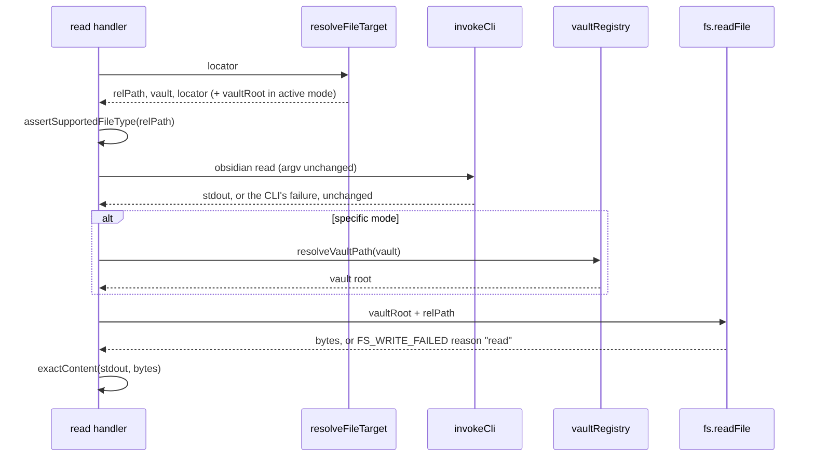

# Read (full and surgical)

Tools that return the content of one note, either in full or one piece of it.
The contract for each tool — inputs, output shape, error roster, examples — is
in its `docs/tools/` page, which is also what `help` serves. This page covers
how the group is built.

| Tool | Pipeline | Contract |
| --- | --- | --- |
| `read` | native CLI `read`, after a type check on the resolved file, corrected by a disk read (PR #102) | [docs/tools/read.md](../../docs/tools/read.md) |
| `read_heading` | `eval` template over `metadataCache` headings | [docs/tools/read_heading.md](../../docs/tools/read_heading.md) |
| `read_property` | native CLI `properties` | [docs/tools/read_property.md](../../docs/tools/read_property.md) |

## How it is built

All three take `target_mode` ([architecture](../architecture.md#targeting-target_mode)):
`specific` with `vault` and exactly one of `file` or `path`, or `active` for
the focused note.

`read` routes through `invokeCli` and returns the file's exact text as
`{ content }`. Because it shares the typed-tool bounds, a note whose text
exceeds 10 MiB fails as `CLI_OUTPUT_TOO_LARGE` rather than returning a
partial body. It was the first typed tool (BI-006, PR #7, as `read_note`) and
took its current name in the BI-022 rename (PR #24).

Until PR #97 it was also the thinnest tool in the server: one CLI call,
whatever the file. It returned decoded binary for an image or a PDF. Since
PR #97 (spec 070 Clarifications Q3) it reads notes, canvases and bases — the
text formats — and rejects attachments and unknown types with
`UNSUPPORTED_FILE_TYPE`, naming `open_file` as the alternative for an
attachment. To know the type it first resolves the file
([file types](../architecture.md#file-types-check-the-file-that-will-be-acted-on)):
a `path` is classified as given, a `file` name costs one `obsidian file`
resolver call, and active mode one focused-file `eval`. A `file` call then
forwards the original `file=`; an active call forwards the resolved `path=`
with no `vault=`, so a focus change between the two calls cannot make it read
a different file. `read_heading` and `read_property` are unchanged by PR #97.

### Exact content: the CLI's text, corrected from the disk bytes

Until PR #102 `read` returned the CLI's stdout verbatim, on the understanding
that stdout *was* the file. It is not quite. A plan-time live probe of
`obsidian read` against 14 byte fixtures (spec 074 research F2) showed the CLI
changes the text in two ways: it appends `\n` when the file does not end with
one, and it removes one leading UTF-8 byte-order mark. `docs/tools/read.md`
documented the first as a "trailing-newline caveat" and claimed "no BOM
strip", which was wrong. Both changes break a round trip with the write
tools: an agent that read a note with no final line break and wrote the text
back added one.

Since PR #102 (BI-0115, spec 074 FR-001, research D1) the CLI call and its
argv are unchanged. Only after it succeeds does the handler read the file's
bytes from disk and take two one-bit facts from them, which the pure
`exactContent(stdout, disk)` in `src/tools/read/handler.ts` applies:

- the last byte is not `0x0A` and stdout ends with `\n` → drop that one `\n`;
- the bytes start with `EF BB BF` → put U+FEFF back in front.

The returned text is still built from stdout only; no disk content reaches the
result. So every failure the CLI raises — missing note, unknown vault, the
output cap, timeout, cancellation, closed-vault auto-open — is raised exactly
as before and before any disk read, and no `realpath` containment is needed
for the joined path, because the read cannot disclose anything the CLI did not
already return. Why this beat returning the disk text or replacing the CLI
read is in
[ADR-047](../decisions/ADR-047-read-corrects-the-cli-text-from-two-disk-facts.md).

The vault root comes from two places (research D2). In active mode it is the
focused-file `eval`'s `base`, which `resolveFileTarget` already fetched;
`FileTarget` carries it as `vaultRoot` only when `vault` is `undefined`, a
union the type checker narrows (review finding F1, commit `57b17af`). In
specific mode it is `vaultRegistry.resolveVaultPath`, called **after** the CLI
read, so an unknown vault still fails at the CLI rather than as the registry's
`VALIDATION_ERROR`. That is why `read` does not use `resolveFsTarget`, which
resolves the registry first. `createServer` now passes `vaultRegistry` to
`createReadTool`; that one argument is PR #102's only change to the boot spine.
The disk read goes through an `fs?.readFile` seam on `ExecuteDeps`
(default `node:fs/promises`), and reads the whole file rather than its first
three bytes and last byte, a saving no measurement asked for (research D3).

`read_heading` (PR #17) exists so a client does not pull a whole long note to
read one section. It does not parse Markdown itself. Its frozen template reads
the heading array Obsidian has already parsed into `metadataCache`, and finds
the section by a `::`-separated path such as `"H1::H2"`.

The body is the note text from the end of the matched heading line to the
start of the next heading of any depth, or the end of the note. The template
then removes the heading line's own line ending, CRLF or LF, before returning
(`src/tools/read_heading/_template.ts:42-43`); nothing else is trimmed or
normalised. So a body starts with a line break only when the note has a blank
line directly under the heading. Until PR #96 the help page said the opposite —
that every body "always begins with a leading `\n`" and should be trimmed —
which was never true of the template. An agent that followed it deleted the
first character of real content, or left a stray `\r` in a CRLF note. PR #96
corrected `docs/tools/read_heading.md` only, with no code change, after 11 live
reads against fixture notes (`specs/069-fix-section-body-docs/contracts/t0-probe-findings.md`);
the per-layout table is in that page's "Start of body" section.

`read_property` (PR #15) returns `{ value, type }` with the YAML type
preserved, so a client can tell the number `7` from the string `"7"`.

Published surface (PR #90; [architecture](../architecture.md#registration--the-one-path-from-a-schema-to-a-published-tool)):
all three carry the read-only hint row, so a client that honours annotations
can run them in parallel without a "may modify data" prompt (068 SC-006). Their
descriptions no longer restate the locator rule or end with a call-help
sentence; the rule is in the shared `target_mode`, `vault`, `file` and `path`
descriptions ([targeting](../architecture.md#targeting-target_mode)).

Typed results (PR #91; [architecture](../architecture.md#typed-results-outputschema-and-structuredcontent)):
`read_heading` and `read_property` publish an `outputSchema` and return their
result as `structuredContent` as well as the identical text. `read` does not:
its `{ content }` text block is kept byte-identical (068 FR-041). That held
the envelope's shape, not the value: since PR #102 `content` itself differs
for a file with no final line break or with a leading byte-order mark. The
published description now says "Returns the file's exact text as
{ content }: nothing added or removed", which moved only `read`'s description
fingerprint in the register baseline (spec 074 FR-009).

## Failure

The usual dispatch codes apply. Beyond them: `ERR_NO_ACTIVE_FILE` when active
mode has nothing focused; `CLI_REPORTED_ERROR` (with `details.code` where the
tool can name the condition) for a missing note, an unknown vault, or a
section path that matches no heading. `read` adds `VALIDATION_ERROR` with
`details.code: "UNSUPPORTED_FILE_TYPE"`, `reason: "unsupported-type"` for a
file that is not a note, canvas or base (PR #97); resolution failures for a
`file` name or the focused file surface first, unchanged.

Since PR #102 `read` has one failure that runs after a successful CLI read:
the confirmation read of the file's bytes. If the file was deleted or locked
in between, or the server cannot read the vault folder, the call fails as
`FS_WRITE_FAILED` with `details: { reason: "read", errno, syscall?, path }`
and keeps the `cause` (spec 074 FR-008, research D4). That is the read-side
shape `find_and_replace` already used, so no code or sub-reason was added; the
price is a code whose name says "write" on a read-only tool. It never falls
back to the uncorrected stdout. A failed registry lookup in specific mode
propagates unchanged. `getSyscall`, which builds `details.syscall`, moved into
`src/tools/_fs-errors.ts` beside `getErrno` in the same PR (review finding
F2) and is shared with the write cohort's mapper and `find_and_replace`.

An absent property, or a note with no frontmatter, is **not** a failure for
`read_property`: it returns `{ value: null, type: "unknown" }`. That is a
documented success, not an empty result standing in for an error.

## Known limits

- `read_heading` handles ATX headings only. It needs at least two path
  segments, so an H1-only section cannot be addressed, and it cannot match a
  heading whose text contains `::`. Setext headings are out of reach. The
  documented fallback is `read` plus parsing on the client.
- `read_heading` returns the direct body only, stopping at the next heading of
  any depth. Child sections are not included.
- PR #102 corrected `read` only. `read_heading`, `read_property` and the
  search tools may show the same two CLI changes (an added final line feed, a
  dropped byte-order mark); spec 074 leaves each to its own item once
  confirmed. `obsidian_exec` running `read` keeps the raw CLI output by
  design.
- A write that lands between the CLI read and the disk read can change the
  two facts, so the correction may follow the newer version of the file. The
  window is a few milliseconds of local I/O and the outcome is the
  last-write-wins the write cohort already accepts; no locking was added
  (spec 074 research D5).
- A `read` right after `write_note` *creates* a note can fail before the
  correction runs: PR #102's live round trip (T023) got
  `Error: File "Sandbox/t074/rt.md" not found.` from the CLI, and a following
  `append_note` got `EXTERNAL_EDITOR_CONFLICT` (`EPERM`), until a 2 s settle
  let Obsidian pick up the new file. This is the CLI's view lagging the disk,
  not the correction, and PR #102 did not change it.
- Specific-mode `read` now depends on the vault registry for the correction,
  so the first such call in a process pays the registry's lazy
  `obsidian vaults verbose` probe; later calls hit its cache
  ([architecture](../architecture.md#two-ways-to-touch-a-note-through-the-cli-or-directly)).
- No in-process test pins the line-ending strip at
  `src/tools/read_heading/_template.ts:42-43`. The start-of-body behaviour the
  help page documents rests on PR #96's one-off live probe. Review of PR #96
  (finding F1) asked for a `_template.test.ts`; 069's clarification ruled out
  new tests in a docs-only BI, so the test was returned to the owner rather
  than added.
