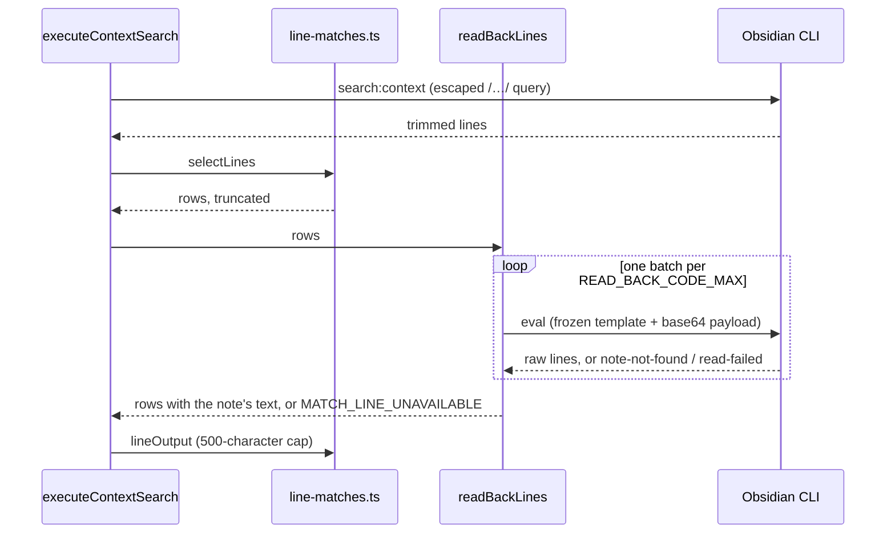

# Search and discovery

Tools that find notes — by text, by regex, by property value, by tag, or by
link — plus the two tools that deal with what Obsidian has focused. The
per-tool contracts are the `docs/tools/` pages linked below.

| Tool | Pipeline | Contract |
| --- | --- | --- |
| `search` | native CLI `search` / `search:context` | [docs/tools/search.md](../../docs/tools/search.md) |
| `context_search` | native CLI `search:context`, an `eval` read-back of the matched lines, and a `folder` probe | [docs/tools/context_search.md](../../docs/tools/context_search.md) |
| `pattern_search` | `eval` template | [docs/tools/pattern_search.md](../../docs/tools/pattern_search.md) |
| `find_by_property` | `eval` template | [docs/tools/find_by_property.md](../../docs/tools/find_by_property.md) |
| `tag` | `eval` template | [docs/tools/tag.md](../../docs/tools/tag.md) |
| `links` | `eval` template | [docs/tools/links.md](../../docs/tools/links.md) |
| `backlinks` | `eval` template | [docs/tools/backlinks.md](../../docs/tools/backlinks.md) |
| `open_file` | `eval`, vault-targeted | [docs/tools/open_file.md](../../docs/tools/open_file.md) |
| `get_active_file` | `eval`, vault-targeted | [docs/tools/get_active_file.md](../../docs/tools/get_active_file.md) |

## How it is built

**Two kinds of targeting.** The text and index searches (`search`,
`context_search`, `pattern_search`, `find_by_property`, `tag`) are vault-scoped:
they take an optional `vault`, and omitting it means the focused vault. There
is no `target_mode`. The link tools (`links`, `backlinks`) act on one note and
take `target_mode`, like the read group.

**Native where the CLI already does the job, `eval` where it does not.** The
literal-text searches wrap the CLI's own search. Regex search, the tag index,
property-value lookup and the link graph need Obsidian's `metadataCache`, so
they run frozen templates through `eval`
([architecture](../architecture.md#reaching-obsidian-internals-the-eval-template-pattern)).
`backlinks` (PR #38) is an example of choosing `eval` over a native
subcommand that exists. The native `backlinks` has no active mode, returns a
bare integer for counts and has no cap or truncation signal, so one `eval`
path gave a uniform contract. During that work a live probe also showed that
`getBacklinksForFile`'s `.data` property is empty, so the template uses the
dictionary's `.keys()`/`.get()` methods (T0 finding F3).

**The query is one literal phrase** (PR #120, spec 087;
[ADR-057](../decisions/ADR-057-text-searches-send-the-query-as-one-escaped-literal-phrase.md)).
The CLI reads its `query` as Obsidian search syntax, splitting it into words
and operators. Until PR #120 both wrappers forwarded the query unchanged, so
`alpha beta` matched notes holding the two words anywhere, `-draft` matched
notes *without* `draft`, and `tag:urgent` matched the tag, not the text,
while the descriptions promised a literal substring. Both handlers now send
`literalPhraseQuery(input.query)` from `src/tools/search/literal-phrase.ts`.
File-name and metadata matching, the case flag and folder scoping are the
CLI's own and did not change.

PR #120's form was wrong, and PR #130 (BI-0175;
[ADR-063](../decisions/ADR-063-text-searches-send-the-query-as-an-escaped-regular-expression.md))
replaced it. PR #120 sent the query in double quotes, with `\` and `"`
escaped, and its probes used whole words only. Obsidian matches a quoted
phrase on whole-word boundaries, so a query that started or ended inside a
word silently found nothing (`ead170` missed `lead170`, `TC-0078` missed
`TC-00783`). The helper now returns the query as a regular expression,
`/…/`, with each of `\ ^ $ . * + ? ( ) [ ] { } |` and `/` escaped, which the
CLI matches as the literal character sequence anywhere, inside words too.
Everything else PR #120 settled is unchanged (live-probed): syntax
characters are text, a multi-word query matches only the exact phrase, and
the case fold, file-name matches, folder scoping and the line-break rule are
as before. The helper kept its name. Its completeness is tested without the
CLI: L11 in `literal-phrase.test.ts` compiles the escaped body for a large
pseudo-random input set, with and without the `u` flag, and checks that it
matches its input and nothing else.

**One line-level pipeline, in two steps.** `context_search` and `search`
with `context_lines: true` both build their rows in
`src/tools/search/line-matches.ts`. `selectLines` decides which lines and in
what order: a query containing a line break keeps no lines; otherwise the
`.md` filter, then `oneMatchPerLine` (the CLI lists a line once per
occurrence), then flattening, conservative truncation, the `(path, line)`
sort and the slice. Because the per-line step runs before counting, `count`
and `truncated` count lines. `lineOutput` then caps each text at 500
characters with `…` and builds the result. The deprecated line mode calls
`lineOutput(selectLines(…))` and returns the CLI's text as it came;
`context_search` replaces the text between the two steps (below). The
PR #120 code-quality review argued that PR into one shared module, then
called `lineMatches`, with a text normaliser per handler; the fix had first
written the pipeline into each handler. PR #121 split it, and its review
removed `lineMatches` and the normaliser once search's identity function was
the only value left
([ADR-058](../decisions/ADR-058-context-search-reads-matched-lines-back-and-fails-when-one-cannot-be.md)).
The helpers sit in `search/`, and `context_search` reaches them over the
context_search → search import it already had for `stripBoundarySlashes` and
`searchContextWireSchema` (`pattern_search` uses the same edge for
`stripBoundarySlashes`).

**`context_search` reads its lines back** (PR #121, spec 088;
[ADR-058](../decisions/ADR-058-context-search-reads-matched-lines-back-and-fails-when-one-cannot-be.md)).
Obsidian's `search:context` trims every line it reports, and has no option
not to (research F6, F9). So after selection the handler hands the rows to
`readBackLines` (`src/tools/context_search/read-back.ts`), which reads the
selected lines from the notes with a frozen `eval` template
(`context_search/_template.ts`: `cachedRead`, split on `"\n"`, the requested
lines raw). Each line is accepted only when its trimmed text equals the
CLI's, loses one trailing `\r` through `lineText` (`src/tools/_note-lines.ts`,
the section editors' line rule) and, on line 1, a byte-order mark. The cap
applies afterwards, so indentation counts towards the 500 characters.

The read-back is batched because the `Obsidian.com` shim answers nothing once
an `eval`'s code passes about 4,000 characters (F10,
[architecture](../architecture.md#reaching-obsidian-internals-the-eval-template-pattern)):
`planReadBack` keeps each batch's composed code at or under
`READ_BACK_CODE_MAX = 2900`. A typical result takes one extra call; in the
PR #121 live check 300 lines over 300 notes took 10. A search with no lines
makes no read-back. The read-back passes the call's deps whole, so a
cancelled call drops the batches still queued. In review (PR #121, F3) it
moved onto the shared `decodeEvalEnvelope`, so its parse failures carry the
cohort's stages and messages rather than hand-rolled copies.

**Caps and truncation.** `search`, `context_search`, `pattern_search` and
`backlinks` stop at an implicit 1000 results, take a `limit` to change that,
and report `truncated: true` when the cap applied. Truncated results are the
**first N of a deterministic sort of the full match set**, not whatever the CLI
happened to emit first. That was corrected across PRs #48, #55 and #57 after
the earlier docs claimed a "visible subset" the code did not deliver.
This page made that claim for `pattern_search` too, and until PR #132
(BI-0183) it was wrong there: see *Sort before the cap* below.
`find_by_property`, `tag` and `links` have no cap. `tag`, `links` and
`backlinks` take `total: true` to return only the count, and for `backlinks`
that also bypasses the cap.

**Focus.** `open_file` (PR #60) makes a file the active one, and
`get_active_file` (PR #70) reports which file is active. Both send an `eval`
targeted at the named vault, so they work on a background or closed vault
without switching focus first (ADR-031, Cross-Vault Open via Vault-Targeted
Focus; PRs #66 and #67). `open_file` does switch focus, because that is its
job. `get_active_file` is a pure read: "nothing focused" is the success value
`{ active: null }`, not `ERR_NO_ACTIVE_FILE`.

Since PR #151 (BI-0189) `open_file`'s success means the file *is* the
active file. Until then the template returned its placement as soon as it
had called `openLinkText` or `setActiveLeaf`, and neither proves anything:
`openLinkText` swallows an open that throws, a leaf still busy with an
earlier open skips the next one, and `setActiveLeaf` was not awaited. A
silently failed open read as a success, and the caller's next
`target_mode: "active"` call, possibly a write, acted on the file that was
active before. After every placement the template now runs the shared
wait `AWAIT_ACTIVE_FILE_JS` (`src/tools/_focus-wait.ts`, the check
`views_base` gained in PR #140), comparing the active file with the
resolved file object for up to 1 s, and never retries the open
([ADR-072](../decisions/ADR-072-views-base-lists-only-once-the-named-base-is-the-active-file.md),
amendment of 2026-11-07). The wait runs inside the one `eval`, so the
handler still adds no poll or spawn of its own, and a healthy open gains
one synchronous comparison.

**Published surface** (PR #90;
[architecture](../architecture.md#registration--the-one-path-from-a-schema-to-a-published-tool)).
Every tool here carries the read-only hint row except `open_file`, which is a
repeat-safe write (not read-only, not destructive, idempotent) because it
changes Obsidian's focus. The five vault-scoped searches publish one shared
optional `vault` field, `focusedVaultField` in `src/tools/_vault-field.ts`
("Omit to use the vault focused in Obsidian"), which the PR #90 review
introduced to replace identical per-tool copies; tools whose `vault` follows a
different rule keep their own declaration. `get_active_file` builds on
`folderScopedTargetModeBaseSchema`
([targeting](../architecture.md#targeting-target_mode)). It rejects a `file`
or `path` locator in both modes, as `files` does, but since PR #112 (spec 082)
with its own reason: "`<key>` is not allowed: the active file is the implicit
target, so no note may be named", passed to the shared folder-scoped
refinement in place of the "folder-scoped" wording that misdescribed it. The
same PR corrected the description and help page, which had stated
`name === basename + extension` without the dot; both now give
`basename + "." + extension` (just `basename` when `extension` is `""`), and
tests check every worked example in the help page against that formula. The
frozen `ACTIVE_FILE_TEMPLATE` string did not change. Since PR #143 the
formula is on the help page only: the description says what the tool
reports and when to use `open_file` instead.

Since PR #143 (spec 092,
[ADR-074](../decisions/ADR-074-tool-descriptions-route-within-a-budget-and-the-help-page-holds-the-contract.md))
every description here is a routing text of at most 400 characters that
names its family siblings: the three text searches name each other and
state the `case_sensitive` difference (true in `pattern_search`, false in
`context_search`, per ADR-046); `find_by_property` and `tag` name each other;
`links`, `backlinks` and `outline` name each other; `get_active_file` and
`open_file` name each other. Result shapes, caps and error rosters are on
the help pages. `search`'s input root description lost its internal
identifiers and version history and is otherwise unchanged, still a long
reference block in the schema.

**Typed results** (PR #91;
[architecture](../architecture.md#typed-results-outputschema-and-structuredcontent)).
Every tool here except `tag` publishes an `outputSchema` and returns its
result as `structuredContent` beside the identical text. `search` has two
result shapes chosen by mode, so PR #91 added `searchOutputSchema`, the union
of the default (paths) and line (matches) schemas, as its published shape; it
publishes with an object root wrapping both variants, and its results did not
change. `tag` publishes none, because `total: true` returns a bare integer
rather than an object; its text is unchanged. PR #91 put that exclusion to
the owner for review.

**File types** (PR #97;
[architecture](../architecture.md#file-types-check-the-file-that-will-be-acted-on)).
`links` and `backlinks` now say "Supported file types: notes." and
`open_file` says it works on any file type; each sentence is built from a
declaration in the tool's handler. None of the three changed behaviour:
`links` and `backlinks` keep their existing `NOT_MARKDOWN` rejection
(spec 070 FR-007a).

**Display labels in `links`** (PR #98, spec 071). Obsidian fills
`displayText` on every link-cache entry, and when no alias is written it makes
one up for its own link pane: `"Tgt > Head"` for heading and block links,
`"paper.pdf > page=3"` for other fragments, the bare fragment for a same-note
link. Until PR #98 the template's only rule was omit-when-equal (spec 025 F6),
which let every unaliased fragment link and embed through, frontmatter links
included, and reported empty or blank aliases as `""`. The help page made up
for it with a CAVEAT and a regex the caller had to apply, and said wiki
embeds never carry the field. That was wrong: they carried the derived label
whenever they pointed at a fragment. The help page now says what the tool
does.

The rule now lives in the one `wrap()` that `src/tools/links/_template.ts`
uses for frontmatter links, body links and embeds alike (research D1/D2). An
entry is wiki-form when its `original` source text starts with `[[` or
`` still reports `""` (analysis I1, option (b)).
The emitted value is still the cache's own, and Obsidian trims surrounding
whitespace off an alias before the template sees it (live gate G1). That is
why the contract reads "as written, with surrounding whitespace trimmed". In
review, the same `wiki` test came to feed the `kind` classification, so the
two cannot disagree. Review also removed an `e.original||''` default that
would have sent an entry with no `original` down the Markdown branch and
brought the derived label back. A missing `original` now fails the `eval`
loudly. Every recorded cache shape carries one.

The fix ships with the first test that runs a tool's `eval` template
([architecture](../architecture.md#reaching-obsidian-internals-the-eval-template-pattern)).
Handler tests mock the envelope, which is how the derived labels shipped
unnoticed.

**Tags and the leading `#` in `find_by_property`** (PR #131, BI-0181;
[ADR-064](../decisions/ADR-064-tags-are-compared-and-returned-without-one-leading-hash.md)).
Obsidian's metadata cache holds a note's `tags` as written (`bi-0166`) after
a file-watcher parse, and with a leading `#` (`#bi-0166`) after Obsidian's
own frontmatter writer has updated the note, while the file text has no `#`.
The template compared with strict `===`, so a tag lookup silently missed
every note cached in the other form, and the result changed as notes were
refreshed. For the property named exactly `tags`, the template now builds
`tg` from the shared in-eval fragment `WITHOUT_TAG_HASH_JS`
(`src/tools/_tag-hash.ts`) and applies it once to each stored value and once
to the query (`q`), so `x` and `#x` find the same notes and the unchanged
`eq` / `arrEq` see the same shapes as before. Scalar, contains and
exact-array matching all follow it; case folding runs after it; every other
property, `Tags` and `tag` included, stays strict. `read_property` returns
`tags` by the same rule ([read](read.md)), and `tag`'s input schema calls the
same `stripTagHash`. The fix as first written kept an inline copy in the
template, on the premise that a template cannot import; the PR #131
code-quality review moved it onto the fragment, the pattern the
[architecture](../architecture.md#reaching-obsidian-internals-the-eval-template-pattern)
page describes. `find_by_property/_template.test.ts` runs the template under
`node:vm` over a mixed cache.

**Sort before the cap in `pattern_search`** (PR #132, BI-0183;
[ADR-065](../decisions/ADR-065-pattern-search-sorts-notes-before-its-capped-scan-and-owns-result-order.md)).
`pattern_search`'s template applies `limit` inside its scan and stops early,
which keeps its output bounded (`CLI_OUTPUT_TOO_LARGE`, `CLI_TIMEOUT`). It
used to walk notes in `app.vault.getMarkdownFiles()` order, Obsidian's
file-map order, while the handler sorted only the matches that survived the
cap. A small `limit` therefore returned an arbitrary subset that looked like
the top of the list: in the PR's live check, `limit: 5` over 76 backlog
matches returned the last five in path order. The template now sorts the
filtered note list by path, by UTF-16 code unit (`B` before `a`, `a.md`
before `a/c.md`), before the scan. A note's matches already come out in
`(line, offset)` order, so the cap keeps exactly the leading `limit` matches
and `truncated` stays exact. As first written the fix kept the handler's
`(path, line, offset)` re-sort as a defensive step; the PR #132 code review
removed it, because a sort after a capped scan can only reorder the subset it
was given, so a template regression would come back looking sorted and
holding the wrong matches. The template is now the one owner of result
order, and the handler keeps the envelope's order after its `.md` filter.
`pattern_search/_template.test.ts` runs the template under `node:vm` over
notes listed out of path order and checks the first N for every N.

## Failure

Shared across the group: an unknown vault fails as `CLI_REPORTED_ERROR`; an
invalid regex in `pattern_search` is `VALIDATION_ERROR`; a missing `folder`
is `CLI_REPORTED_ERROR` for the tools that probe for it.

The unknown-vault failure has two shapes here, set by how the tool reaches
its vault. Until PR #142 this page gave every tool in the group
`details.code: "VAULT_NOT_FOUND"`, and so did several help pages and
descriptions; the 0.9.0-local test run showed that most of them never
return it (BI-0174, item 4). `open_file` and `get_active_file` look the name
up in the vault registry before anything runs and remap a miss to
`details.code: "VAULT_NOT_FOUND"`, `details.reason: "unknown"`. The others
pass the name straight to the CLI, which answers `Vault not found.` on
exit 0; the facade fails that as `CLI_REPORTED_ERROR` whose `message` and
`details.message` are both `Vault not found.`, with no `details.code`
([architecture](../architecture.md#runtime-spine)). A caller that wants one
test for both checks the code and `details.message` together. Every page's
hint for it now names the `vaults` tool.

Since PR #151 `open_file` has one failure that comes after the open ran:
`CLI_REPORTED_ERROR` with `details: { stage: "focus", path, vault, active }`
and no `details.code`, when the file did not become the active file in
time. `path` is the resolved vault-relative path (a `file` locator reports
where it resolved) and `active` is the file in front instead, or `null`.
The template answers `FOCUS_NOT_APPLIED`, a strict variant nested in the
`ok:false` arm of `openEvalResponseSchema`, and `mapEvalError` maps it in an
exhaustive `switch`. It is the one row of the
[help page's](../../docs/tools/open_file.md) roster where something may
have opened: the file can be showing in a tab without being active. The
recovery is a retry, or naming the file with `target_mode: "specific"`.

Since PR #121 `context_search` can also fail after a successful search, when
a selected line cannot be read back: `CLI_REPORTED_ERROR` with
`details.code: "MATCH_LINE_UNAVAILABLE"`, `details.path` and `details.line`,
and `details.reason` `note-not-found` (no file at the path), `read-failed`
(`cachedRead` threw; `details.detail` carries its text) or `line-changed`
(the line is past the note's end, or its trimmed text no longer equals the
CLI's). The first failing row in output order is reported and nothing else
is returned (Clarification Q1, option A): the note changed while the search
ran, and the recovery is to search again. A malformed read-back answer fails
the `json-parse` or `envelope-parse` stage, and a failure of the `eval`
itself propagates from `invokeEval` unchanged.

This page used to give the missing-folder error one shape,
`details.code: "FOLDER_NOT_FOUND"`. That is `pattern_search`'s, whose eval
template reports the folder itself. `context_search` probes with the native
`folder` command after a zero-match search, and the probe's `Error:` line
surfaces as dispatch's generic error: the top-level `message` is
`CLI bridge upstream error: CLI_REPORTED_ERROR`, with no `details.code`, and
the caller branches on `details.command === "folder"` and `details.message`.
Its help page had shown Obsidian's folder text as the top-level `message`;
PR #115 (spec 084, FR-009) corrected the page and added tests that pin
`details.command`, `details.message` and the top-level message. The handler
did not change.

Until PR #153 (BI-0204) `pattern_search`'s template checked only that the
`folder` existed (`adapter.stat` not `null`). A note's `stat` is not `null`,
so a note path such as `Repro1106/single.md` passed the check, the
`startsWith(folder + "/")` filter kept no notes, and the call returned
`{ count: 0, matches: [] }` even when the note matched (TC-00906, on 0.9.0).
A caller read that as the pattern being absent. The template now also checks
`stat().type`, as `paths` does, and answers
`{ ok: false, code: "NOT_A_FOLDER", folder }` for a path that is not a
folder. The eval envelope's failure branch is widened to
`FOLDER_NOT_FOUND | NOT_A_FOLDER`, the input and output schemas are
unchanged, and the handler raises `CLI_REPORTED_ERROR`, `cause: null`,
`details: { code, folder, stage: "handler-stage-3" }`. As first written,
Stage 7 threw `NOT_A_FOLDER` and reached `FOLDER_NOT_FOUND` only by
elimination; the PR #153 review made it one throw that passes the envelope's
code through, with the message taken from `FOLDER_FAILURE_MESSAGE`, a table
typed `satisfies Record<…>` over the envelope's codes, so a third code is a
compile error (`src/tools/pattern_search/handler.ts`). The
`FOLDER_NOT_FOUND` error is byte-identical to before. The `NOT_A_FOLDER`
message, `pattern_search: "<path>" is a file, not a folder. …`, carries the
phrase Obsidian's `folder` probe gives `context_search` for the same input,
so the two tools fail with the same code and a recognisable phrase, though
not the same `details`.

A closed registered vault is not a failure. The dispatch layer's cold-start
retry opens it and the call returns its normal result
([architecture](../architecture.md#runtime-spine)). `tag` and
`pattern_search` document what happens when it cannot be brought up: the
retry's `CLI_REPORTED_ERROR` whose `details.stdout` starts
`Error: Command "eval" not found.` ("vault unavailable"), never an empty
result. Since PR #110 that line may come after other plugins' lines, and
dispatch finds it there too. Until PR #100 both tools instead documented a
`VAULT_NOT_FOUND` / `details.reason: "not-open"` failure from a per-tool
check that waited for empty stdout. That answer only came from Obsidian's GUI
executable, never from the shim the server drives, so the state was never
produced; PR #100 deleted the check
([ADR-045](../decisions/ADR-045-closed-vaults-recovered-only-by-the-dispatch-retry.md)).

## Known limits and inconsistencies

- A `folder` that names a note fails differently in `pattern_search` and
  `context_search` (PR #153, BI-0204). `pattern_search` gives
  `details.code: "NOT_A_FOLDER"`; `context_search` still surfaces the
  `folder` probe's line as `details.message`
  (`Error: "<path>" is a file, not a folder.`) with no `details.code`.
  Aligning `context_search` was out of the report's scope
  (`.specify/bugs/bi-0204/test.md` Residual Risks). Neither tool searches a
  single note; pass the folder that contains it.
- The stat-type folder check is written twice, in `paths/_template.ts` and
  `pattern_search/_template.ts`, and the copies differ when `adapter.stat`
  throws: `paths` answers `FOLDER_NOT_FOUND`, `pattern_search` lets the
  throw reach its `json-parse` failure. The PR #153 review proposed one
  shared fragment; the owner deferred it (option A) because `paths` was out
  of BI-0204's scope and merging the copies is a behaviour change that needs
  that decision first (`.specify/bugs/bi-0204/fix.md` Follow-ups). Since
  PR #154 (BI-0205) the shared fragment exists: `FOLDER_STAT_KIND_JS` in
  `src/tools/_folder-stat.ts`, which treats a throwing `stat` as missing, as
  `paths` does. Only `files`' folder check uses it; both inline copies are
  unchanged, and moving `pattern_search` onto it still changes that tool's
  answer to a throwing `stat`
  ([list and inventory](list-and-inventory.md#how-it-is-built)).
- PR #153's live check called the built handlers directly against the test
  vault on Windows, with no MCP-client round trip.
- Until PR #151 this list said `open_file`'s template trusts `openLinkText`
  and reports a placement without checking that the file became active.
  PR #140 had found that `openLinkText` resolves even when Obsidian drops
  the open, fixed `views_base`, and left `open_file` as a follow-up; PR #151
  (BI-0189) fixed it (see *Focus* above). What remains: the silent failure
  has no known live trigger, so its error path is proven only by stub-app
  template tests; plugin-registered views and slower machines against the
  1 s bound were not exercised (`.specify/bugs/bi-0189/test.md`, Residual
  Risks); and `write_note`'s `open` option, in the
  [mutate](mutate.md) cohort, still opens without checking the result.
- `search` with `context_lines: true` is deprecated in favour of
  `context_search`, and kept for compatibility.
- Case sensitivity defaults **differ**: `pattern_search` is case-sensitive by
  default, while `context_search` is not. This is documented, deliberate
  (BI-037 FR-007), and a trap when porting a query between them.
- Until PR #101 `find_by_property` took the property name as `property:`
  while its siblings `read_property` and `set_property` use `name:`, and its
  description warned about the mismatch. PR #101 (spec 073) renamed it to
  `name`, and `arrayMatch` / `caseSensitive` to `array_match` /
  `case_sensitive`, to match the search tools' snake case. The old names are
  accepted until the next major release, with a `deprecated_parameters`
  notice in the result
  ([architecture](../architecture.md#renamed-parameters-deprecated-aliases-folded-before-validation),
  [ADR-046](../decisions/ADR-046-shared-parameter-names-within-a-tool-family.md)).
  During that transition `name` is enforced at parse time but absent from the
  published `required` list, and `array_match` and `case_sensitive` publish no
  JSON Schema `default` (their defaults, both `true`, are applied at parse time
  and stated in the descriptions). The eval payload the template receives kept
  its keys, so the CLI call is byte-identical. Until PR #135 (BI-0182)
  `property: ""` was reported at `["property"]` rather than `["name"]`,
  because the alias kept its own `min(1)`; it now gets the same issue as
  `name: ""`, and only a successful call carries the notice
  ([ADR-067](../decisions/ADR-067-deprecated-aliases-carry-the-type-only-and-the-current-name-keeps-its-checks.md)).
- `tag` folds case with ASCII lower-casing only, so non-ASCII tags match
  case-sensitively.
- The one-`#` tag rule has a third copy: `tag/_template.ts`'s `normTag`
  still strips inline rather than interpolating `WITHOUT_TAG_HASH_JS`. It
  already handles both cache forms; the owner ruled to move it when the tag
  template is next touched (PR #131, `.specify/bugs/bi-0181/fix.md`
  Follow-ups).
- PR #131's live check built a mixed cache from a fixture already cached as
  `#…` and a new note cached raw; Obsidian's own trigger for the `#` form did
  not fire that session, and an MCP-client round trip, macOS and Linux were
  not run.
- PR #132's live check showed the `pattern_search` symptom and its fix only
  in `My-Setup-Vault`; the bare test vault already listed notes in path
  order, so there it shows only that the sort does no harm. It called the
  built handler directly, with no MCP-client round trip, and ran on Windows
  only. Until PR #143 `PATTERN_SEARCH_DESCRIPTION` said only that `limit`
  "caps the response `matches` array", and spelling out the leading-slice
  guarantee there was left out of the bug fix
  (`.specify/bugs/bi-0183/fix.md` Follow-ups). PR #143 (spec 092) removed
  `limit` from the description altogether; caps and ordering are help-page
  material under
  [ADR-074](../decisions/ADR-074-tool-descriptions-route-within-a-budget-and-the-help-page-holds-the-contract.md).
- `search` and `context_search` used to describe their default case
  handling as an ASCII-only fold, in their published descriptions and help
  pages, but the CLI also folds at least Latin-1 letters: `CAFÉ` matches
  `café` (spec 087 research F7). The wording predated PR #120, which left it
  alone because correcting the descriptions moved two fingerprints. This
  page carried it as open after it was fixed: at PR #143 neither description
  mentions case folding, and both help pages say accented letters fold as
  well as ASCII ones.
- This page used to record that the CLI trims each returned line's `text`
  (spec 087 F9) and that the help pages did not say so. For
  `context_search` that was a bug against its own help page, and PR #121
  fixed it by reading the lines back. `search`'s deprecated line mode still
  returns the trimmed text (spec 088 FR-008); `context_search`'s help page
  lists it as a migration difference, and `search.md` does not mention it.
- The read-back's code budget is local to `context_search`. The shim's limit
  of about 4,000 characters of `eval` code (spec 088 F10) applies to every
  template whose payload grows with its input; the PR names `pattern_search`
  and `find_and_replace`, and checking them is a separate backlog item.
- Search syntax is not available through `search` or `context_search`
  (PR #120): `OR`, a leading `-`, `tag:`, `path:` and the rest are matched as
  text. Raw syntax goes through `obsidian_exec`, which passes the CLI's
  `search` command its query unchanged.
- Since PR #130 a query also matches inside longer words (`decision` finds
  `decisions`). That is the published contract, but callers used to
  0.9.0-local's whole-word results see more hits.
- The regex escape exists in three copies: `literalPhraseQuery`,
  `find_and_replace`'s `escapeRegex` (the same set without `/`), and an
  inline set in `src/tools/_vault-relative-error.ts`. One shared module was
  deferred by the PR #130 review (owner ruling Q1 = C) because it edits tools
  outside BI-0175. The name `literalPhraseQuery` also predates the regex form;
  a rename waits until the files are next touched.
- PR #130's live check did not exercise a path-mode phrase that spans a line
  break, or macOS and Linux. The report's original `|` query was never
  recorded; synthetic `|` rows stand in for it.
- `backlinks`'s description still keeps a "Targeting:" paragraph that
  restates the locator rule now carried by the field descriptions. PR #90's
  T051 list did not include it, and the PR body leaves its removal to the
  owner (the same applies to five write tools, [mutate](mutate.md#known-limits)).
- `links` does not say whether a `kind: "embed"` entry came from a wiki embed
  or a Markdown image. On an embed, `displayText` may be an image's alt text
  rather than an author alias, so `"displayText" in entry` finds exactly the
  author-written aliases only on `kind: "wikilink"` entries (PR #98; stated on
  the help page).
